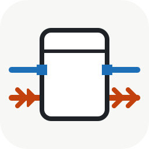
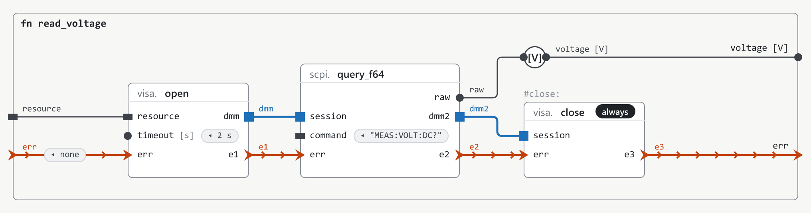
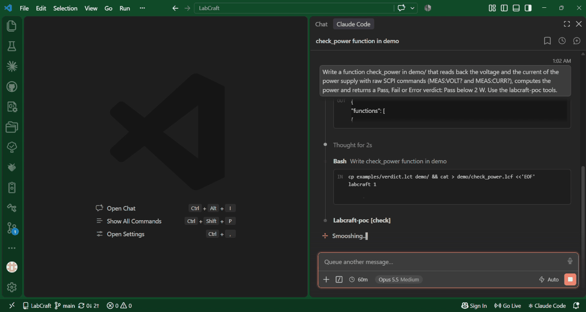

<p align="center">
  <picture>
    <source media="(prefers-color-scheme: dark)" srcset="docs/images/logo-dark.svg">
    
  </picture>
</p>

<h1 align="center">LabCraft</h1>

<p align="center">
  <strong>A graphical dataflow programming language and IDE, built in pure Rust.</strong><br />
  Designed from the start to be written, run and fixed by people and AI agents alike. Ambition:
  to do at least what LabVIEW does, open and cross-platform.
</p>

<p align="center">
  <a href="docs/language-spec-v0.md">Specification</a> ·
  <a href="docs/visual-notation.md">Visual notation</a> ·
  <a href="examples/">Examples</a> ·
  <a href="#try-it">Try it</a> ·
  <a href="CONTRIBUTING.md">Contributing</a>
</p>

**Status (2026-11-03): specification phase.** The language and its text format are described (spec
v0), with example programs. There is no product code in Rust yet: only throwaway Python tools,
including a proof of concept that checks and runs the examples against simulated instruments, and
that an AI agent drives over MCP. The first milestone in Rust (M0: reading, checking and writing
programs, then running them, with a read-only diagram viewer alongside) is described in
[docs/roadmap.md](docs/roadmap.md).

## One program, two views

<picture>
  <source media="(prefers-color-scheme: dark)" srcset="docs/images/read_voltage-dark.png">
  
</picture>

The error wire (red) orders the actions and carries the error: if the measurement fails, the
nodes after it are skipped, except `visa.close`, marked `always`, which still closes the session
(blue). Values carry their physical unit (`[V]`).

The diagram is drawn from a text file, which is the format itself,
[examples/read_voltage.lcf](examples/read_voltage.lcf):

```text
labcraft 1

use scpi
use visa

/// Reads the DC voltage of a multimeter.
fn read_voltage(resource: string, err: error = none) -> (voltage: f64[V], err: error) {
    dmm, e1 = visa.open(resource, timeout: 2 s, err: err)
    raw, dmm2, e2 = scpi.query_f64(dmm, "MEAS:VOLT:DC?", err: e1)
    #close: e3 = visa.close(dmm2, err: e2)
    voltage = with_unit(raw, [V])
    err = e3
}
```

The diagram was rendered from this file by a throwaway tool
([tools/lcf-figcraft](tools/lcf-figcraft/README.md)), following the draft
[visual notation](docs/visual-notation.md); the editor does not exist yet.

## An AI agent at work

An agent (Claude Code) writes a new function from a one-line request, using the proof of concept
over MCP: `check` finds a real error, the agent fixes it, the diagram is drawn from the text, and
the function runs against a simulated power supply.



## Try it

The proof of concept is in Python (3.11 or later):

```sh
pip install -r tools/lcf-poc/requirements.txt
python tools/lcf-poc/lcf.py check examples
python tools/lcf-poc/lcf.py run examples check_voltage --sim instruments/dmm-230V.toml --arg resource=SIM::DMM0
```

`check` reports errors with their line and node; `run` executes a function against a simulated
instrument and prints its outputs (here `Verdict.Pass`, 230.06 V). To let an AI agent drive it over
MCP, see [tools/lcf-poc/README.md](tools/lcf-poc/README.md).

## Documents

**The language**

| Document | Content |
|---|---|
| [docs/language-spec-v0.md](docs/language-spec-v0.md) | Language and file format, v0 (first draft): types and units, dataflow, errors, structures, grammar, open questions |
| [docs/visual-notation.md](docs/visual-notation.md) | How a diagram is drawn: nodes, terminals, wire families, structures (first draft) |
| [examples/](examples/) | Example programs (`.lcf` functions, `.lct` types), from a multimeter check to a test station state machine |
| [docs/glossary.md](docs/glossary.md) | Terms used across the documents |

**The project**

| Document | Content |
|---|---|
| [docs/vision.md](docs/vision.md) | Why LabCraft, for whom, principles, differentiators, non-goals |
| [docs/roadmap.md](docs/roadmap.md) | Where the project stands, milestones from a first vertical slice in Rust (M0), planned code layout |
| [docs/acceptance-m0.md](docs/acceptance-m0.md) | The scenarios that say when each part of M0 is done (M0a, M0b, M0v), and what they need written first |
| [docs/decisions.md](docs/decisions.md) | The project decisions: options, recommendation, status |
| [docs/alternatives.md](docs/alternatives.md) | Existing products and what they teach us |
| [docs/inspirations.md](docs/inspirations.md) | Ideas to borrow (languages, compilers, tools, UX) |
| [docs/craft-ecosystem.md](docs/craft-ecosystem.md) | The Craft apps (storytold, SolidCraft) and what LabCraft takes from them |

**Throwaway tools and material**

| Folder | Content |
|---|---|
| [tools/lcf-poc](tools/lcf-poc/README.md) | Python proof of concept: check, run against simulated instruments, MCP server |
| [tools/lcf-figcraft](tools/lcf-figcraft/README.md) | Renders a function as a diagram, following the visual notation |
| [tools/lcf-view](tools/lcf-view/lcf_view.py) | Syntax check of the examples and of the spec's code blocks |
| [instruments/](instruments/) | Simulated instruments (TOML) for the proof of concept |
| [design/](design/) | The board of the visual notation, drawn by hand, and the component library the renderer reads ([FigCraft](https://github.com/storytold/figcraft) files) |
| [docs/rfc/](docs/rfc/) | Small programs discussed in the RFCs |

## Contributing

The language is not frozen: feedback from users of LabVIEW and other test and measurement tools is
what matters most right now. See [CONTRIBUTING.md](CONTRIBUTING.md).

## License

Your choice of [MIT](LICENSE-MIT) or [Apache 2.0](LICENSE-APACHE). LabCraft is an independent
project, not affiliated with NI; see [NOTICE](NOTICE).
