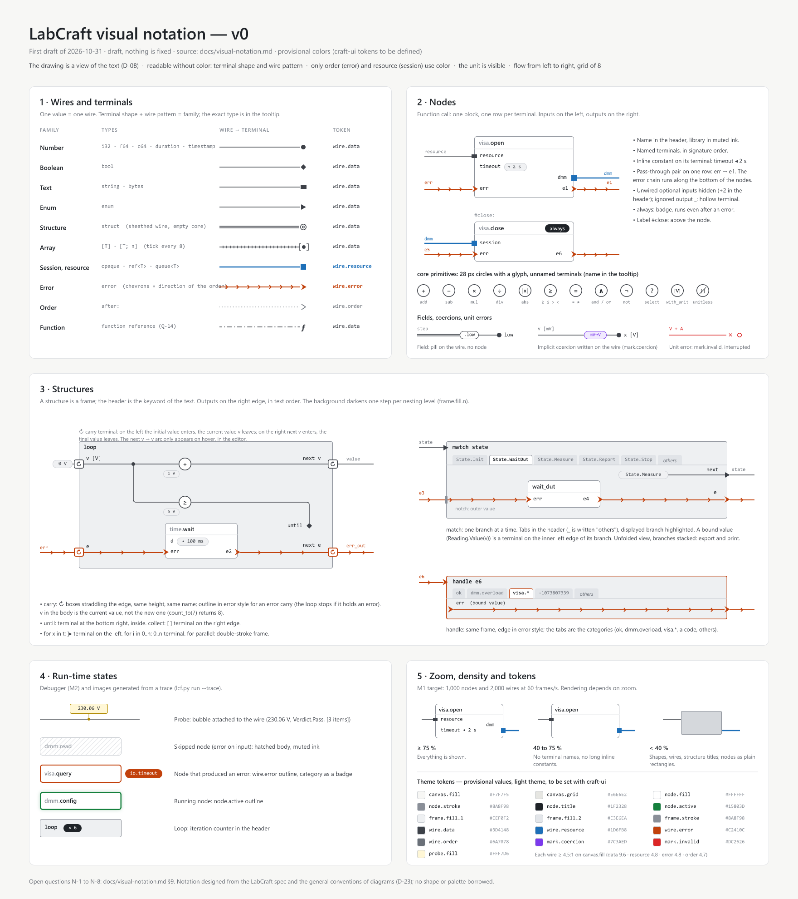

# Visual notation — v0

*Last updated: 2026-11-16. Status: draft, nothing is frozen; the compact view (3.2), automatic placement (2.1), wire routing (2.2), the font (2.3), the values of a run (6.1) and the theme (8) are implemented for M0v; editing by hand (2.4), the editing states (2.5) and color by type (4.3) are for M1.*

How a LabCraft diagram is drawn. The language spec (`language-spec-v0.md`) defines the text; this
document defines its graphical view. It serves the M0v viewer and the M1 editor and, before them,
the project images generated from real `.lcf` files. Open questions are numbered N-1, N-2… at the
end of the document.

[](images/visual-notation-board.png)

*The board, drawn by hand on 2026-10-31 (click to enlarge). It does not show the compact view of
nodes yet (3.2, N-10 to N-12).*

A function rendered from its file by `labcraft-cli diagram`, not drawn by hand
([examples/check_voltage.lcf](../examples/check_voltage.lcf)):

<picture>
  <source media="(prefers-color-scheme: dark)" srcset="images/check_voltage-dark.svg">
  
</picture>

**Files.** All three open with [FigCraft](https://github.com/storytold/figcraft), a design app of the
Craft family:

- [design/visual-notation-v0.figcraft](../design/visual-notation-v0.figcraft): the board above.
- [design/notation.figcraft](../design/notation.figcraft): the component library that the throwaway renderer
  `tools/lcf-figcraft` (retired after M0, 2026-11-15) read to draw diagrams (terminals, primitives, pills, node and structure
  samples, one sample per wire family, theme tokens in light and dark modes).
- [design/editing-states.figcraft](../design/editing-states.figcraft): the six sheets of the editing states (2.5) and of
  color by type (4.3), the code and the diagram of `check_voltage` face to face (2026-11-15).

## 1. Principles

1. **The drawing is a view of the text (D-08).** Every drawn element corresponds to a construct of
   the text, and the reverse. Only the position comes from elsewhere (`layout` section, spec 11).
   If a graphical element has no equivalent in the text, it does not exist.
2. **Readable without color.** The type is read from the shape of the terminals and the pattern of
   the wires; color only doubles the information. A diagram stays readable printed in black and
   white, or by a color-blind person.
3. **Order and resources first.** On a test bench, the question is "in what order do the actions
   happen, and on which equipment?". The error wire carries the order (spec 5.3), the session
   carries the resource: these are the only two wires drawn in color. Data is drawn in a single
   neutral ink, unless the developer turns on color by type (4.3).
4. **The unit is visible.** A physical quantity shows its unit on its terminal and on its wire; an
   implicit conversion (`mV` to `V`) is written on the wire.
5. **Its own identity (D-23).** A notation designed from the LabCraft spec and from the general
   conventions of schematics and node editors. No palette, icon or shape borrowed from NI. Every
   proposed shape is justified by a construct of the text, never by "as in such and such tool".
6. **Theme tokens.** No hard-coded color: tokens (`wire.error`, `node.fill`…) whose values are
   LabCraft's own, light and dark (section 8; Craft convention).
7. **Show that something is there, not always what it is.** Where a value or a detail would weigh on the
   drawing, a mark says that it exists and the tooltip says what it is: a widening conversion is an arrow alone
   (4.2), a default value is in the tooltip of its input (3.2). A mark never takes the shape of a family of type (4.1)
   where a terminal could stand. The marks of the editor (2.5) that are round or triangular stand elsewhere: the disc
   and the triangle of a diagnostic carry a `!` and sit on the corner of a body or on a wire, and the dot of a default
   is smaller than a terminal and away from the edge (decided with the owner, 2026-11-15).

## 2. The canvas

- The flow goes **left to right**: inputs on the left of a node, outputs on the right.
- **The function is drawn as a frame without a box**: its title, the keyword `fn` then its name as the text writes
  them (`fn check_voltage`), as a structure shows its keyword in its header (decided with the owner on 2026-11-16),
  its inputs as terminals on the left
  edge, its outputs on the right edge, as a structure has, but no outline and no fill (5), in signature order, except `err`, which is at the bottom of each
  edge (2.1); terminals moved by hand keep the height they were given (2.4). An optional input shows its default value next to
  its terminal (`low ◂ 220 V`). The `///` documentation is the tooltip of the title.
- Orthogonal wires, rounded corners (radius 6). Grid of 8 units.
- Canvas units: 1 unit = 1 logical pixel at 100% zoom; `node x at (40, 80)` places the top-left corner
  of the node, from the origin of the frame that holds it (spec 11).

### 2.1 Automatic placement

A function without a `layout` section, which is what an agent writes, is placed automatically, and so
are the nodes that a `layout` section does not place (spec 11).

- **One drawing per file.** Placement and routing depend only on the file, on what it uses from other
  files (the signatures, type declarations, icons and bands of what it calls), on the font of the
  notation (2.3), on the values of the notation (10), which are the defaults outside a viewer tuning them, and on
  the view state: the view of each node, tabs or unfolded branches, folded or
  unfolded constructions, the branch shown in tabs (by default that of the run,
  6.1), which changes nothing around its frame, as large as its largest branch (5.2). With the same
  view state, the same file gives the same drawing on screen, when it is opened again, in an export and
  in the snapshots of CI (scenario 6 of `acceptance-m0.md`). Nothing comes from a previous drawing, from
  the size of the window or from the order in which files were read.
- **Stable by construction.** Every choice rests on what changes little: the dependencies, the order of
  the signature and the names, through the canonical order of lines (spec 5.2), which keeps the written
  order only for ties (call statements without a label, lines whose outputs are all `_`, `collect`
  lines, the arms of a `match`, a body that cannot be ordered). No choice is random. A small
  change moves what depends on it, as far as the rules below allow. For each example and each data wire
  between two nodes, CI inserts a neutral node on the wire (`core.select(true, v, v)`, which passes the
  value on unchanged), compares the drawing with the drawing before, and reports how many other nodes
  change place. M0 reports the figure, without a threshold; M1 sets one, on measures of the editor, where a
  node the user places stays in `layout` (owner, 2026-11-14).
- **Columns.** The flow goes left to right: a node stands in the column after the last of the nodes
  that feed it, and a node fed only by the inputs of the function in the first column. Nodes with no
  input (a named constant, `time.now()`) are left out of that count; each one then stands in the column
  just before its leftmost reader, and when that reader is in the first column, a column opens before
  it. A node with no input and no reader stands in the last column.
- **The main error chain on one straight line** (N-7). The main chain is the chain of nodes joined by
  their error pass-through pairs (3.1) that starts at the `err` input of the function and goes through
  the most nodes; on a tie, the one that reaches the `err` output, then the first in the canonical order
  of lines. A function with no `err` input starts it at the first node, in that order, whose error input
  is not wired. The chain runs along the bottom of the nodes it crosses. Every other node goes above it,
  stacked in its column, in the order that keeps crossings low, ties broken by the canonical order of
  lines. Below the axis, apart from the lower edge of the nodes on the chain, there are only error wires
  that leave the main chain (`e2` in `check_voltage` leaves it at `query` and joins `handle e2`). A
  function with no error pair at all (`projectile`) has no axis: its nodes stack upward from the bottom
  of the frame, by the same rules.
- **Error pairs of structures.** A `loop` or a `for` with an error register has the two boxes of the
  register as its pair. A `match` or a `handle` whose arms take an outer error and yield an error output
  has a pair too: that error, entering by its notch or as the selector of a `handle`, on the bottom line
  of the left edge, and that output. With two error registers or two error outputs, the first in the
  text makes the pair. Inside a body, the chain starts at the inner side of the pair (the register box,
  the notch, the value bound by the arm) and ends at `next` of the register or at the error that the arm
  yields.
- **Through structures.** A structure on the chain is placed so that its error input and output sit on
  the axis around it, and the chain inside goes on along the same line: one straight line through every
  level of nesting. Structures grow upward, and their error lines line up. A structure off the main
  chain keeps its own chain straight along its own bottom.
- **The numbers** *(proposed)*. In a column, the blocks are aligned on their left edge, and the column is as
  wide as its widest node. Two nodes stacked are 24 apart, plus what a label adds above the lower one (a band is inside its block, 3.2);
  a column with no node of the chain starts 40 above the axis. The order in a column comes from four sweeps of
  barycentres each way, the order that makes the wires the shortest kept. A channel is as wide as
  its wires need (2.2). A frame has a header of 24 for its title and 16 inside around what it holds; a
  `match` or a `handle` unfolded stacks its arms 16 apart, 16 below its header, each with a title of 24, all as wide
  as the widest; the error enters and leaves it on the axis of its last arm, whichever arm reads it.
  The terminals of a frame keep their order (the signature, the clauses of a loop), each at the height of the
  first node it feeds or that feeds it, as far as that order allows and at least 24 apart; the error terminal on
  the axis, at the bottom of its edge, and every other terminal at least 24 above it; the two boxes of a register at
  one height. Each has its name inside the
  frame, with its unit and the default of an input (`low ◂ 220 V`). An error that crosses a body with no node
  on its way still has its straight line.
- **A partial `layout` section.** The nodes it places never move. A frame grows upward to hold the nodes that
  they push out of it *(proposed)*; the positions of the file are still measured from the corner it has without
  them. A node that it does not place goes into
  free space between what it connects: right of what feeds it, left of what it feeds, above the error
  chain if there is one. The other unplaced nodes move apart only as far as needed. With no position in
  the file, this gives the placement above. What the file writes always wins: around a position or a
  `via` that it gives, the rules that say "never" hold as far as they can. Two nodes that the file places one over the other are drawn
  where it puts them, and `diagram` warns (`LC7005`, decided 2026-11-11), so that the author moves one. In the frame of the function, the
  axis of the chain goes through the first node of the chain, placed or not, and a node of the chain that the file
  does not place goes on the axis. In the frame of a loop or of an arm, which its structure aligns on the chain
  outside, the axis stays where the placement puts it: a node of the chain that the file places goes where it is
  put, off the axis if need be, and the chain bends to reach it, so that moving it never moves its structure back
  over it (decision of the owner, 2026-11-17).
- **When the file changes**, in the live viewer, the nodes glide from their old place to the new one in
  about 150 ms *(proposed)*, so that one sees what moved. There is no glide when the system asks for
  reduced motion. The drawing at the end is always the one computed from the file. The update time of
  scenario 6 runs to the new drawing; the glide comes after it. A node is followed across the change by
  the body that holds it (the function, an arm, a loop body) and the name that designates it in the
  `layout` section (spec 11: its label or the name of its line); a node with no name, by its rank among
  the nodes with no name of its body, in the canonical order. A node whose name changed appears in its
  new place.
- When the developer moves a node (M1), its position is written in the `layout` section, and it no
  longer moves.

### 2.2 Wire routing

- A wire never crosses a node, a label, a pill, a band or a wire name, and it enters a structure only
  through its terminals and its notches (section 5).
- A wire whose two ends are at the same height is straight. Between neighbouring columns, it otherwise
  has a single vertical segment, in the channel between them. A wire that skips columns, other than an
  error wire, runs on a horizontal track, with one vertical segment at each end: through a lane free across all
  the nodes it passes over, between them or under them and above the main chain (`voltage` in `check_voltage`,
  under the `match`), or above them (`low` and `high`), whichever is nearest its source *(decided 2026-11-11)*;
  a secondary error wire runs below the chain.
- Two wires never share a segment: parallel wires are 8 units apart. Two values that reach one terminal share the
  way into it: an input that reads several values, or a value bound twice, which `check` refuses.
- **Narrow channels** *(proposed)*. The channel between two columns is as wide as its vertical segments need,
  8 apart, with the conversion and field pills of its wires, the pills of the inline constants of the blocks
  it leads to, and a margin of 8 on each side: 16 with no vertical segment or one, 8 more for each other. The
  pills stand just before the block they lead to, in the room that its inline constants take (3.2). The name of a
  wire never widens it (section 4), nor does a value of a run (6.1): they take the room that is there, or none.
- **The numbers of routing** *(proposed)*. The wires of one value (its readers, an `after:` that names it) are one
  net: from its source, a vertical in the channel after it reaches the readers of the next column and goes to its
  track, which drops in the channel before each column further on. The track runs at the height nearest its source
  that is 16 from every node of the columns it passes over (what is above a node included), 8 from every other
  track over them, 8 from where another wire ends in the channel where it starts or the one where it ends, and 8
  above the main chain: at the height of its source when that one is free, with no vertical; otherwise on the grid
  of 8, the upper one on a tie. That grid, and the one of the jogs below, starts on the main chain of the body (or
  where it would run), so that they keep their place against its nodes wherever the body lies. Two nodes stacked 24 apart leave no lane between them; above them all is always free.
  The shortest tracks are laid first. In a body so large that the searches for lanes would read more than its budget
  (architecture 11.3), the tracks laid past it go over the nodes. A wire that goes back to the left runs over the
  nodes and the other tracks, 8 above where another wire ends in the channels at its ends. A secondary error wire
  runs 16 below the chain. In a channel, a wire that enters at the height where another leaves (within 8) has its vertical left of
  the other's; otherwise those that rise stand left of those that fall. Wires that must each stand left of the next,
  round a cycle, cannot all keep 8 apart: all but the first of the cycle jog, a vertical where they enter, across at a
  height of the grid that no other wire of the channel enters, leaves or crosses within 8 (a track over it included),
  above the main chain, the nearest the middle of their vertical, then their own vertical. The main error chain runs straight on its axis past the columns that hold nothing there
  (2.1). A wire leaves a terminal of a frame past its name, and reaches one before its name; an order wire from a
  label starts right after the label, at its middle; a terminal on the top edge (`after:` of a compact block) is
  reached from 8 above what is above the node, and the label of that block starts right of it. A junction point is a
  disc of radius 3. A trunk is drawn once: each branch from where it leaves the others.
- **The margins of a `match` or a `handle`** *(proposed)*. A value that enters by a notch of the frame goes on to the
  notch of each arm that reads it, and what each arm yields to the output of the frame: a vertical each in the margin
  between the edge and the boxes of the arms, 8 apart, the margin 16 wide at least and 8 more for each other
  vertical. On the right, the later outputs stand further left.
- The order of preference is the fewest crossings, then the shortest length, then the fewest bends.
  Ties are broken by the order of the signature and by the names, as for placement. These are
  preferences that a fixed procedure follows as well as it can, not an exact optimum, which large
  diagrams could not afford (scenario 6, point 4).
- A value that feeds several inputs runs as one trunk, with a junction point at each split (section 4).
- Every wire that is not an error wire (data, session, order, function) stays above the main error
  chain and never crosses it. An error wire that leaves the main chain runs below it, and crosses it
  once, in the channel before the node it reaches.
- Order wires are routed like the others.
- The waypoints that a `via` gives (spec 11) are kept, and the routing joins them: across, then down to each, and
  from the last down to the height of the reader *(proposed)*. A `wire` entry keeps its waypoints when it names one
  wire by its value and the node it reaches, an output of the function or an input named after it, and from inside
  a structure, the wire to its `next`, `until`, `collect`, `last` or `yield` (`wire stop -> n`). A wire whose first waypoint
  lies on another wire of its value is a branch of it (2.4): it runs along that wire to that point, its junction,
  and on from there; the others run from their source. The wires of one value are one net all the same, its trunk
  drawn once, with a junction point where each leaves the others. Past 64 wires with waypoints in one body, each runs
  from its source (decision of the owner, 2026-11-17): a budget, as those of architecture 11.3, so that many entries cost
  their number.
- A terminal can sit on any side of its node, and the routing leaves it in that direction, so that
  sides chosen later (N-15) need no other routing. Every terminal of a compact block or of a primitive is on the grid
  of 8 (3.2, decided 2026-11-13).

### 2.3 Font and text metrics

Every text of the diagram, on the canvas and in the SVG, is set in one monospaced font: **Hack**,
version 3.003, Regular (MIT and Bitstream Vera licences, attributed). The font belongs to the notation,
not to the preferences: placement depends on the width of the texts (2.1), so that every screen, every
export and the snapshots of CI draw the same thing. A monospaced font tells `l`, `I` and `1`, or `O`
and `0`, apart in names, and keeps a value as wide when an iteration selector changes it (6.1). The
developer chooses the zoom, and the font of the other panels of the IDE.

- **Three sizes** *(proposed)*. 10 units (`text.large`, `text.medium`, section 10): the names of terminals, the
  titles of structures and of the function, the names of wires, inline constants, the values of a run (6.1), badges,
  tabs, legends and banners. 9 units: the label in the center of a block and of an oblong (`text.label`), the text of
  the band (3.2). The values stay apart in the table, so that each can be tuned. A title stands out by its place and
  its color, never by its weight: there is one face.
- **Cells.** Every length of text in the notation is counted in cells: its width, and the limits at
  which a text is cut (3.2, 6.1). A grapheme (Unicode, UAX #29) takes one cell, or two when one of
  its code points is East Asian Wide or Fullwidth (UAX #11) or an emoji (`Emoji_Presentation`, or
  U+FE0F, which asks for one): `☝🏽`, a hand and a skin tone, takes two; `©`, `™` or `▶`, which Hack
  draws, take one cell, and `e` with an accent one: in the band of a block of 40, which holds 5 cells, a
  library name in Japanese is cut after 2 characters and `…`, not after 4. The Unicode version is the one with which names are read (spec 14.1).
- **Every text has a cut.** A text that no other rule cuts (the name of a terminal or a wire, a title,
  a label in standard view, an inline constant) is cut at 40 cells *(proposed)*: 39 and `…`, and its
  tooltip shows more of it. A name of normal length stays whole (`measurement_channel_voltage_limit` is 33
  cells), and a name or a string of millions of characters cannot stretch the drawing or the SVG. Nor can
  a letter followed by a million accents, a single grapheme: a drawing keeps the first 32 code points of a
  grapheme *(proposed)*, which no real text passes (Unicode's stream-safe form asks for no more than 31),
  and the text ends there with `…`, so that what it keeps cannot join what followed.
- **A tooltip is cut too**, on the canvas as in the `<title>` of the SVG ([cli.md](cli.md), section 7.2): at
  200 code points and `…`, names and values alike, so that hovering stays fast whatever the file holds. To
  see a longer value whole belongs to the debugger (M5).
- **Width.** Every character of Hack has the same advance, 1233/2048 of the size: 6.02 units at 10,
  5.42 at 9. A text is as wide as its cells times that advance. No kerning, no ligatures.
  A character that Hack lacks (a name in Japanese, an emoji in a string) is drawn by a fallback font.
  On the canvas, a text that a fallback font makes wider than its cells is drawn smaller, as a whole, to
  fit them, so that it never runs past them.
  A text keeps 4 units on its left and on its right between itself and the edge of its box (block,
  band, pill, badge, tab, bubble); the label of an oblong keeps 2 (`node.label_padding`), and the label of a
  compact block holds between its terminals, which straddle its edge (3.2).
- **Direction.** Every text is put in display order with the Unicode bidirectional algorithm
  (UAX #9), on its own and with a left-to-right base direction, so that a name in Hebrew or Arabic
  reads in its order. A text is cut first, in its logical order (one cell less than its limit and `…` at its logical end,
  which then shows on the right), and reordered after. The `diagram` crate cuts and counts; it does not
  reorder. The canvas and the SVG both give the text in its logical order, isolated, with a left-to-right
  base, to a text engine that applies the algorithm and joins Arabic letters: epaint, in the egui of the
  Craft suite, for the canvas ([architecture.md](architecture.md), section 11.4); the browser for the SVG
  (`direction: ltr; unicode-bidi: isolate`). A bidirectional control
  character of those that `LC0005` names (U+202A to U+202E, U+2066 to U+2069) never acts: it is shown
  as its code, `⟨U+202E⟩`, in the token `mark.invalid`, so that no text can hide how it reads (spec 2,
  Encoding). The marks U+061C, U+200E and U+200F act as in any right-to-left text.
- **Controls.** A text has one line. A line break in it (LF, CR, or CR LF) is drawn `↵`, as a value of a run
  writes it (6.1), and a tab `⇥`; any other control character (general category Cc) is shown as its code,
  `⟨U+0007⟩`, in the ink of the text, since it is legal and hides nothing. Each sign counts the cells it
  shows: a code takes 8. A cut never splits a sign: it is whole, or gone after `…`. The text of an icon and
  `LC5009` count the same signs.
- **Height.** A line of text is 2384/2048 of the size (ascent 1901 and descent 483, in units of 2048).
  A text that sits on a line, such as the name of a terminal, has the middle of its capitals on that
  line (capital height 1493/2048); a text in a box (band, pill, badge, tab, bubble, each line of a
  label) has the middle of its capitals at the middle of its line in the box.
- **Where the numbers live.** These metrics and the counting of cells live in one crate, with the
  SHA-256 of the font file that they come from, low enough for `check` to judge the text of an icon
  (spec 11.1) and for `diagram` to place. A test reads the font that the canvas draws with and checks
  them, so that another version of the font is a reviewed change of the drawing. They are the module
  `text` of `types`, and the file is in `assets/fonts/` ([architecture.md](architecture.md), section 11.1).
- **In the SVG**, the font is named once, on the root element:
  `font-family="Hack, DejaVu Sans Mono, Menlo, monospace"`. DejaVu Sans Mono and Menlo come from the
  same Bitstream Vera design and have the same advance. Another font draws texts slightly narrower or
  wider, and so can a fallback glyph, which the SVG cannot scale: a text can then run a little past
  its box in that SVG; the positions do not change. The
  SVG does not embed the font.

### 2.4 Editing by hand (M1)

What the editor of M1 does with the placement, decided with the owner on 2026-11-14 on an interactive prototype.
One rule governs it: **what the diagram shows, the file keeps** (spec 11). Closing and reopening a function draws the
same diagram, so the editor never shows a state that the `layout` section cannot write; only a gesture in progress
(a wire being drawn, a field being typed in) escapes it. How each state is drawn (marks, handles, the wire being
drawn) is in 2.5, and the keys and the gestures in detail in 2.6. Where two
behaviours are defensible, the other one is a setting of the user or of the project, and the default is the one
below.

- **Fixed and free nodes.** Moving a node fixes it: its `node … at` entry is written, and that node alone. The
  others stay automatic and move as little as they can around it; their place still depends on the file alone (2.1),
  so the fixed nodes are what keeps the drawing stable. Setting: "fix every node at the first move". A node that an
  agent adds without a position is placed near its neighbours, without moving the others, and stays free until
  someone moves it.
- **A fixed node shows it.** A pin icon (`pin` of Lucide, ISC, the family of the icons of the window, attributed with the other assets; decision of the owner, 2026-11-17) in `ink.muted` (2.5), and on hover: "Position fixed
  (`node x at (…)` in `layout`). Right-click › Remove the fixed position". Setting: "mark the fixed nodes", on by
  default. Removing the fixed position deletes the entry; the node goes back to the automatic placement.
- **Arrange** (Shift+Alt+F, 2.6): on the selection, a branch or the whole function, it removes
  the entries of what it arranges, `via` points, terminals and `frame size` included for the whole function, and the
  automatic placement places it again around the fixed nodes outside the selection. One step of undo.
- **The frame of the function** is resized by its right edge, its bottom edge or its corner, never by its top or left
  edge, which would move the origin and rewrite every `node` line (spec 11): `frame size (w, h)`. It never hides a
  node: below the size of its content, it stops. A node moved within 24 of an edge grows the frame on that side,
  up and to the left as well, with negative coordinates; it grows only then, so a node can come that close to the edge, nearer than the
  margins that the automatic placement keeps (2.1). The terminals keep their height when the frame grows: nothing else moves.
- **A structure** is moved by its header and its left edge (`node.move`), and resized by its right edge, its bottom
  edge or its corner, as the frame of the function is: `frame ys size (w, h)` (spec 11), by whole steps of the grid of
  8; below the size of its content, it stops. Its edges take the pointer 6 units inside its box, wider than its
  outline; inside that, its body is canvas. On a structure whose header or edge is under the pointer, or selected, a
  grip of two columns of three dots shows at the start of its header and a corner of three short diagonals at its
  bottom right, in `ink.muted`, and the edge under the pointer is lit in `select.stroke`; the pointer says what a
  press takes (a hand to move, an arrow to resize). The corner of the frame of the function shows when its edge is
  under the pointer (decisions of the owner, 2026-11-18). Arrange on a structure removes its size.
- **A fixed size shows it**, as a fixed node shows its pin: the corner of a frame whose size `layout` fixes, that of a
  structure or of the function, stays drawn, in `ink.muted`, and on hover: "Size fixed (`frame ys size (…)` in
  `layout`). Right-click › Remove the fixed size". Under the same setting, "mark the fixed nodes" (decision of the
  owner, 2026-11-19). Removing the fixed size, in the context menu of the structure or of the edge of the frame of the
  function, deletes the entry (`frame.resize` with no size): the size is automatic again, and the position stays.
- **The terminals of the frame** are moved by hand along their edge, an input on the left, an output on the right:
  they stay on the edge, on the grid of 8, at least 24 apart, and their order can change. Only the terminals moved
  are written, one `input x at y` or `output x at y` each (spec 11). A terminal moved up or down past the frame grows
  it without pushing anything. It has the pin of a fixed node, outside its edge beside it, which says its entry on
  hover; removing its fixed position, or Arrange, puts it back. The terminals of its edge without an entry keep their
  order and their automatic heights, each moved down past a terminal that comes within 24 of it.
- **The terminals of a block** are the choice of the author of the function called, not of the caller (spec 11.2):
  Alt+drag on a terminal of a node in compact view moves it onto another place of its block, or onto another side (a
  plain drag draws a wire, 2.6). The drop writes the line of the `terminals` section in the file of the function
  called, so every call to it changes, which a note says during the drag; it is one step of undo. Alt held when the
  drag starts moves the terminal; the setting "replace only with Alt" reads Alt when a wire is dropped, so the two
  never meet. The free places
  light up while dragging. A function that the project does not hold (a library shipped with LabCraft or found with
  `--lib-path`) refuses the drop, and says why. "Reset the terminals of this block" removes the section.
- **A wire to an input already wired** replaces the old one, visibly: the old wire retracts. Setting: "replace only with
  Alt".
- **A wire of the wrong type** is refused by default, and the reason is shown where it is dropped. Setting: "accept
  it": the file then holds it, `check` gives `LC3001` and the wire is drawn broken (2.5).
- **Moving a wire.** Alt and a drag on a segment moves it across, on the grid of 8, the segments on each side
  following, and writes `wire a -> b via (…)`; a plain drag from a wire starts a branch instead. A segment that
  leaves a terminal gets a jog 16 from it, so that the wire still leaves the terminal in its direction *(proposed)*.
  A segment that several wires of the value share moves for all of them: the wire dragged gets the route, and each
  other one that ran along the segment becomes its branch, its junction where it left it, in one step (decision of
  the owner, 2026-11-17). Setting: "move a wire with Shift+Alt", for a desktop that keeps Alt and a drag to move
  windows. "Arrange this wire" (its context menu, the inspector) removes its entry. The `via` points stay where they
  are when a node moves (to confirm with use); a junction follows its trunk (2.5).
- **A branch from a wire** is a wire from the same value: it starts at a junction where the wire was grabbed, and
  that junction follows the trunk. No syntax is added: the first `via` point of a branch that lies on a wire of the
  same value is its junction, a rule of the editor. Its tolerance, and what a junction does when an automatic trunk
  moves, are in 2.5.
- **A right-click on the empty canvas** opens the palette of functions. Setting: "menu first".
- **The name of a value bound to an output.** A value bound to an output of the function carries the name of that
  output (`voltage = core.with_unit(…)`, R-2); otherwise, the name that inserting its node would have given it (the
  name of the output of its function, numbered when taken, N-14). Unwiring it from the output renames it, and its
  readers follow; wiring it back folds it again, and the text comes back byte for byte; each is one gesture, one
  step of undo. Exceptions: a value already bound to another output (the second is written `b = a`), and an output
  that is also an input (`err`, R-2) when the value has other readers, which would then read the input. Wiring
  another node to an output bound by name renames the old one and folds the new one. So renaming a node to the name
  of an output is refused: the wire gives that name, otherwise the text would bind the output with no wire drawn. A
  file written by hand (`err = e3`) stays as it is: these are rules of the gestures, not of the language.

### 2.5 Editing states (M1)

How the editor of M1 draws what is selected, what a gesture is doing and what `check` says, decided with the owner on
2026-11-15 on six sheets where the code and the diagram of `check_voltage` face each other. Two kinds of state:

- **States of the editor** (the selection, a hover, a gesture in progress) are never written to the file and never drawn
  in an export. The pin of a fixed node shows an entry of the file, but it is drawn only by the editor, under its setting
  (2.4).
- **States of the file** (a hole, a wire that does not check, a diagnostic, an input left to its default) come from the
  text: every drawing shows them, the viewer and `diagram --svg` included.

The text and the drawing show the same thing: what is selected or named by a diagnostic is drawn on the canvas and
highlighted in the code, the line tinted with the color of the state (`select.stroke`, `mark.invalid`, `mark.warning`).
Nothing is greyed out during a gesture, and nothing moves: a mark stays inside the grid of 8 and never grows a node (N-6).

**Selection and hover.**

- **A node selected**: an outline in `select.stroke`, 3 outside its body; its line is highlighted in the code.
  `select.stroke` is the color of what the user points at, selects or is placing (a hover, a ghost, a junction being
  drawn); `node.active` stays the node that runs (6).
- **A wire selected**: a click on any of its segments selects the whole value, every branch of it, the line that gives
  it and the lines that read it. The tooltip gives its exact type (4.1) and who reads it.
- **A terminal hovered**: a ring in `select.stroke` around it, and a tooltip with its name, its exact type and what it
  holds (its wire, its constant, its default value).

**Drawing a wire.** Nothing is written during the gesture (2.4).

- **In progress**: dragged from a terminal, the wire follows the pointer in the style of its family (4.1); the inputs
  that would take it get the ring of a hover, a wired one too, since a drop there replaces its wire (2.4) unless "replace
  only with Alt" is on and Alt is up.
- **Snapped**: near an input that takes it, the wire snaps to it on a square route, through the middle, as the wires of
  a drag (architecture 12.4): nothing moves during the gesture, and its route comes with the drop, where the nodes
  placed automatically may move round it (decision of the owner, 2026-11-17). Releasing it is one `wire.connect`
  ([commands.md](commands.md), 9.4), one step of undo.
- **Refused**: over an input that `wire.connect` would refuse, the wire turns to `mark.invalid`, dashed, and the reason
  sits where it would be dropped: the message of the refusal (`wire.type_mismatch`, `wire.cycle`, `wire.out_of_scope`,
  or `wire.occupied` when Alt is needed to replace). Releasing it writes nothing. With the setting "accept it" (2.4), a
  wire of the wrong type is written and drawn broken.
- **Out of a loop**: a wire from a value inside a loop to an input outside it is not refused; it takes the value out
  through each loop that it leaves (`wire.connect` with `through`; decision of the owner, 2026-11-18). The type of the
  input chooses: an array of the value's type, a `collect`; the value's type, a `last`, its value at the last
  iteration (spec 6.2), which needs no initial value; neither (a generic input, a value with no type yet), a `last`
  for a `loop` and a `collect` for a `for`. Through several loops, the type chooses for all only when it is the
  value's type (`last`s) or that type with one level of array per loop (`collect`s); otherwise each loop takes its
  own default. Alt held at the drop takes the other one for each loop. **An `error`** that a loop would give as a
  `last` is a carry instead, `carry e2 = none` and `next e2 = e`, so that a `loop` stops on it (spec 6.3, Q-7); Alt
  takes a `last`, and a `for parallel`, which has no carry (spec 6.2), a `last` too. The snapped wire shows beside the
  pointer the mark of what it will make (`•]`, `[•]`, `↻`, 5.1). With the setting "replace only with Alt", Alt on an
  occupied input both replaces and takes the other one. Otherwise the gesture makes no carry: "Add carry…" (2.6, "The
  parts of a structure") does. These are defaults: Alt, the commands of the parts and the text change them
  (decisions of the owner, 2026-11-18).

**What `check` says.** A mark sits on what the diagnostic names (the hole, the wire, the node); each has its tooltip,
the message of the diagnostic (or, for a required input that a call leaves out, the one below), and its line in the
list of diagnostics. The shape of a mark doubles its color (principle
2).

- **A hole** `?` (spec 5.1, `LC2101`): a pill with `?` in it, its outline dashed in `mark.invalid`, where a constant
  would sit, as the text writes it. A required input that the call leaves out (`LC2101` too, [commands.md](commands.md),
  9.1) is drawn the same, since for the user who draws it is the same state: a value must reach it and nothing does
  (decided with the owner, 2026-11-15). Each such pill has its tooltip, "required input, not wired", even where `check`
  gives one `LC2101` for the call and the list shows that one. It is neither the glyph of `select` nor a hollow
  terminal, which would read as an output left unwired.
- **A broken wire** (`LC3001`, written with "accept it"): in `mark.invalid`, stopped short of the terminal as a unit
  error is (4.2), with the disc of an error on it. An export draws it whole, as 4.2 says.
- **A diagnostic on a node**: a mark on the top-right corner of its body, a disc of 14 in `mark.invalid` with a white
  `!` for an error, a triangle of 16 in `mark.warning` with a white `!` for a warning (`LC4101`, an `err` wired nowhere).
  The top-left corner is the pin's.

**Inserting, fixing, branching.**

- **The ghost of an insertion**: a function taken from the palette follows the pointer as its block, outlined dashed in
  `select.stroke`. Over a wire it can take, that wire is drawn in `select.stroke`; releasing it there inserts the node into
  the wire (`node.add` with `into`, one step of undo), and the required inputs it leaves unwired are drawn as holes.
  Elsewhere, a free node.
- **A fixed node** (2.4): the pin (`pin` of Lucide) in `ink.muted`, 16 across, on the top-left corner of its body;
  its tooltip names the `node … at` entry it comes from. Its size is judged at the real scale, in the editor.
- **A junction** (2.4): a plain drag that starts within 4 of a wire grabs it; the junction goes to the nearest point of
  the grid of 8 on that wire, drawn in `select.stroke` while the branch is drawn, then in the color of the wire. It
  follows its trunk: when the trunk moves, the junction keeps its distance from the start of its segment, cut to the
  length of the segment. If the trunk no longer has that segment (the route of an automatic trunk changed its bends),
  the first `via` point of the branch is dropped, in the same step of undo as the move, and the junction becomes
  automatic again; a later `via` point then never becomes the junction, even if it lies on the trunk. A junction that
  still lies on its trunk, on a part of it that did not move, stays where it is (decision of the owner, 2026-11-17). This
  holds after every editing command, the move of an agent too (decision of the owner, 2026-11-17). Dropped on an input of
  its frame, a branch goes down from a junction on a horizontal to the height of the input, or 16 across from one
  on a vertical, then down *(proposed)*: one `wire.connect` and one `wire.route`, one step. To an input of another
  frame or an output of the function, its junction is automatic.

**An input left to its default.** An optional input of a node that nothing wires shows a dot of 5 in `ink.muted`, its
center 12 to the left of its terminal in compact view, within the place where a pill would sit; in standard view, inside
the block, where a constant would sit after the name (3.1). There is a value, and the tooltip and the inspector say
which (principle 7). A dot is not a pill: it never takes the place of a constant, and never grows a node. At a glance an input is
wired, given a constant (a pill with its value), left to its default (a dot) or a hole (a dashed `?`). The inputs of the
function keep their value beside them (2): there the default is part of the signature being drawn. An empty pill was
set aside: too close to a constant at a glance, and heavy on a wide node.

### 2.6 Gestures and keys (M1)

What the hand and the keyboard do in the editor of M1, decided with the owner on 2026-11-15, after the prototype of
2.4. Every gesture ends in a command of [commands.md](commands.md), section 9, the same that an agent calls; a gesture
in progress writes nothing (2.4).

- **The keys are the user's.** Each binding below is a default. The user changes it in their settings, never in
  those of the project: keys belong to the hands, not to the program (`craft-keymap`, `craft-settings`). On macOS,
  Cmd stands for Ctrl and Option for Alt. A binding that clashes with another, or with a key that the system keeps,
  is named in the settings and in the command palette, never dropped in silence.
- **Nothing is hidden.** Every gesture has an entry in a menu (the context menu, or the menu of the window), and the
  entry shows its key. The **command palette** (Ctrl+Shift+P, or F1) lists every command of the IDE, with its key,
  searched as quick insertion searches.
- **A gesture that does more than asked can be turned off**, each one apart: autopatch, inserting into a wire,
  replacing on a drop (2.4). A gesture keeps its meaning from one version to the next; a change of meaning is a new
  binding, never the old one reused.
- **The focus decides.** A text field (a name, a constant, a template, the `Text` panel) keeps its keys: Ctrl+Z,
  Ctrl+C, Delete and the arrows act in the field ([commands.md](commands.md), 9.1). The keys below act when the
  canvas has the focus.

**With the pointer.**

| Gesture | On | Does |
|---|---|---|
| Click | a node, a wire, a terminal | Selects it, as 2.5 draws it; a wire selects its whole value |
| Shift+click, Ctrl+click | a node, a wire | Adds it to the selection, or removes it |
| Drag | the empty canvas | Selects the nodes that the rectangle touches. Setting: "drag on the empty canvas pans", Shift+drag then selects |
| Middle drag, wheel, two fingers | anywhere | Pans; Shift+wheel pans sideways; Ctrl+wheel or a pinch zooms around the pointer, as the viewer does |
| Drag | a node, or the selection | `node.move`, which fixes what it moves (2.4), by whole steps of the grid of 8. From a node of the selection, the nodes of the selection in its frame move, the others stay (decision of the owner, 2026-11-17); from another node, that node, which the drag selects. Escape during the drag puts them back |
| Drag | an output | Draws a wire to an input (2.5): `wire.connect`. Released on the empty canvas, it opens quick insertion, filtered (below) |
| Drag | an input | Draws a wire back to an output; from an input already wired, the new wire replaces the old one (2.4) |
| Ctrl+drag | a wired terminal | Takes the end of its wire to another terminal: `wire.disconnect` and `wire.connect` in one `commands.batch`, one step. On an input, its wire, dropped as any wire is (2.4); on an output, every wire of that value, so that its readers read another output |
| Drag | a wire | Starts a branch at a junction (2.5) |
| Alt+drag | a segment of a wire | `wire.route` (2.4). The modifier is a setting, Shift+Alt, for a desktop that keeps Alt+drag to move windows |
| Drag | the header or the left edge of a structure | `node.move`, as for a node |
| Drag | the right edge, the bottom edge or the corner of the frame, or of a structure | `frame.resize`, with `inside` for a structure (2.4). Escape during the drag puts it back |
| Drag | a terminal of the frame | `terminal.move`, at the drop, on the grid of 8 and at least 24 from the other terminals of its edge (2.4); a mark across the edge shows where it goes. Escape during the drag puts it back |
| Drop | a wire from a terminal of a node that holds nothing, on the left edge of the frame (from an input) or its right edge (from an output) | Makes it an input or an output of the function, as "Make an input of the function" does (below) |
| Alt+drag | a terminal of a block | `block.set_terminal` on the function called, to the place where it is dropped (2.4); the same setting as for a wire |
| Double-click, or F2 | the name of a node, its label | A field in place: `value.rename` on Enter, nothing on Escape. F2 on a node with no name opens the field of its label above it (`node.set_label`), as "Label…" of its context menu does for any node (decision of the owner, 2026-11-17) |
| Double-click | a pill of a constant, a dot of a default, a hole | A field in place: `input.set_constant` on Enter. An empty field on Enter clears a constant (`input.clear_constant`), and does nothing on a dot or a hole. On a dot, the field opens with the default, all of it selected; on the template of a `string.format`, `node.set_template` |
| Double-click, or F2 | the name of a terminal of the frame | A field in place: `signature.rename` on Enter, which also renames the calls that name an input (decision of the owner, 2026-11-19) |
| Double-click, or F2 with nothing selected | the title of the frame of the function (`fn name`) | A field in place: `function.rename` on Enter, which renames its file and every call to it (decision of the owner, 2026-11-19) |
| Double-click | the pill of the default of an input of the function | A field in place: `signature.set_default` on Enter; an empty field makes the input required |
| Double-click | the body of a call to a function of the project | Opens that function in a tab |
| Right-click | a node, a wire, a terminal | The context menu of what it is on, each entry with its key. On a terminal of a node that holds nothing, "Make an input of the function" or "Make an output of the function": `signature.add` and `wire.connect` in one `commands.batch`, one step, the terminal named after it (N-14, numbered when the name is taken) and of its type; greyed when its type is not known |
| Right-click | the edge of the frame, a terminal of the frame | "Add input" and "Add output": a field in place on that edge for its name (`name`, or `name = default` for an input), then the list of types, searched as quick insertion searches, the types of the language first, then those of the project and its libraries; a unit typed by its name gives the number of that unit (`mV` gives `f64[mV]`; `ohm`, `u` and `deg` spell `Ω`, `µ` and `°`), any named unit of spec 3.3 with its prefixes; the type chosen is `signature.add`. `name: type` typed in full adds it at once. On a terminal of the frame, also "Rename", "Type…" (the same list, `signature.set_type`), "Default…" (an input) and "Remove" (`signature.remove`), and "Remove the fixed position" on a terminal that `layout` places (decisions of the owner, 2026-11-19) |
| Right-click | the empty canvas | The palette of functions (2.4); setting: "menu first" |
| Drop | from the panel `Palette` ([ide.md](ide.md), 4) | `node.add` with `at`, where it is dropped; over a wire, into it (2.5) |

**With the keyboard**, on the canvas.

| Key | Does |
|---|---|
| Space | Quick insertion (below) |
| Ctrl+Shift+P, F1 | The command palette |
| Delete, Backspace | Deletes the selection: `node.delete` for nodes, `wire.disconnect` for wires, one step. On a terminal, it removes what the terminal holds (its wires, its constant); an input or an output of the function itself is removed only from its context menu (`signature.remove`) |
| Ctrl+C, Ctrl+X, Ctrl+V, Ctrl+D | Copy, cut, paste, duplicate (below) |
| Ctrl+Z; Ctrl+Y, Ctrl+Shift+Z | Undo; redo ([commands.md](commands.md), 9.1) |
| Ctrl+A | Selects every node of the frame that holds the focus |
| Shift+Alt+F | Arrange (2.4): the selection, or the whole function when nothing is selected, as Format Document in VS Code |
| Alt+Left, Alt+Right | Adds to the selection what feeds it (upstream) or what it feeds (downstream), one level per press; Shift with it, every level |
| F8, Shift+F8 | Moves the focus to the next or the previous diagnostic, on what it names (2.5) |
| Escape | Cancels the gesture in progress; otherwise goes up one level (a terminal to its node, a node inside a structure to that structure); otherwise clears the selection |
| Tab, the arrows, Enter, W, Ctrl+arrows | Moving around and wiring without a pointer (below) |

Shift+[ and Shift+] were set aside for upstream and downstream: on an AZERTY keyboard, `[` and `]` need AltGr.
The editor of M1 is the desktop application; in a browser, some of these keys (Ctrl+Shift+P in Firefox, Alt+Left for
Back, Ctrl+D for a bookmark, Alt and a letter) belong to the browser, and F1 is there for the palette.

**A field in place** writes on Enter, and on a click elsewhere: what was typed is never lost; Escape writes nothing. A command that refuses leaves the field open with its text, a border in `mark.invalid` and the message under it (decisions of the owner, 2026-11-17). Enter on a text unchanged writes nothing. The field of a template shows it
between its quotes, which the IDE writes back, a `"` typed escaped; a label is unique among the labels (R-17), and may
bear the name of a value. While the command of a field is on its way, no other field opens.

**Quick insertion.** One catalog, the one of the panel `Palette`, opened where the work is:

- **a wire dropped on the empty canvas**: the list holds what takes the type of the wire; the node chosen falls where
  the wire was dropped, already wired, in one step (`node.add` and `wire.connect`, one `commands.batch`);
- **Space on the empty canvas**: the whole list; the node falls under the pointer, or at the focus when the pointer is
  not on the canvas;
- **Space with a node selected (autopatch)**: the node falls to the right of the one selected, without moving the
  others, and its first input that takes the first output of the selected node is wired to it. Setting: "autopatch
  from the keyboard", on by default; off, Space works as on the empty canvas;
- **Space with a wire selected**: the node goes into the wire (`node.add` with `into`), its ghost shown where it will
  fall (2.5);
- **Space with a terminal in focus**: as a wire drawn from it and dropped on the empty canvas. With several nodes
  selected, Space works as on the empty canvas.

The list holds the functions that the project can call (its own, its libraries', those of `core`), the struct types
and the variants that hold values (a construction), and a constant: text that reads as a constant (`240 V`,
`"MEAS?"`) puts "constant `240 V`" first (`constant.add`). The search is fuzzy, on the name and the name of the
library. The order is deterministic and works offline: first what takes the type (when a wire filters), among those
first the ones whose first required input takes it, then what this user inserted most recently, then the alphabet.
The recent insertions are kept on the machine of the user; no model ranks the list and nothing asks the network. The filter is the predicate of `wire.connect`, so the list never offers what the drop would refuse.
Each row shows the signature and the library. The arrows move in the list, Enter inserts, Escape closes. The node gets
its name at once (N-14), and the `use` it needs is added (`node.add`). The list also holds the four structures,
`match`, `handle`, `for` and `loop`, after what takes the type: Enter makes an empty one where the list was opened, in
the frame under it (`structure.surround` with no nodes), and asks first for its value as surrounding does (below).

**Surrounding with a structure.** "Surround with ▸ `match`, `handle`, `for`, `loop`", in the context menu of a
selection, the menu `Edit` and the command palette, puts the selected nodes, of one frame, in a new structure
(`structure.surround`, [commands.md](commands.md), 9.6), one step; nothing moves on the screen. A `match`, a `handle` and
a `for` need a value first: a list opens where the selection is, as quick insertion does, of the values that the frame
sees and that the kind takes (a boolean, an integer, a string or an enumeration for a `match`, an error for a `handle`,
an array for a `for`, which also takes a range typed as the text writes it, `0..n`), those that the selection reads
first, then in the order of the text. Enter surrounds, Escape cancels and writes nothing. The arms come complete
(`true` and `false`, each variant), and the nodes go into the first. A `loop` surrounds at once (decision of the owner,
2026-11-18).

**The parts of a structure.** Each gesture is one step of undo ([commands.md](commands.md), 6.7). "Add arm…", "Add
carry…", "Add clause…", "Continue on error" and "Parallel" are also in the menu `Edit` and the command palette, on the one
structure selected:

- **An arm.** "Add arm…", in the context menu of a `match` or a `handle`, or the `+` after its last tab (after the `›` of
  its selector when the tabs do not hold; the canvas draws it, an image does not), opens a field in place, where the
  patterns are typed as the text writes them (`1, 3..=5`, `io.timeout(err)`). Enter writes `structure.add_arm`, Escape
  writes nothing. A double-click on a tab, or "Edit patterns of …" in the context menu of the structure, opens the same
  field on the patterns of that arm (the one right-clicked, else the one shown): `structure.set_patterns`. "Remove arm"
  in the same menu removes it with its nodes (`structure.remove_part`); the last arm has no such entry.
- **A carry.** "Add carry…", in the context menu of a `loop` or a `for`, opens a field in place at its left edge,
  `name = initial` (`acc = 0 V`), or `name: type = ?` for a carry that starts from a hole: `structure.add_carry`. Its
  `next` is wired as any input.
- **A clause.** "Add clause…", in the context menu of a `for`, opens the list of values of surrounding (above), its
  arrays, and a range typed as the text writes it: `structure.add_clause`, its name from the value (N-14). A wire of an
  array from outside dropped on the left edge of a `for` adds it at once.
- **A `collect` or a `last`.** A wire from inside a loop dropped on its inner right edge: `structure.add_collect`, or
  `structure.add_last` with Alt held. A wire to an input outside the loop takes the value out too ("Out of a loop", in
  "Drawing a wire" above).
- **Removing a part.** "Remove carry `x`", "Remove clause `x`", "Remove collect `y`", "Remove last `y`", in the context menu of its
  terminal: `structure.remove_part`. Delete on the terminal still removes only what it holds (its wires, its constant).
- **Changing how a loop takes a value out.** The context menu of the terminal of a carry, a `collect` or a `last` (`↻`,
  `[•]`, `•]`) offers the other two: "Make it a carry", "Make it a collect", "Make it a last" (`structure.set_passage`).
  The output keeps its wires. "Make it a collect" and "Make it a last" are disabled while the body reads the carry, and
  their tooltip says why; a `for parallel` has no "Make it a carry" (spec 6.2). For an `error` in a `loop` without
  `continue_on_error`, the tooltip says that the loop no longer stops, or now stops, on the first error (spec 6.3).
- **Options.** "Continue on error" for a `loop`, "Parallel" for a `for`, checked when on, in the context menu of the
  structure: `structure.set_option`. "Parallel" is disabled while the `for` has a carry, and its tooltip says why
  (spec 6.2).

**`string.format`** arrives with an empty template, `string.format("")`, and its template field already open. The
template has no terminal (spec 5.4): Enter writes it with `node.set_template` ([commands.md](commands.md), 9.4), which
gives each `{field}` typed its input and keeps the wires of the fields that stay, by name; until then nothing is
written. Escape leaves the empty template. Inserting the node is one step, writing the template another. A parameter
that takes only a literal, as the template does, never takes a wire: neither a drop, nor autopatch, nor `into`.

**Copy and paste.** The clipboard holds text: the selection as a function of the language, in canonical form (spec
5.2), which an agent, a text editor or a message can read.

```text
labcraft 1
use visa
fn clipboard() -> () {
    …
}
layout {
    …
}
```

- **Copy** (`fragment.copy`) writes the `use` that the selection needs, the lines of the selected nodes in the order of
  the text, what each of them holds (constants, the nodes inside a selected structure), and the wires between them. The
  `layout` section holds a `node … at` entry for each node that has a name (spec 11), and the `via` points of the wires
  between them, as drawn. The nodes of the selection and their wires are counted from the top-left corner of the
  selection; the nodes inside a selected structure keep the coordinates of its frame. An input wired from outside the
  selection is left out, or gets a hole where the text cannot leave it out ([commands.md](commands.md), 9.1). A value
  that a node outside reads is not an output of `clipboard`. The text is a file of the language, header included (spec
  14), and the editor puts it on the clipboard of the system as plain text.
- **Paste** (`fragment.paste`) puts the body of the text in the frame under the pointer, or in the frame of the focus.
  The nodes keep their places relative to one another, from the top-left corner of the selection at the pointer, and
  each one that has an entry is fixed: what the diagram showed, the file keeps (2.4); a node without a name has none,
  and is placed automatically. Of the `layout` section, only the `node` and `wire` entries come, and the `frame … size`
  of a structure copied; the signature, the `frame size` of the function, the terminals, `panel` and `icon` do not. A name already taken in the function, a label or the name
  of an output of the function included, gets a suffix (N-14), and its readers in the fragment follow. The result
  lists the names in `renamed`, and a name that the fragment reads without binding it is left out. A call to a
  library that the project lacks is pasted as written, and `check` says so. One step. Any text that holds a function
  can be pasted, and its body is what comes.
- **Cut** (Ctrl+X) is copy, then `node.delete`, one step. **Duplicate** (Ctrl+D) is copy, then paste 16 to the right
  and 16 below, one step, without touching the clipboard.
- Pasting with the wires from outside kept is left for later (a "paste with its sources").

**Without a pointer** (N-8, D-03). Everything above can be done from the keyboard, and a screen reader can read what
the canvas shows.

- **The focus is the selection.** Moving the focus selects what it reaches, as in a list. Tab and Shift+Tab go through
  a frame in the order of the text (spec 5.2): its input terminals, its nodes, then its output terminals. Tab after
  the last one leaves the canvas for the next panel, and Shift+Tab before the first one for the previous panel, so the
  canvas never traps the focus. The arrows go to the nearest node in their direction, or in the order of the text
  when two are as near. The canvas scrolls to keep the focus in view.
- **Levels.** Enter on a node that is not a structure goes to its terminals: Up and Down along a side, Left and Right
  from one side to the other. Enter on a structure goes into its frame, in the arm shown; its own terminals (its
  notches, its carries) are the terminals of that frame. Ctrl+Page Down and Ctrl+Page Up show the next or the previous
  arm of the structure that holds the focus, as a click on its tabs does. Escape goes back up one level.
- **Moving a terminal of a block.** Ctrl and an arrow on a terminal of a node in compact view, as on a node (below),
  moves it to the next free place in that direction, onto the next side past a corner: `block.set_terminal` on the
  function called, one step each, with the note of 2.4.
- **Moving a terminal of the frame.** Ctrl and Up or Down on a terminal of the frame of the function, selected alone,
  moves it along its edge to the next free place on the grid in that direction, by 8, or by 64 with Shift: the presses
  that follow one another are one run, one `terminal.move` and one step of undo, as for nodes (below; decision of the
  owner, 2026-11-19). Left and Right do not take it off its edge.
- **What Enter does on a terminal** depends on what the terminal holds: a wire, Enter selects that wire (its whole
  value); a constant, a default or a hole, Enter opens its field, as a double-click does.
- **Wiring.** W on a terminal starts a wire. Tab and Shift+Tab go through the terminals that would take it, in the order
  of the text, each drawn with its ring and the wire snapped to it (2.5). The filter is the predicate of
  `wire.connect`. Enter wires it, replacing as a drop does (2.4), and Escape cancels. Space opens quick insertion,
  filtered, as a wire dropped on the empty canvas does; the node falls to the right of the start of the wire.
- **A route by hand** has no key in M1: "Arrange this wire" gives a wire its automatic route back, and W on an
  output draws a branch, with an automatic junction (decision of the owner, 2026-11-17).
- **Moving.** Ctrl and an arrow moves the selection by 8, one step of the grid; with Shift, by 64. The presses that
  follow one another on the same nodes are one run, one `node.move` and one step of undo, as a drag is
  ([commands.md](commands.md), 9.1): the nodes show where they go at each press, as in a drag, and the move is written
  when the run ends; another key, a click or a second without a press ends it. The nodes of the selection in the frame
  of the first one move, as a drag moves those of the frame of the node it holds.
- **AccessKit.** Each node, terminal of a node, terminal of the frame and structure is an element of the tree of
  AccessKit, with a role and a name made of what 2.5 draws and its tooltips say. A node reads as
  "verdict, `core.lt`, error LC3001", and a terminal as "input high of verdict, `f64[V]`, constant 240 V", "wired from
  limit", "default 1.0" or "required input, not wired". A wire is reached from its terminals. What the status bar says
  (an undo and its author, a refusal) is announced.

## 3. Nodes

A function call has **two views**:

- **Compact, the default**: a small shape with the function's icon or a short label, with a band at its top
  naming its library when it comes from another one, unnamed terminals (3.2). It lets a whole
  function fit on screen.
- **Standard, on request**: a block with the name as a header and named terminals (3.1).

The view of a node is changed in the IDE and saved in the `layout` section (`view standard`,
spec 11); an IDE preference displays everything in standard view. The read-only viewer of M0v
draws the view that the file gives; a view changed there is a state of the viewer, never written to
the file, like the branch shown in a `match` (N-2). **Primitives** are not a special
case: they are the `core` functions whose compact view is a D with a glyph (3.2); a project's own
`add` is an ordinary function, with no glyph. The choice
of view changes nothing in the program: the text, its canonical form and its diffs stay the same.

### 3.1 Standard view

Rectangular block with rounded corners. Header: the function name (`visa.open`, the library in
muted ink). Named terminals, **in signature order**: inputs on the left, outputs on the right. The
sides of the terminals, and the error chain along the bottom, are **defaults**: what the IDE and the
agents draw when nobody chooses. The author of a function may later choose other sides for its
terminals (N-15).

```text
                ┌─ visa.open ───────────────┐
  resource ─────▬ resource              dmm ■━━━━━━━━ dmm
                │ timeout ◂ 2 s             │
  err ──›──›────▸ err                    e1 ▸──›──›── e1
                └───────────────────────────┘
```

- **Sizes** *(proposed)*, those of `design/notation.figcraft` on the grid of 8: a header of 24, its text at 10; the
  first line of terminals at 40 from the top, the others 24 apart (a pill is 14 high), the last at 16 above the
  bottom, so a block of one line is 56 high and one of two 80. The names of the terminals keep 12 from the edge,
  and an input name and an output name on one line 24 between them; a unit badge follows its name, 4 after it,
  and the pill of a constant its input, 8 after. The width is the largest of 112, the header (12, the name, the
  badges, 12) and each line, rounded up to the grid.
- **Lines of terminals**: a line holds at most one input, on the left, and one output, on the right.
- **Pass-through pair on the same line**: an input and an output of the same opaque type (session)
  or error type share a line, so that the wire crosses the node in a straight line. Pairs are made
  by name first (an input `to` with the output `to`), then in signature order among the terminals of
  that type that are left. A pair that would cross one made before it, in signature order, is not
  kept: its two terminals are placed like the others. The `err` pair is always on the bottom line,
  even when `err` is not last in the signature (it is last by convention): lines are made as if `err`
  were last in both lists, so the error chain runs along the bottom of the nodes. A function with an
  error output and no error input (`errors.merge`) has its error output alone on the bottom line.
- **The other terminals**: the pairs fix their lines, in signature order. Before the first pair,
  between two pairs and after the last, the inputs and the outputs that lie there in their own
  lists fill lines side by side, in signature order; when one side has more, the rest take lines of
  their own. `visa.open` above: `resource` and `dmm`, then `timeout` alone, then the pair `err`,
  `e1`. `scpi.query_f64` (inputs `session`, `command`, `err`; outputs `value`, `session`, `err`):
  `value` alone, the pair `session`, `command` alone, the pair `err`, so four lines.
- **Inline constants**: a constant written as an argument (spec 5.1) is shown on its terminal
  (`timeout ◂ 2 s`, `◂ "MEAS:VOLT:DC?"`), not as a separate node. Long text is truncated (`…`),
  in full in the tooltip.
- **Named constant** (`limit = 240 V`, spec 5.1): a small node without a body, the user places it near what it
  feeds. It shows its name, its value in a pill and one output terminal (`limit  240 V ●`), and its wire splits like any
  other. *(proposed)* It is 24 high: its name in `text.large`, then 8, the pill, 8, and the terminal on its right edge. Dragging a wire from an inline constant to a second terminal makes one. A new name for a wire (`err = e3`) still
  draws nothing.
- **Constant construction** (`k = Limits { low: 220 V, high: 240 V }`, or a variant with values): when every field is a
  constant and the values fit in a tooltip, it is drawn folded by default, as a small node (`k  Limits {…} ●`). Each node can be
  unfolded into its block; the file does not change, and an exported image shows the block. A field that is a variant
  without values (`Verdict.Pass`) is a constant.
- **Nodes of `ui`** (`ui.set`, `ui.get`, spec 10): the element is written on the face of the node (`set live_voltage`), with no
  terminal for it, since it is no wire. An element named like an input or an output of the function is also that terminal of the
  function, and selecting an element selects its nodes and terminals. The default of an input has one field in the inspector,
  shared with the pill on its terminal, since it belongs to the signature.
- **`led` on a panel** (spec 10): until the developer chooses, grey when off and one accent colour, neither green nor red, when
  on, with the name of the variant on an enumeration. No default gives a colour a meaning: colours by position would make a
  `Fail` green.
- **Unwired optional inputs**: drawn, at their place in the signature, so that a node has the size of its
  definition at every call (N-6); the tooltip of the terminal gives the default value.
- **Ignored output** (`_`): hollow terminal, no wire.
- **`always`**: `always` badge in the header. This is the node that runs even after an error; it
  must be spotted at a glance.
- **Label** (`#close:`): shown above the node.
- **`after:`**: small order terminal to the left of the header, connected by an order wire (4.1).
- **The name of the node** (key of the `layout` section) is that of its first named output, already
  written on its terminal, or its label (spec 11): nothing more to draw.

### 3.2 Compact view

```text
               ┌─ visa ─┐
  resource ────▬        ■━━━━━━━━ dmm
     2 s ◂ ────●  open  │
  err ──›──›───▸        ▸──›──›── e1
               └────────┘
```

A compact node is a **block** whose center says what the function does: its icon, or a short label.
When the function comes from another library, a **band** at the top of the block says which.

- **Band**: the name of the library of the function (`visa`, `scpi`, `dmm_driver`, `results_log`), whole
  when it holds in the width of its block less, on each side, how far the terminal of the first line reaches into the
  block, since it is beside the band (half a terminal, 3, and the brackets of an array, 4.1; 3 where there is none), and
  2, beyond that cut to one cell less followed by `…`
  (cells, 2.3): in a block of 40, 5 cells at 9, `visa`, `resu…`; in `StepResult`, 64 wide, 9 cells, `results_…`; on a node with `after:`, the text starts past its chevron instead, 13 from
  the left edge (8, half a terminal and 2), so a block of 40 holds 4 cells, `res…` *(proposed)*, in the token `band.text` on `band.fill`, neutral by default,
  with a contrast of at least 4.5:1 in both themes. The band is **inside the block**, at its top (decided 2026-11-12,
  drawn 2026-11-13): 12 units high and as wide as the block, rounded at the top with it, square at the bottom, a line of
  `node.stroke` under it. It never makes a block taller or wider, and the lines keep their places (below), the first one
  beside the band, so that a line has the same height on a block with a band and on one without and the wire between
  them stays straight. A block of 40 keeps 28 under its band for its icon or its name; an oblong (below), as wide as its label, holds more of it (`results_…` in the band of
  `StepResult`). The name of a library is whole in the tooltip, and a library mask will give it a shorter
  text (N-11). A call to a function of `core`, of the other primitive libraries of the spec
  (`array`, `string`, `time`, `errors`, `ui`, spec appendix A.2) or of the library that holds the diagram has no
  band: those are everywhere, and their band would say nothing. `visa`, `scpi` and every other library keep
  theirs. A folder of the project is a library like any other (spec 4), so a call from the root to
  `relays.close` has the band `relays`. A sub-library `a.b` shows its last segment, `b`, with the full
  path in the tooltip; when two bands of one diagram would read the same (`x.util` and `y.util`), each
  shows the full path. The texts compared are those drawn, after the cut: when they still read the
  same, each is cut in the middle instead, keeping its start and its end (above a block of 40,
  `measurement_a` and `measurement_b` give `me…_a` and `me…_b`). The label (`#close:`) is drawn above the block, in 10
  (`text.medium`) and `ink.muted`, 4 above it, right of an `after:` terminal on the top edge *(proposed)*. It does not
  count in the position: `node x at (40, 80)` places the top-left corner of the block (spec 11). In v0 every band has
  the colours of `band.fill` and `band.text`. From M1 the mask of a library (spec 11.3) gives its band a shorter text,
  a place, `inside`, `above` or `hidden`, and a colour it proposes, from which the theme derives the fill and the text
  of that band, 4.5:1 in both themes; the developer can change that colour, and a function can set its own place
  (spec 11.2). A band `above` lies on the block, 12 high, without moving the block: its top-left corner, its size and
  its lines stay. A block with a top side (a terminal that its `terminals` section puts there; an `after:` does not
  count) keeps its band inside, so that the terminals of that side, on its top edge, stay on the grid; the text of
  the band then goes in the widest gap between them, cut to it, and is not drawn when not one cell holds there. How the rounding of the block joins a band above
  (A4c) is judged on renders.
- **Block** *(proposed)*: `node.square` wide, 40 units, whatever its label, its band or its lines, so that a node
  reads as an icon and the blocks of a column line up; as tall as its places need (below), with 8 above
  the first place and 8 below the last one, 40 at least, rounded up to the grid: up to four lines a square of 40; past
  that, it grows by two places, five or six lines 40 × 56; a `terminals` section sets another size (spec 11.2). Its size comes from the definition of what it calls, never from what a call wires: every terminal of
  the signature is drawn, its lines take their places (below), and its label, its band and the pills of its constants never
  make it larger (N-6). A label that does not hold is cut (below): a reason to give the function an icon. A
  construction, a variant constructor and a node of `ui` are not squares: they can have no icon, and their text
  is what they show. Their width is that of their label, in `text.label` (9), with 2 on each side
  (`node.label_padding`), their height the larger of what their lines need and their label with 8 above and below,
  under their band when they have one (two lines, `set` / `live_volt…`, need 36.95, so 40; `Reading` / `Value` under a
  band, 48.95, so 56), each at least 40 and rounded up to the grid; their lines take the places of a square (below). A value too many for a
  variant, or an argument too many for a function, which `check` refuses, still has its input, named by its position
  (`1`), so that the drawing shows where.
- **Center** of the block, in the middle of what the band leaves: the function's icon (`icon` section,
  spec 11.1), alone, drawn 28 × 28 units and cut to its grid, so that a shape that leaves it (`LC5009`) never covers
  the block, a terminal or a wire, each of its texts cut at 40 cells (2.3) to bound what is drawn; otherwise a
  short label: the last segment of the name (`visa.open` → `open`), in `text.label` (9), on two lines at most, each
  as wide as the block less a terminal (6 cells in a block of 40 with terminals of 6) *(proposed)*. A label that holds
  is on one line. Otherwise it is cut at an underscore, which is not drawn, when both parts hold: the cut whose longer
  line is the shortest, the first one on a tie, never one that leaves a line empty (`query_f64` → `query` / `f64`).
  Otherwise the first line goes as far as the last underscore that it holds, or the one right after what it holds,
  which is not drawn, and the second line takes the rest; when the first word does not hold, it keeps the first line
  and the rest goes on the second; each line longer than the block is cut to one cell less followed by `…`:
  `bench_selftest` → `bench` / `self…`, `read_dc_volts` → `read` / `dc_v…`, `append_csv` → `appe…` / `csv`. A name
  with no underscore that two lines hold is cut in two halves as even as its graphemes allow, the first the longer, so
  that no letter is left alone (`elapsed` → `elap` / `sed`, `settle` → `set` / `tle`); a longer one fills the first line
  and the rest is cut. The room is the width of the block, never a number of letters: a block that the author makes
  wider (N-15) holds more (decided 2026-11-11). Here and in the band, a cut falls
  between two graphemes, before the one that would pass the limit, and `…` takes one cell. The author does not declare a label: the icon is there for that. The qualified
  name (`visa.open`) is in the tooltip, and in the `<title>` of the node in an exported SVG.
- **Unnamed terminals**: inputs on the left, outputs on the right by default (3.1, N-15), on the
  **same lines as in standard view**: signature order, pass-through pairs on one line. Switching a
  node from one view to the other never reorders its terminals, unless the `terminals` section of its function moves
  them in compact view (spec 11.2). The lines take the **places** of the block, the
  defaults of N-15 (decided 2026-11-13): from the top, one line per place, the first 8 below the upper edge and the
  next ones `node.pitch` apart, 8, the grid of the canvas, whatever they carry; the line of the `err` pair takes the
  last place, 8 above the lower edge. So a line has the same height on every block, whatever follows it, and two
  functions in a row join by a straight wire: `duration` and `err` at 8 and 32 in a block of 40; three lines and `err`
  at 8, 16, 24 and 32. When the lines do not hold, the block grows by two places, every input on the left, an optional
  one too: v0 has no top side. From M1 the `terminals` section of the function (spec 11.2, N-15) sets the size of the
  block and the place of each terminal on its grid, and an optional input goes to the top side when the left side is
  full. A pill (an inline constant, or the pill of its wire, 3.3, 4.2) is 14 high and lies where a
  wire would, 8 left of the terminal; when it would overlap the pill of a line above, it steps outward, its right end 8
  left of that pill, and a constant so moved has a wire to its terminal, as N-15 does for M1. The name of a terminal is shown in the tooltip and while wiring, on the targeted
  terminal. The shape of the terminal still tells its family (4.1).
- **The top side and the direction (M1).** A terminal of the top side is on the top edge, at its place, its wire
  coming down to it; the first place is the `after:` terminal's (below). A constant on it is a pill above it, its
  bottom 8 above the edge, centred on the terminal; two neighbouring pills step upward, as those of the left side step
  outward. A block with a top side (as above, `after:` aside) draws its label 4 below the block instead of above
  it, clear of those wires. In a block that a section makes smaller than 40, the icon is scaled down to the room that
  its band leaves, never up, and a label that does not hold on two lines is cut on one. A
  terminal off its default side, an input on the right or an output on the left or the top, carries a **mark of
  direction**: a chevron in `ink.muted`, 2 outside the block, pointing the way the data go, into the block for an
  input and out of it for an output, since the shape of a terminal tells its family, not its direction *(proposed)*.
  A constant on an input of the right side is a pill 8 right of it, the mirror of the left side. The places are
  `node.pitch` apart, 8, on every block of every library, so that two blocks in a row join by a straight wire. From
  M1 the pitch is a constant of the notation, since a `terminals` section counts in places, and leaves table 10 with
  the program of M1; `canvas.grid` and `node.square` stay values of the style, but a block with a section has the
  size that its places give, whatever they are.
- **The `err` pair stays on the bottom line**, the last place, as in standard view: the error chain crosses the
  node in a straight line.
- **What the compact view never hides**: the `always` badge (reduced to `▴` at the bottom center,
  clear of the `err` terminal, drawn over the icon if they meet; without an icon, the name of a node `always` is on
  one line, cut as above, centred between the band, or the top edge, and the `▴`, which it never meets, decided
  2026-11-13), the inline constants (abbreviated to
  8 cells, 2.3), the label (`#close:`), the `after:` terminal (on the top edge of the block, 8 units from its
  left corner, over the band when there is one, whose text then starts past it), the conversion marks and the run-time state
  (6). Otherwise the diagram would lie about the execution.
- **Unwired optional inputs** are drawn, at their place, as in standard view: a node has the size of its
  definition at every call (N-6), and the tooltip of the terminal gives the default value. A variadic primitive
  (`errors.merge`) has the inputs that the call gives.
- **Construction** (`StepResult { … }`, 3.3): the label is the name of the type, without its library,
  which goes to the band (`results_…` in the band of `StepResult`). **Variant constructor**: the type and the
  variant on two lines (`Reading` / `Value`).
- **Nodes of `ui`** (`ui.set`, `ui.get`, 3.1): no band; the label is the operation and the element on
  two lines, each cut at `text.label_line` (`set` / `live_volt…` at 10 cells), so the element stays on the face of the
  node.
- **Indistinguishable inputs**: when two or more wired inputs have the same type and nothing
  tells them apart (no inline constant, no wire name drawn, section 4), the editor warns: "inputs `low` and `high`
  indistinguishable in compact view", with the action "show in standard view". This is a warning,
  not an error.

**Primitives.** The compact view of the `core` operations is a **D** with a glyph, unnamed terminals (name in the
tooltip): a block whose left edge is straight and whose right corners are cut by 8, a quarter of its least height, the output
at the middle of the right edge, so that its shape says which way the data go (decided 2026-11-12, A3 of the review of
M0v). The cut is moderate, so that it reads as a block with cut corners, not as an arrow; and unlike a compact block,
its corners are cut and not rounded, and it shows a glyph and not an icon. The list is closed (N-4):

| Glyph | Primitives |
|---|---|
| `+` `−` `×` `÷` | `add`, `sub`, `mul`, `div` |
| `−` with one input | `neg` |
| `√` | `sqrt` |
| `\|x\|` | `abs` |
| `≥` `≤` `>` `<` `=` `≠` | comparisons |
| `∧` `∨` `¬` | `and`, `or`, `not` |
| `?` | `select` (condition on the upper input, then value if true, value if false) |
| `[V]` | `with_unit` (shows the added unit); `unitless`: the requested unit, struck through |

**Size** *(decided 2026-11-13)*: 32 × 32 (`node.primitive`), the right corners cut by 8 (`node.chamfer`), which a D that grows keeps (at most half its height and its width, for a value tried with `--style`). A unit too
long for it (`[kg/(m*s)]`) makes it wider, as wide as the unit needs with 3 on each side, rounded up to the grid; it
keeps its height. The other `core` functions (`min`, `max`, `pow`, the conversions, `call`) have the ordinary compact
view (block, no band).

**Terminals of a D**: on its straight left edge, all on the grid of 8. One input at the middle (16); two on the first
and last places (8 and 24); three on the first, the middle and the last (8, 16, 24), `select` with its condition on
the first; the output at the middle of the right edge. More inputs (an argument too many that `check` refuses and the
drawing still shows; no primitive drawn as a D is variadic, spec A.1) take the places from the top, 8 apart, and the D grows by two
places (16) each time they no longer hold, its output still at the middle, on the grid. Targets too many for its one
value (`y, z = core.add(a, b)`, which `check` refuses and the drawing still shows) give it as many outputs, one per place
of 8 on the straight part of the right edge from its top (8 and 16 for two), so that no two wires leave from one point;
the D grows by two places at a time to hold the longer of its two sides.

**Constant on a primitive input**: the pill lies where a wire would, 8 left of the terminal, as on a block (`◂ 0.5` in
front of `>`); two neighbouring pills step outward in the same way (above), so the D never grows for its pills.

**The D in files (M1).** From M1 the D is the template `d` of the `outline` section (spec 11.4), and the places of its
terminals are lines of a `terminals` section (spec 11.2), both written in the file of each primitive (spec A.1): a
primitive is drawn by the rules of every block, and what this section says of the D is what those files give.

**An outline of its own (M1).** A function, or the mask of its library, can give its block another outline (spec
11.4, 11.3). `check` judges only its geometry; whether the shape still reads as a block is its author's choice, as the
colours are the developer's. The guidance, for whoever draws one:

- keep the body a block: a straight edge on each side that has terminals, a fill that holds the icon or the name, and
  the detail at the edges (a pin, a notch, a cut corner);
- a shape that reads as an arrow, a tip on its right edge, says that data flow, which every wire already says: the D
  cuts its corners by 8 and no more for that reason;
- a piece repeated at each terminal tells a family of blocks apart from afar; a shape that differs from one function
  to the next of a library does not;
- a band inside a shaped block is cut to its outline, so a body that narrows at the top leaves little room for it.

### 3.3 Field access, structs, variants

- **Field access** (`step.low`): no node. The wire starts at `step` and carries, just before the
  terminal, a `.low` pill. This is what the text says: a path as an argument, not a call. A pill of a
  wire, a field or a conversion (4.2), is cut at 10 cells (`text.label_line`), and steps outward past the pill of a
  neighbour as an inline constant does (3.2) *(proposed)*.
- **An array of wires** (`y = [a, b]`): a block `[ ]` with one input per element, in order, one output,
  as the IR builds it; an array of constants is an inline constant *(proposed)*.
- **Construction** (`StepResult { name: n, … }`): block with the header `StepResult { }`, one
  input per field in declaration order, one output.
- **Enum value** (`Verdict.Pass`): inline constant that shows its **variant alone**, `Pass`, on the pill of an input, a
  terminal of a frame, the first value of a register, a constant node, a default, an array of constants (`[Init, Init]`)
  and the title of an arm (`RunStep`, `Value(v)`); the terminal gives the type, the tooltip and the `data-` attributes of
  the SVG the whole path (retained 2026-11-11). The values of a run (6.1) keep the whole path. **Variant constructor**
  (`Reading.Value(v)`): small `Reading.Value` block.

## 4. Wires

**One value = one wire** (spec 5.1). The wire starts at a named output terminal; it splits at
junction points when the value feeds several inputs. The name of the value is that of the output
terminal. It is written on the first horizontal segment of the wire, 3 units above it, when the whole name
(cut at 40 cells, 2.3) fits there with 4 units on each side and covers no node, pill, bubble, wire, other name, terminal
of a frame (a register box reaches past the edge) or name of such a terminal (a parallel
wire 8 above runs through a name, which is 12.8 high); otherwise on the next horizontal segment of that branch where it
does; otherwise it is only in the tooltip and in the `data-wire` of the SVG: it never widens a channel (2.2). A name is
never written twice side by side: a wire that leaves a terminal of the frame showing the same name (an input of the
function, a terminal inside a loop or an arm), or a constant node, which shows its name (3.1), has no name at its start,
and a branch that ends at one (`err` to the
output `err`, `s` to the register `next s`) has none on its last segment. A long
wire repeats its name halfway (N-3), by the same rule: on its longest horizontal past the segment of the first name,
centred, when that is three times what the name needs *(proposed)*.

### 4.1 Wire families

| Family | Types | Wire | Terminal | Color |
|---|---|---|---|---|
| Number | integers, floats, complex, `duration`, `timestamp` | solid, 1.5 | filled circle | `wire.data` |
| Boolean | `bool` | solid, 1.5 | diamond | `wire.data` |
| Text | `string`, `bytes` | solid, 1.5 | rectangle | `wire.data` |
| Enumeration | `enum` | solid, 1.5 | triangle | `wire.data` |
| Struct | `struct` | sheathed: outline of 4, empty core | double circle | `wire.data` |
| Array | `[T]`, `[T; n]` | that of `T`, as wide as a struct and 4 at least, with a tick across its width every 8, one per dimension: a cut in a solid wire, a rung in a sheath | that of `T` in brackets | `wire.data` |
| Session, resource | opaque types, `ref<T>`, `queue<T>` | solid, 2.5 | filled square | `wire.resource` |
| Error | `error` | a tape of 4, chevrons `›` cut into it every 8 in the flow direction | chevron | `wire.error` |
| Order | `after:` | thin dotted | hollow chevron | `wire.order` (muted) |
| Function | function references (Q-14) | dash-dot | `ƒ` | `wire.data` |

**Nothing is drawn outside the width of a wire** (retained 2026-11-11): a pattern is cut into the wire, never drawn
around it, so that two parallel wires 8 apart never touch and a crossing or a junction stays clear. A cut shows the
ground: the fill of the frame the wire runs in.

*(proposed)*: the core of a sheath is the fill of the frame it runs in, 1.6 wide; a tick of an array is 1 along, across
the whole width of the wire, every 8, up to three per period for three dimensions and more; the chevrons of an error are
1.8 long, 2.8 across and 0.9 thick, inside its 4, 8 apart along the wire, none centred within `wire.radius` (6) of a bend
or an end; an order wire is 1
wide, dotted 1.5 and 3; a function wire dashed 6, 3, 1.5, 3. A value read as an order and as a value is one net: its
trunk is drawn with each.

- A terminal is `node.terminal` across (6 units), centred on the edge of its node.
- The chevrons of the error wire show **the direction of the order**: this is the wire you follow
  to know what happens before what. Its tape is the heaviest wire of a drawing, as the error chain is its spine (N-7).
- The exact type (`f64[V]`, `[StepResult]`) is always in the tooltip of the wire and the terminal.
- **Order wires** are the text's `after:` (spec 5.3). The command "order in sequence"
  (`order.chain`) chains the selected nodes with order wires, in the order they were selected, and
  adds the labels that are missing.

### 4.2 Units and conversions

- A terminal or wire that carries a unit shows a badge: `voltage [V]`, `period [ms]`.
- **Implicit conversion** (numeric widening spec 3.4, scale change spec 3.3): on the wire, just before the terminal
  that receives it, in `mark.coercion` on a ground without outline, never a round mark: a **widening that keeps the
  value** (`i16→i32`, `f32→f64`, the unit unchanged) is an **arrow alone**, `→`; a **change of scale** shows the unit it
  arrives in, `→V` for `mV→V`; any other change the type it arrives in, `→f64[s]` for `duration→f64[s]`. The start is
  the type of the wire. The tooltip of the terminal gives the whole conversion (`converted: f64[mV]→f64[V]`)
  (retained 2026-11-11).
- Unit error at edit time (`V + A`): the wire is drawn in `mark.invalid`, interrupted at the
  terminal, with the message in the tooltip. An exported image draws the wire again in `mark.invalid`, over
  itself and not interrupted, *(proposed)* ([cli.md](cli.md), 7.2).

### 4.3 Color by type (M1)

Principle 3 draws data in one neutral ink. **"Color wires by type"** is a mode of the editor that the developer turns on
or off, a setting of the user, for every diagram (decided with the owner on 2026-11-15, N-1). The file never changes:
the mode is not written in a `.lcf`. Its default, on or off, is decided at the style review at the end of M1, on
renders, with the palette.

- **One color per family** (4.1), on the wire, its terminals and its name: number, boolean, text, enumeration, struct
  and function. An array takes the color of its element. The error, resource and order wires keep their tokens.
- **The color doubles the shape** (principle 2): the patterns and the shapes of the terminals do not change, so a print
  in grey reads the same, with the mode on or off.
- **The shape tells the families apart first; the color tells apart the wires of the same shape.** The solid wires 1.5
  wide (number, boolean, text, enumeration) and the solid resource wire 2.5 wide are the ones a color must tell apart,
  so their colors are the farthest from one another; a struct or a function is told by its pattern already.
- **Number is colored too**, in the calmest color of the palette: it is the most frequent family, and a black number
  among colored wires would read as a family of its own.
- **The states win over the mode**: `select.stroke`, `mark.invalid` and `mark.coercion` are drawn as without it (2.5,
  4.2).
- **The same color in the code.** A literal takes the color of its family: a number, a text, `true` and `false`, a
  variant. So do the names of struct types and functions. The language server marks them with semantic tokens (LSP):
  the standard types `number`, `string`, `enumMember`, `struct` and `function`, and a type of LabCraft's own,
  `boolean`, for `true` and `false`, which the standard list does not have. Each shares the theme token of its family
  (`type.number`…, below). A name that holds a value is a `variable` and keeps the ink of the code: semantic tokens
  classify the text, not the type. A theme sets these colors once for the code and the drawing; colors imported from
  another editor's theme are the user's choice.
- **Contrast**: 4.5:1 against `canvas.fill` and each `frame.fill`, in both themes, as every wire token (8).
- **No yellow or olive**: at 4.5:1 on a light ground they turn to mud. And not the palette of another tool (D-23).
- **Exports and snapshots** keep the colors of section 8, unless asked: an option of `diagram --svg` comes with the
  mode.

The proposed palette, held to 4.5:1 and at least 18 apart in CIEDE2000 among the solid wires (`wire.resource`
included); the defaults are fixed at the style review, after other palettes have been tried in the editor. Its tokens
join the table of section 8 when the Rust draws them.

| Family | Token | Light | Dark |
|---|---|---|---|
| Number | `type.number` | `#336B5D` | `#53AC96` |
| Boolean | `type.boolean` | `#AE1395` | `#EF6CD9` |
| Text | `type.text` | `#7F593D` | `#BE9679` |
| Enumeration | `type.enum` | `#346D17` | `#55B326` |
| Struct | `type.struct` | `#815A0E` | `#CF9117` |
| Function | `type.function` | `#94476E` | `#C78CAA` |

To watch at the style review, in CIEDE2000 in the light theme: number and enumeration are both green (18.2); the
struct ochre is close to `mark.warning` (5.1, where the triangle of a warning and the sheath of a struct still differ in
shape), and the text brown too (10.7); enumeration is close to `node.active` (9.1); and number against `select.stroke`
(18.2) makes a selected number wire less striking than a selected plain one.

## 5. Structures

A structure is a **frame** with, as header, the keyword of the text (`loop continue_on_error`,
`for x in readings`, `match state`, `handle e6`), after a **mark of its family**, so that the kind of a structure
still reads when a zoom (7) makes its title too small: a circular arrow `↻` for a loop (`loop`, `for`), a stem that
splits at a right angle `-⊏` for a choice (`match`, `handle`), two arrows `⇉` for `for parallel`. The mark stands in a
square of `frame.mark` (12), 12 from the left edge (`place.label_start`), in the middle of the header; the title follows
4 further (`node.padding`), and the width that the header asks of the frame counts both. It is drawn in lines of 1.5, in
the color of the frame (that of an error for a `handle`). A shape in a corner, not a styled frame (D-23), and not a color, since the background says the
depth (decided 2026-11-12 on renders, size 2026-11-13 on `station`). The frame of the function has none. Its outputs
are terminals on the right edge, in
the order of the text, except its error output, which is always on the bottom line, so that the error
chain crosses the frame in a straight line (2.1).

- **Names of the terminals of a frame** (of the function, of a loop, of a branch): inside, by their terminal. A wire
  leaves a terminal from its centre and runs under its name, which lies on a ground of the fill of the frame, from an
  outline past the terminal, so that it never covers it (a register's box), to the end of the name, or to its pill: the
  drawing is the same, and where a zoom hides the names (7) the wire shows up to its terminal *(proposed)*.

- **Outer values** used inside (spec 6): the wire crosses the edge; a notch marks the crossing.
  No terminal to wire. A value that is also the selector of a `match` or a `handle` enters by the
  selector, which serves as its notch: one wire outside, not two side by side. The developer can still
  give it a notch of its own, which the `layout` section keeps (spec 11). The notches of a frame (a loop, a `match`, a
  `handle`) are in the order of the height of what feeds them outside, a tie keeping the order in which the text reads
  them, so that their wires do not cross outside: the drawing is placed with the order of the text, then once more
  with that order when it differs (decided 2026-11-11); what the `layout` section places keeps its place, and the
  notches follow it.
- **Nesting**: frames contain each other; the background darkens by one step per level (token
  `frame.fill.n`). The frame of the function is drawn, with no fill: its title and its terminals are on it, on the
  canvas (`canvas.fill`), and a structure in its body is the first level, `frame.fill.1`; from the fifth level on, the
  background stays `frame.fill.4` *(proposed)*.

### 5.1 `loop` and `for`

```text
        ┌─ ↻ loop ─────────────────────────────┐
 0 V ──┤↻├ v ─────── …               … ── next v ┤↻├───── value
        │                             until ◆  │
 err ──┤↻├ e ───›─── …               … ─›─ next e ┤↻├───›── err_out
        └──────────────────────────────────────┘
```

- **`carry` register: a register terminal**, a small box straddling the edge, marked `↻` ("the
  value goes around"). It renders the four values of the text:
  - **on the left**, the initial value enters from outside (inline constant or wire) and the
    **current** value (`v`) leaves on the inside;
  - **on the right**, `next v` enters on the inside and the final value leaves on the outside.

  The two boxes of a register are at the same height and carry the same name: they are paired
  without an arrow, whatever the number of registers. The outline of the box takes the color of
  the register's family (error style for an `error` register). The labels `v` on the left and
  `next v` on the right make visible the trap noted in spec 13: `v` in the body is the current
  value, not the new one.
- **Return arc: in the editor only.** On hover or selection of a register, an arc connects its two
  boxes over the frame, with the tooltip "`next v` becomes `v` at the next iteration". Exported
  images do not have it: with several registers (five in `station`), stacked arcs would become
  unreadable. No pair of vertical arrows on the edge, a shape too close to an existing editor
  (D-23).
- **`collect`**: `[•]` terminal across the right edge, two brackets around the shape of the element's family (4.1): the
  element enters, the array leaves.
- **`last`**: `•]` terminal across the right edge, the shape of the value's family (4.1) inside, one bracket outside:
  each value enters, the last one leaves. No register box: it has no initial value and no `next`.
- **`for x in array`**: `]▸` terminal on the left edge: the bracket outside, where the array enters, a triangle inside,
  where the element leaves, in the shape of its family (4.1). `for i in a..b`: a box across the left edge, rounded and
  thinner than the box of a register, which writes each bound that is a constant in its place and `·` for one that a
  wire gives (`0..·`, `0..10`, `·..10`), so that it reads as the text; the wires of the bounds enter it, and a constant
  bound is not a pill on a wire. The box reaches inside as far as a register's and grows outside with its text; its
  tooltip does not (retained 2026-11-12). Two wired bounds enter at a point each, the start a place (`node.pitch`) above
  the end, and the box is a place taller, its text between them (decided 2026-11-13).
- **`until`**: `until` terminal on the right, inside the frame, just above the error register, so
  that the error chain keeps the bottom line (2.1); it is a `bool`, so a diamond.
- **Error register**: box in error style, on the bottom line of the frame; it is a reminder that the loop stops when it contains
  an error (spec 6.3). **`continue_on_error`**: badge in the header, since it changes this default
  behavior.
- **`for parallel`**: header `for parallel`, double-line frame, and the mark `⇉` instead of `↻` (5).

### 5.2 `match` and `handle`

- **Selector**: terminal on the left edge, at the level of the header. The selector of a `handle`,
  which is an error, enters on the bottom line instead, which is the axis when the `handle` is on the
  error chain (2.1).
- **One branch at a time**: the frame is as large as its largest branch, so that showing another
  branch moves nothing around it. A tab bar in the header lists the branches (`true`, `false`;
  `Init`, `WaitDut` …, the variant alone (3.3); `_` is written `other`). A branch with several patterns is one
  tab, which lists them (`1, other`). The displayed branch is highlighted. *(proposed)* The tabs stand in a row
  of 24 under the header, each 20 high and 4 apart, from where the header starts (its mark, 5): the branch shown filled with
  `tab.fill` and outlined like the frame, the others outlined with `frame.divider`, their text in `ink.muted`. The
  number of branches never sets the width of the frame, which its branches and its title set: when the tabs do not
  hold in it, a **selector** stands for them, `‹ WaitDut ▾ 2/5 ›`: its two steps as wide as a tab is high, and a
  title of 13 cells at least, 134.27 with the values of section 10, which is all the tabs can widen the frame; `‹` and `›` show the
  branch before and after, round, and a click on the title lists the branches to choose one *(proposed)*. The
  box of a branch has no title of its own, 8 at its top, and the boxes of all the branches start from one corner,
  moved down so that their error chains meet on one line: the frame is as high as the lowest.
  A bound value (`Reading.Value(v)`, `io.timeout(err)`) appears as a terminal on the inner left
  edge of that branch.
- **`yield`**: each branch wires the same output terminals on the right edge. A terminal that a
  branch does not wire is impossible (the text forbids it), so there is nothing to flag here.
- **Unfolded view**: all branches stacked vertically, each with its title. This is how exported
  images and printouts are rendered, and an editor mode. The last branch in the text sits at the
  bottom, on the axis of the error chain; the others are stacked above it, each with its own straight
  error chain, joined to the error output of the frame. The output of each branch joins a vertical
  bus along the inner right edge, which leads to the output terminal; an outer value read by several
  branches enters by its notch, then a vertical bus along the inner left edge (N-9). After a run, the
  branches that the run did not take are muted (6.1).
- **`handle`**: same frame, edge in error style; the tabs are the categories (`ok`,
  `dmm.overload`, `visa.*`, a code, `other`).

## 6. Run-time states

For the values of a run on the wires (M0v, once M0b runs programs), the debugger (M5) and images
rendered from a run trace
(`labcraft-cli diagram --svg --out DIR --trace FILE FOLDER FUNCTION`, cli.md 7):

| State | Rendering |
|---|---|
| Value of a wire (probe) | bubble at the output terminal: `230.1 V`, `Verdict.Pass`, `[3 elements]` (6.1) |
| Skipped node (error on input) | hatched body, muted ink |
| Node that produced an error | `wire.error` outline, category in a badge (`io.timeout`) |
| Running node | `node.active` outline |
| Loop | iteration counter in the header (`× 6`) |

### 6.1 Values of a run on the wires

The viewer of M0v shows the values of the last run of the function it draws, read from the trace that
the run writes (`labcraft-trace/1`, [commands.md](commands.md), section 8).

- **Every wire shows its value** once the run has ended, in a bubble at its output terminal, 4 units above
  the wire *(proposed)*: below it, a bubble reads as that of the wire beneath.
  - **The bubble** is 16 units high, a rectangle with corners of radius 3, in `probe.fill` with an outline in
    `probe.stroke`: never the capsule of a constant, so that the two are told apart without color (principle 2).
  - **Neighbouring outputs.** The outputs of a node less than 20 apart have their bubbles side by side, from the
    bottom line up, each starting 4 units after the end of the one below.
  - **What it covers.** A bubble covers the wires and the wire names under it, never a node, a pill or another
    bubble: its start moves along the first horizontal segment of its wire, from the terminal, to the first place where
    it covers none, and it may reach past the end of that segment, over the wire that turns there. A node is one of
    its own body, a structure with its whole frame; the headers of structures and arms, the tabs, and the terminals of
    frames with their names are never covered either, a text by what it shows, from the top of its capitals to the
    bottom of its descenders. A bubble stays inside the frame of its body.
    When there is no such place, no bubble is drawn and its value is read on hover; the SVG still holds it, in a
    `<g data-value>` with its `<title>` and no shape (cli.md 7.2).
  - **The name of the wire** follows the bubble when the segment has room (section 4): where the bubble covers it,
    it is hidden under the fill of the frame and written again just after the bubble; it is otherwise in the tooltip
    while the values are shown.
  - **Other starts.** An input of the function shows its value at its terminal on the edge of the frame, in place
    of the pill of its default, at least as wide as that pill, unless it would leave the frame or cover a node, its
    value then read on hover; an input without a default, as any other start of a wire, above the wire that leaves it. A value that a register, a branch or a bus binds has its bubble where it starts
    inside the frame: the inner box of a register, the bound terminal of a branch, the top of a bus.
  - **Inputs.** Hovering or selecting a node also shows the values at its input terminals, to the left of each,
    side by side as those of outputs, each ending 4 units before the start of the one below, 4 units above their
    wire; the values are never drawn at every input, which would repeat a value at each of its readers. A value that
    enters a frame by a notch shows at the inputs it reaches inside, as the value outside. A bubble of an output that
    one of them covers gives the same value and is not drawn while they show (decision of the owner, 2026-11-13).
  - **Selection.** In the viewer, a click selects a node, outlined in `select.stroke` 6 units from its block (twice the
    room of the outline of a node that produced an error, which it stays outside), `marks.width` wide; or a wire, under
    a halo of `select.stroke` 8 units wide at 35 % *(proposed)*. Escape, or a click on nothing, selects nothing. A node
    selected keeps the values at its inputs shown while the view moves, and stays selected across a change of its file,
    found by its key (decisions of the owner, 2026-11-13). Neither is in an SVG.
  - **Order.** Bubbles are drawn after everything else: those of the inputs of the function in the order of
    the signature, then the others in the canonical order of the lines that bind their values (spec 5.2), so
    that the SVG is the same every time.

  Order wires carry no value. The value is in the tooltip, up to 200 code
  points (2.3), which says when the trace cut the value (`$len`, `$cut`). An error wire that carries no error shows nothing, so that the eye
  goes to the errors; one that carries an error has a bubble with its category in `wire.error`, as the badge of the node that
  produced it shows it.
- **Short forms.**
  - A float with 4 significant digits, zeros after the decimal point dropped, then its unit
    (`230.1 V`, `0.5 s`, `12350 Hz`); an exponent when the magnitude is below 0.001 or from 1,000,000
    on (`1.2e-6 A`); `0` as `0`; `nan`, `inf`, `-inf` as they are. An integer in full, with its unit
    (`42`, `1250000`, `-3 mV`). A complex number as `1.5+2i`, with its unit. A `duration` with its unit
    (`2 s`), a `timestamp` as its time of day in UTC (`14:02:31.250Z`).
  - A string in quotes, whole up to 12 cells, beyond that 11 followed by `…`, counted as in 3.2;
    a line break is written `↵`. `bytes` by their length (`[16 bytes]`).
  - `true` or `false`; a variant (`Verdict.Pass`), with `(…)` when it holds data
    (`Reading.Value(…)`).
  - An array by its length (`[1 element]`, `[3 elements]`), by its sizes when it has more than one
    dimension (`[3×4]`), or `[… elements]` when the trace cut it without its length; a waveform by its
    samples (`[1000 samples]`); a struct as `{…}`.
  - A session by its resource (`SIM::DMM0`), and `SIM::DMM0 (closed)` once closed; another opaque
    value, a `ref` or a `queue` by its type (`⟨queue⟩`); a function reference by its name (`ƒ scale`).
  - Every name or text that comes from the trace (a resource, a category, a file or node name in a
    banner) is cut like a string.
- **Bubbles never move the drawing.** They are drawn over it, after placement and routing, which
  ignore them (2.1), and cover what passes under them: the narrow channels (2.2) leave no room to make for
  them. Opening a trace or hiding the values changes no position.
- **A button hides the values** and shows them again. It is a state of the view, never written to the
  file.
- **Where a value comes from**, in the frame of the function drawn (frame 0):
  - an input of the function: the `in` of the `call` event of frame 0;
  - a value that a node binds: the `out` of its `ran` event, under the name of the wire;
  - a node that did not produce its results, because it was skipped or because its
    own error output carries a new error: no value on the outputs that it fills with defaults, which
    would read like results (spec 7.2). The error it passes on shows, and so does a value that it
    passes through unchanged (a session). A node was skipped when the trace says so (`skipped` event), and when it
    is a call whose error input held an error, which the trace writes as `ran` for a function written in LabCraft,
    the nodes of its body being skipped; never a node that runs `always`. A skipped node has its block veiled in
    `node.fill` and hatched in `ink.muted`, lines at 45 degrees 6 units apart *(proposed)*. A node whose error output
    carries a new error is outlined in `wire.error`, `marks.around` from its block, with a badge of the category above
    its right end. A structure that ends on an error gives its last values, never defaults: a loop keeps the last
    `next` of its carries (spec 6.3);
  - the current value of a carry (`v`): its initial value at the first iteration, then the `next v` of
    the iteration before;
  - the element of a `for x in` (`x`): the element of the array at that iteration, and no value when
    the trace cut the array before it; the index of a `for i in a..b`: `a` plus the iteration;
  - a value bound by a branch (`Reading.Value(v)`, `io.timeout(err)`): taken from the selector of the
    `match` or `handle`.
- **Loops.** A wire inside a loop has one value per iteration (the `iter` of the trace). The frame of
  the loop gets an iteration selector next to its counter (`× 6`), on the last iteration by default: before it in the
  header, `canvas.grid` from it, a box `node.pill_height` high, as wide for every iteration as for the widest number, in `tab.fill` outlined in `pill.stroke`, its corners those of a
  bubble, the arrow that leads nowhere in `ink.muted` (`‹ 6/6 › × 6`). Where the header has room for only one, the
  viewer shows the selector in the place of the counter, its `6/6` giving the count; with room for neither, no
  selector, and the iteration is chosen on the values of a wire (below). A click on `‹` or `›` steps back or forward;
  the wheel over the selector steps, down forward, and does not scroll; a click on the number opens a field where a
  number is typed (decisions of the owner, 2026-11-13). The iteration chosen is kept, by the key of its loop, across
  the runs that follow and a change of the file, bounded by the last iteration of each: a shorter run shows its last,
  and a longer one after it the iteration chosen again; choosing the last follows the last of the runs to come.
  What a person reads counts iterations from 1, as the counter does: the selector (`‹ 6/6 ›` next to `× 6`)
  and the message of a fault (`LC8001`); the fields of JSON (`iter` of a trace, `status.loops.iteration`) count
  from 0, as indices. The bubbles inside show the chosen iteration, and stepping it forward or back shows the values
  change. A loop that made no iteration shows `× 0` and no iteration selector; one that the run did not reach shows no
  counter. Each nested loop has
  its own iteration selector: when an outer one moves, the inner ones go to the last iteration of
  their loop in that outer iteration. In a `for parallel`, the last iteration is the one with the
  highest index. Hovering a wire inside a loop shows its values over the iterations of its own loop,
  within the iterations chosen outside: a small curve for a number, over the whole run, a list otherwise, of at most
  1,000 iterations in a row around the one shown, with a note that says which. The curve reads every iteration up to
  10,000, the iterations of a loop by default (cli.md 6.2, `--max-iterations`), beyond that 10,000 spread evenly from the
  first to the last, and the one shown, each at the place
  of its iteration in the run, so that a pixel that holds many shows the lowest and the highest of them, with a note
  that says how many were read (decision of the owner, 2026-11-13). It goes from the lowest value at the bottom to the
  highest at the top, the two written above and below it in short, a line between two iterations read that both give
  a finite value; the iteration shown is marked. A click on the wire selects it and pins its values next to where it was clicked: a click on a
  point of the curve, or a line of the list, chooses that iteration, and every bubble follows (decisions of the owner,
  2026-11-13).
- **`match` and `handle`.** The branch shown by default is the one that the run took, at the chosen
  iterations (the `arm` event of the trace); without a trace, or when the branch of the trace no longer
  exists, the first (N-2). A tab that the developer picks then wins until an iteration selector moves
  or another trace arrives. A branch that the run did not take, in a tab or in the unfolded view, is
  muted, under a veil of the fill of its frame at 60 % *(proposed)*, and carries no values.
- **A run that did not end well.** A wire with no value in the trace (a node that never ran, after a
  `fault`, an `aborted` run or a cut trace) shows nothing, and a banner gives the status that the `end` event gives ("aborted", "fault"), or says that the trace was cut, or that it has no end (the
  run did not finish writing it). With a cut trace, the last iteration shown is the last one traced,
  and the banner says so. The banner is 20 units high, above the drawing of the function and never over the
  drawing, and its text is whole: the image is as wide as it needs; a trace that no longer matches (below) and did
  not end well has one banner, which names the files first.
- **A trace that no longer matches.** The first line of the trace gives the SHA-256 of every file the
  run read. The viewer compares only the files that it resolved itself to draw the function; one that
  has changed or is gone mutes every value (its bubble takes the fill of the canvas and a dashed outline, and its text
  `ink.muted`), and a
  banner names it, with the time when the trace was written (the time of its file, hours and minutes in UTC, marked `Z`
  as a `timestamp` is): "`check_voltage.lcf` has changed since this run (14:02Z)", or "and 2
  other files" when there are more. Nothing is hidden, and nothing looks current that is not.
- **Worked out within a bound.** A value that a node does not bind is worked out from those that it reads, in at
  most 10,000 steps *(proposed)*: a carry that its loop passes on unchanged steps back once per iteration, and past
  the bound shows no value.
- **The trace is an input like a file.** Reading it is bounded and never crashes the viewer: a line
  that does not read ends the values there, as a cut trace would, and a first line that does not read
  gives a diagnostic and no values. Its limits are those of [cli.md](cli.md), section 7.4
  (scenario 4).
- **Called functions.** The viewer shows the values of the function it draws, when that function is
  the one that was run. Opening a called function to see the values of one of its calls belongs to the
  debugger (M5).

## 7. Zoom and density

M0v target: 1,000 nodes and 2,000 wires, panned and zoomed at 60 frames/s; M1 keeps it while
editing (`roadmap.md`). Rendering depends on the
zoom:

Seeing a whole function without scrolling is a goal, never a rule: the narrow channels (2.2), the square
blocks (3.2) and the bubbles that make no room (6.1) serve it, and a long sequence of steps stays legitimate.
CI reports, for each example, its size and the zoom at which it fits whole in the canvas of the window of
M0v (1340 × 560 units *(proposed)*), as it reports the figure of stability (2.1); the size is a figure, never a threshold.

| Zoom | Shown |
|---|---|
| ≥ 75% | everything |
| 40 to 75% | no terminal names or units, and a wire that leaves a terminal of a frame shows up to it (5); the names of the wires stay; the values of a run (6.1) down to 50 % (`zoom.values`, section 10), only on hover below |
| < 40% | shapes, wires, structure titles and the marks of their families (5); nodes as plain rectangles; no values |

## 8. Theme tokens

`canvas.fill`, `canvas.grid`, `node.fill`, `node.stroke`, `node.title`, `node.active`,
`frame.fill.1..4`, `frame.stroke`, `wire.data`, `wire.resource`, `wire.error`, `wire.order`,
`mark.coercion`, `mark.invalid`, `probe.fill`, `probe.stroke`. Supporting tokens, which appeared while drawing
real diagrams (with the throwaway `tools/lcf-figcraft`, retired after M0): `ink.muted`, `ink.faint` (secondary text), `node.divider`,
`frame.divider`, `pill.fill`, `pill.stroke`, `pill.text` (inline constants, fields),
`coercion.fill`, `badge.fill`, `badge.text`, `tab.fill`, `band.fill`, `band.text` (library band of the
compact view, 3.2), `select.stroke` (the node or wire selected in the viewer, 6.1). Their values are LabCraft's own, in a light theme and a dark theme (the table
below), with no reference to another editor's palette (D-23). Whatever library draws the panels of the
IDE, the diagram takes its colors from this table.

- **Contrast of at least 4.5:1, in both themes**, checked by a test of CI on the table: every wire and
  mark token, and every text token (`node.title`, `ink.muted`, `ink.faint`, `pill.text`), against
  `canvas.fill` and each `frame.fill`; and every text on its own fill: `node.title`, `ink.muted` and
  `ink.faint` on `node.fill`, `pill.text` on `pill.fill`, `badge.text` on `badge.fill`, `band.text` on
  `band.fill`, `node.title` and `ink.muted` on `tab.fill` (a tab, an iteration selector), and the texts of a value bubble (`node.title`, `ink.muted`,
  `wire.error`, `mark.invalid`) on `probe.fill`.
- **Outlines of at least 3:1**, checked by the same test: `node.stroke`, `frame.stroke`, `pill.stroke`,
  `probe.stroke`, `node.active` and `select.stroke` against `canvas.fill` and each `frame.fill`, in both themes. A node, a pill or a
  structure is told from its background by its outline, at every level. The dividers inside a node or
  a frame (`node.divider`, `frame.divider`) are decoration and stay outside the rule.
- **"Muted" does not exempt from contrast.** `wire.order` is told apart by its pattern (thin
  dotted), not by a pale color: a light gray falls below 4.5:1. In the light theme, `ink.faint` has the
  value of `ink.muted`: secondary text stands out by its size and place, since a paler gray fell to
  2.2:1.
- **Nesting backgrounds** (N-13). Every wire keeps 4.5:1 down to `frame.fill.4`. In the light theme,
  the backgrounds are closer to `canvas.fill`, and `wire.resource`, `wire.error`, `wire.order`,
  `mark.coercion`, `mark.invalid` and `ink.muted` are a little darker than before; in the dark theme,
  the backgrounds are closer to one another. Lightening the backgrounds alone did not work: to keep the
  former error color at 4.5:1, no background could be darker than `frame.fill.1`, and the four levels
  looked alike. Whether neighbouring levels stay easy to tell apart is judged on the canvas of M0v.
- **In the SVG**, every color is a CSS variable named after its token, with hyphens for dots
  (`wire.error` gives `--wire-error`, `frame.fill.1` gives `--frame-fill-1`), and a shape names it for
  each property it paints (`style="stroke: var(--wire-error)"`, `style="fill: var(--node-fill)"`). One
  `<style>` element gives the light values, and the dark ones under
  `@media (prefers-color-scheme: dark)`; the background, in `canvas.fill`, is always painted. An SVG shows the theme of whoever looks at it, and an agent reads
  what each stroke is. `diagram --svg` can force one theme for an image (`--theme light` or
  `--theme dark`, [cli.md](cli.md), section 7.2). The snapshots of CI use this table.
- **The developer's colors.** The developer may change the colors of their screen, and the IDE warns
  when a choice falls below 4.5:1, without refusing it (M1). Snapshots and exports keep this table.
- **Tokens of the editor (M1).** The editor adds `mark.warning`, the amber of a warning on the drawing (2.5): `#8A5300`
  in the light theme, `#F0820D` in the dark one, *(proposed)*, 4.7:1 at worst on `canvas.fill`, each `frame.fill`,
  `node.fill` and `probe.fill`, and as far as an amber can be from `wire.error` and from the struct of 4.3. The tokens of
  the families (4.3) come with the mode. They join the table below, and its test, when the Rust draws them.
- **Where the values come from.** The light values of the first list of tokens come from the board
  `design/visual-notation-v0.figcraft`; the light values of the supporting tokens and all the dark ones
  from `build_notation.py` of `tools/lcf-figcraft` (retired after M0); `band.fill`, `band.text` and `probe.stroke` (the value of `node.stroke`) are new, and `select.stroke` (2026-11-13), a cyan told apart from the blue of `wire.resource` and the green of `node.active`. Changed on
  2026-11-08 for the two rules above: in the light theme, `frame.fill.1..4`, `wire.resource`,
  `wire.error`, `wire.order`, `mark.coercion`, `mark.invalid`, `ink.muted`, `ink.faint` (now that of
  `ink.muted`), `node.stroke`, `frame.stroke` and `pill.stroke`; in the dark theme, `frame.fill.1..4`,
  `mark.invalid`, `ink.faint`, `pill.stroke` and `probe.fill`. They were tried on the mock-ups of
  2026-11-09, and are judged again on the canvas of M0v.

| Token | Light | Dark |
|---|---|---|
| `canvas.fill` | `#F7F7F5` | `#16181C` |
| `canvas.grid` | `#E6E6E2` | `#23262B` |
| `node.fill` | `#FFFFFF` | `#20242A` |
| `node.stroke` | `#777D88` | `#7B8390` |
| `node.title` | `#1F2328` | `#ECEFF3` |
| `node.active` | `#15803D` | `#4ADE80` |
| `node.divider` | `#E1E3E6` | `#343A43` |
| `frame.fill.1` | `#F0F1F3` | `#1C1F24` |
| `frame.fill.2` | `#E9EBEE` | `#22262C` |
| `frame.fill.3` | `#E2E5E9` | `#282D34` |
| `frame.fill.4` | `#DBDFE4` | `#2E343C` |
| `frame.stroke` | `#777D88` | `#7B8390` |
| `frame.divider` | `#C9CDD2` | `#434A55` |
| `wire.data` | `#3D4148` | `#C5CBD3` |
| `wire.resource` | `#1A63A4` | `#5BA8F0` |
| `wire.error` | `#AD3A0B` | `#FF8F5E` |
| `wire.order` | `#5C6168` | `#A3ABB6` |
| `mark.coercion` | `#752FEC` | `#B197FC` |
| `mark.invalid` | `#BD1E1E` | `#FF6E6E` |
| `coercion.fill` | `#F1EAFE` | `#2E2646` |
| `ink.muted` | `#5D6168` | `#A3ABB6` |
| `ink.faint` | `#5D6168` | `#979EAA` |
| `pill.fill` | `#F0F1F3` | `#2B3038` |
| `pill.stroke` | `#777D88` | `#7B8390` |
| `pill.text` | `#3D4148` | `#C5CBD3` |
| `probe.fill` | `#FFF7D6` | `#3A3419` |
| `probe.stroke` | `#777D88` | `#7B8390` |
| `badge.fill` | `#1F2328` | `#ECEFF3` |
| `badge.text` | `#FFFFFF` | `#16181C` |
| `tab.fill` | `#E1E4E8` | `#2B3038` |
| `band.fill` | `#E1E4E8` | `#2B3038` |
| `band.text` | `#1F2328` | `#ECEFF3` |
| `select.stroke` | `#0E7490` | `#22D3EE` |

## 9. Open questions

| # | Question | Lead |
|---|---|---|
| N-1 | A "color by type" mode for data wires? | Not in v0: shape and pattern are enough. **Settled (2026-11-15):** a mode of the editor, a setting of the user, for M1 (4.3): one colour per family, doubling the shape, shared with the semantic tokens of the code; its default and its palette are decided at the review of style at the end of M1, on renders |
| N-2 | Branch displayed by default for a `match` | **Settled (2026-11-08):** the one that the last run took, at the chosen iterations, when a trace is shown (6.1); otherwise the first; a tab that the developer picks wins until an iteration selector moves or another trace arrives. The editor remembers the last one viewed (editor state, not saved in the file) |
| N-3 | Repeated wire names: from what length? | 400 units; to tune on `station` |
| N-4 | Primitives: closed list of glyphs or extensible by a library? | **Settled (2026-11-08):** closed, the table of 3.2; `neg` and `sqrt` added |
| N-5 | Units and origin of the canvas in the `layout` section | **Settled (2026-11-02):** those of section 2, written in spec 11 |
| N-6 | Layout stability when a signature changes (terminals added) | The top-left corner is fixed, the node grows downward. **Retained (2026-11-10):** in compact view the size of a node comes from the definition of what it calls, never from what a call wires: every terminal of the signature is drawn, an optional input unwired too, the lines take their places (3.2) whatever they carry, and the label, the band and the pills never make a block larger (3.2). A block grows only when the signature changes, or with what a call gives beyond its parameters (the values of a variadic parameter, the fields of `string.format`, what `core.call` passes): down by two places (16) when its lines no longer hold (3.2), never across, so that its top-left corner and its width stay; the lines are counted from the top, so they keep their height, and the `err` pair, on the last place, moves down with the block. This holds for a node that the `layout` section places; a node placed automatically follows 2.1 |
| N-7 | Does automatic layout keep the error chain straight? | **Settled (2026-11-08): yes, at every level** (2.1). The main error chain occupies one horizontal line, at the bottom of the nodes it crosses, through every structure on it; every other node goes above it, and only error wires leave it downward. Columns follow the order of dependencies. Tried on `check_voltage` and `settle` (`tools/lcf-figcraft`, retired after M0, which did not keep the line straight through a `match`) |
| N-8 | Accessibility: keyboard traversal of the diagram and through AccessKit (D-03) | Traversal order = canonical form of the text (spec 5.2). **Settled (2026-11-15):** for M1 (2.6): the focus is the selection, Tab in the order of the text, the arrows to the nearest node, Enter down to the terminals and into a structure, W to wire, Ctrl+arrows to move, an AccessKit element for each node and terminal, named from what 2.5 draws |
| N-9 | Unfolded view of a `match` or `handle`: where does the output wire start when each branch produces the value? How to draw an outer value used in several branches? | **Settled (2026-11-08):** the output of each branch joins a vertical bus along the inner right edge of the frame, which leads to the output terminal, so that the drawing says that every branch gives the value; an outer value read by several branches enters by its notch, then a vertical bus along the inner left edge; one bus per value, in the order of the outputs, the error output on the bottom line like the frame's (5.2) |
| N-10 | Short label of the compact view: always derived from the name, or declarable by the author? | **Settled (2026-11-08):** derived from the name, on two lines when it holds an underscore (3.2); the icon is there for anyone who wants better. A cut at 8 characters gave `bench_s…` and `query_f…` on the examples |
| N-11 | An icon shared by several functions of a library, and the band of a library | Copied into each file in v0, and the band is the plain name of the library (3.2). To judge on the viewer of M0v and settle before the editor (M1): a **library mask**, which a library declares once to change its band (a shorter text, `DMM` for `dmm_driver`; a proposed color, from which the theme derives the light and dark fills and which the developer can change) and to give the icons of its functions a common vector background, in the shapes of spec 11.1. Where it is declared, the manifest or a text file of the library, is open too. Lead: the band stays text and color, readable at 12 units high; drawing belongs to the icon. Retained as a lead (2026-11-09): the mask of a library sets whether its band is shown, and a function can hide it in its own file, next to its `icon` (a helper; a function that talks to an instrument shows it by its session wire); to settle with N-15, before M1. **Settled (2026-11-15):** a table `[mask]` of the manifest, `band`, `band_place` (`inside`, `above`, `hidden`) and `color`, and a `band` line of the `terminals` section for a function that differs (spec 11.3, 11.2). The common background becomes the outline of the blocks of the library: the field `outline` of `[mask]`, in the grammar of the `outline` section of a function (spec 11.4), anchored on the size of the block and on its terminals, with a piece repeated at each terminal (settled 2026-11-15) |
| N-12 | The `tools/lcf-figcraft` rendering (retired after M0) drew only the standard view | **Settled (2026-11-09):** the compact view was judged on mock-ups of `check_voltage`, `settle` and `station` before the code of M0v; `diagram` replaced the public tool, retired after M0 |
| N-13 | Error and order wires fall below 4.5:1 from `frame.fill.2` on (section 8) | **Settled (2026-11-08):** lighter nesting backgrounds and slightly darker wires in the light theme, closer backgrounds in the dark theme; every wire, mark and text token keeps 4.5:1 down to `frame.fill.4`, checked in CI (8) |
| N-14 | How does the editor name the values of what the user draws? The text needs a name for each wire, and the `layout` section designates a node by the name of its line (spec 11) | The user never names a line, only a wire, if they want to. A new node gets a name at once, from the output of its signature (`timestamp`), or from the function when that output says nothing (`result` of `core` gives `sum`, `product`), with a suffix when the name is taken. Renaming the wire on the canvas renames the value in the text and in `layout`. A node with no useful output gets a label when it needs one. To judge on a mock-up in M1: `timestamp2`, `timestamp3` are what the user reads on the wires; a name that ends in a digit takes `_` before its number, `e2_2`, so that the number reads apart, and a name already numbered so goes on with its number: `e2_2` taken again gives `e2_3`, not `e2_2_2` (decisions of the owner, 2026-11-18). **Settled in part (2026-11-14):** a node is known by its name, which the editor gives to every node it places (spec 11, Q-10); the name of a value bound to an output follows the wire (2.4) |
| N-15 | Sides of the terminals, and their place along a side, chosen by the author of the function: a configuration entering from the top, a vertical error chain, a wire that goes back to the left, a single line in the middle of a block | Left and right, with the error chain along the bottom and the lines from the top, are the defaults (3.1, 3.2); nothing in v0 chooses otherwise, so adding the choice later breaks no file. To settle before the editor (M1). Retained (2026-11-08): the choice belongs to the author of the function and is stored in its file, next to its `icon`, so that every call to it looks the same on every screen and in every export; never to each node, nor to a preference of the IDE. Lead: any of the four sides; a mark of direction on a terminal that leaves its default side, since the shape of a terminal tells its family, not its direction. The routing of the wires leaves by any side from M0v on (2.2). With a band (3.2), the terminals of the top side sit on its top edge and its text goes between them, so that the corner of the block does not move (to confirm in M1). **Retained for M1 (2026-11-10):** a section `terminals`, in the file of the function after `layout` and before `icon`, gives its compact block a grid of places, 8 apart on the grid of the canvas: `top N` sets the width and `left N` the height, each (N + 1) × 8 (`top 4`, `left 5`: 40 × 48), and the right side has as many places as the left. `left 2 parts` puts a terminal on a place, counted from the top or from the left; `last` names the last place of a side (no `first`: it is `1`). A terminal that the section does not name keeps its default side, on the first free place, with no warning: the author writes only what differs. By default `err` is on the last place of the left and right sides, so the author writes it only to move it; the error chain stays straight through a node whose `err` is elsewhere, which then hangs from it (N-7). The bottom side has no place. The defaults (retained 2026-11-10, applied in v0 without a section on 2026-11-13, 3.2): inputs on the left and outputs on the right, in signature order, filled from the top, one per place (not one place apart, decided 2026-11-13: a line then has the same height on every block, and two functions in a row join by a straight wire; the author spaces them with the section), a pass-through pair on one place; a terminal that the section does not name takes the first free place from the top, in signature order, else the block grows by two places; an optional input goes to the top side only when the left side is full: left, then top, then the block grows (not in v0, where the block grows: the pills of constants on the top side and the wires that come down between them need a drawing of their own, decided 2026-11-13). The block has the size that the section gives at every call, with one exception: a variadic parameter takes a place per value that the call gives, the block grows from its place and what follows it moves along; the variadic primitives (spec A.2) follow the same rule. Two inputs on neighbouring places may both receive a constant: their pills step outward. The standard view does not follow the section. Like `icon`, the section says nothing about running: the CLI and the MCP server leave it out by default, and an agent writes it only when asked; in M1 the user drags a terminal onto a place and the IDE writes the line. `top`, `left`, `right` and `last` mean something only in the section and stay names everywhere (spec 14.1). Without a section, the layout computed by 3.2, as in v0. **Settled (2026-11-15):** spec 11.2 and grammar 14.6. Added to what was retained: the place `middle`, and a side with a terminal on it keeps an odd number of places, so that the middle is always a place; the pitch of 8 becomes a constant of the notation, since files count in places; any terminal on any of the three sides, with a mark of direction off its default side (3.2); a `band` line; the warnings and errors of a line that cannot apply. With a band, the terminals of the top side sit on its top edge: a block with a top side keeps its band inside, so that they stay on the grid. The first place of the top side is kept for `after:` |

## 10. The values in one place

The numbers that `crates/diagram` gives a drawing by name, with their default, the range that a file of values may
give them, and the section that says what they are; the colours are those of section 8. Where the prose of a section
gives one of these numbers, this table is the reference, and a test checks it against the code: another value is a
reviewed change of both. Other numbers are still written in the code of a shape or of a size, and are not here yet;
among them, the room around
the glyph of a primitive and between a block and its label, the height of an inline constant, the inset of a double
frame, the brackets of a terminal of an array, the junctions, the core of a struct wire and the size of a chevron.

The desktop viewer can try other values on the drawing it shows: `labcraft --style FILE` (`docs/cli.md`, 8) reads a file
of values in TOML, a table per section of this list (`[place]`, `stack = 24`) and `[colors.light]`, `[colors.dark]` for
section 8, and draws again each time it is saved. A value left out keeps its default; a value unknown or out of its range
is refused, and the viewer says why; a colour below the contrasts of section 8 is said too. The ranges keep a drawing
within a few times its work at the defaults. It is a tool to tune the notation, never a preference of the user: the same
file places its nodes the same way on every screen (2.1), so the sizes and gaps are the notation's own, and an export
always draws with the defaults. Only the colours may become a choice of the developer, in the IDE.

| Value | Default | Range | Section | What it is |
|---|---|---|---|---|
| `canvas.grid` | 8 units | 4 to 16 | 2 | The grid of the canvas: positions and sizes round up to it. |
| `canvas.margin` | 16 units | 0 to 64 | 2 | Around what an image shows (`docs/cli.md`, 7.2). |
| `text.large` | 10 units | 6 to 24 | 2.3 | Titles of structures and of standard nodes, names of constants. |
| `text.label` | 9 units | 6 to 24 | 3.2 | The name on a compact block, the label of an oblong. |
| `text.medium` | 10 units | 6 to 24 | 2.3 | Labels, pills, names of wires. |
| `text.small` | 9 units | 6 to 24 | 2.3 | Units of terminals, bands, marks. |
| `text.any_text` | 40 cells | 4 to 160 | 2.3 | A text that no other rule cuts. |
| `text.label_line` | 10 cells | 4 to 48 | 3.2 | A line of the label of an oblong, the pill of a wire. |
| `text.compact_constant` | 8 cells | 2 to 32 | 3.2 | An inline constant in compact view. |
| `node.terminal` | 6 units | 4 to 40 | 4.1 | The shape of a terminal. |
| `node.pill_height` | 14 units | 8 to 72 | 3.2 | A pill of an inline constant. |
| `node.band_height` | 12 units | 6 to 48 | 3.2 | The band of a library, at the top of a block. |
| `node.padding` | 4 units | 0 to 16 | 3.2 | Inside a pill, on each side. |
| `node.label_padding` | 2 units | 0 to 36 | 3.2 | Inside an oblong label, on each side. |
| `node.square` | 40 units | 16 to 160 | 3.2 | The width of a compact block, and its least height. |
| `node.pitch` | 8 units | 8 to 48 | 3.2 | Between two lines of terminals of a compact block. |
| `node.primitive` | 32 units | 16 to 128 | 3.2 | The least width and height of a primitive. |
| `node.chamfer` | 8 units | 0 to 32 | 3.2 | The right corners of a primitive, cut. |
| `node.icon` | 28 units | 12 to 112 | 3.2 | An icon in a block. |
| `node.outline` | 1 units | 0 to 4 | 3 | The outline of a node. |
| `node.radius` | 2 units | 0 to 16 | 3 | The corners of a node. |
| `standard.header` | 24 units | 12 to 96 | 3.1 | The title of a node in standard view. |
| `standard.first_line` | 40 units | 16 to 160 | 3.1 | From its top to its first line of terminals. |
| `standard.pitch` | 24 units | 12 to 96 | 3.1 | Between two lines of terminals. |
| `standard.last_line` | 16 units | 0 to 64 | 3.1 | Below its last line. |
| `standard.side` | 12 units | 0 to 48 | 3.1 | Between a name of a terminal and the edge. |
| `standard.between` | 24 units | 0 to 96 | 3.1 | Between the names of an input and an output on a line. |
| `standard.width` | 112 units | 40 to 448 | 3.1 | The least width of a node in standard view. |
| `place.stack` | 24 units | 0 to 96 | 2.1 | Between nodes stacked in a column. |
| `place.off_axis` | 40 units | 0 to 160 | 2.1 | Between the error chain and the nodes above it. |
| `place.slot` | 24 units | 12 to 96 | 2.1 | Between two terminals of a frame, and above the error chain. |
| `place.label_start` | 12 units | 0 to 48 | 2.1 | From a terminal of a frame to its label. |
| `place.label_above` | 4 units | 0 to 16 | 2.1 | Between the label of a structure and its frame. |
| `frame.header` | 24 units | 16 to 128 | 5 | The title of a structure. |
| `frame.pad` | 16 units | 0 to 64 | 5 | Inside a frame, on each side. |
| `frame.mark` | 12 units | 4 to 40 | 5 | The mark of the family of a structure, before its title. |
| `frame.arm_header` | 24 units | 0 to 96 | 5.2 | The title of an arm of a `match` or `handle` unfolded. |
| `frame.arm_gap` | 16 units | 0 to 64 | 5.2 | Between two arms unfolded. |
| `tabs.row` | 24 units | 12 to 96 | 5.2 | The row of tabs of a `match` or `handle` in tabs. |
| `tabs.height` | 20 units | 12 to 80 | 5.2 | A tab. |
| `tabs.gap` | 4 units | 0 to 16 | 5.2 | Between two tabs. |
| `tabs.arm_header` | 8 units | 0 to 32 | 5.2 | Under the row of tabs, above the arm shown. |
| `wire.gap` | 8 units | 4 to 32 | 2.2 | Between two wires side by side. |
| `wire.clear` | 16 units | 0 to 64 | 2.2 | Between a wire and a node it passes. |
| `wire.min_channel` | 16 units | 8 to 64 | 2.2 | The narrowest channel between two columns. |
| `wire.track_room` | 24 units | 0 to 96 | 4 | Above the highest track: room for the name of its wire. |
| `wire.radius` | 6 units | 0 to 24 | 2 | The corners of a wire. |
| `wire.chevron_step` | 8 units | 4 to 96 | 4.1 | Between two chevrons cut into an error wire. |
| `wire.name_above` | 3 units | 0 to 12 | 4 | Between a wire and its name. |
| `wire.name_side` | 4 units | 0 to 16 | 4 | On each side of the name of a wire. |
| `wire.width_data` | 1.5 units | 0.5 to 6 | 4.1 | A wire of a number, a boolean, a text or an enum. |
| `wire.width_struct` | 4 units | 3 to 16 | 4.1 | A wire of a struct, with a core of the fill under it. |
| `wire.width_session` | 2.5 units | 0.5 to 10 | 4.1 | A wire of a session. |
| `wire.width_error` | 4 units | 4 to 16 | 4.1 | A wire of an error, a tape with its chevrons cut into it. |
| `wire.width_order` | 1 units | 0.5 to 4 | 4.1 | A wire of order (`after:`). |
| `wire.width_function` | 1.5 units | 0.5 to 6 | 4.1 | A wire of a reference to a function. |
| `marks.line_pitch` | 20 units | 10 to 80 | 4.2 | Between the lines of a function that is not drawn. |
| `marks.around` | 3 units | 0 to 12 | 4.2 | Between a node marked and its mark. |
| `marks.width` | 2 units | 0.5 to 8 | 4.2 | The stroke of a mark. |
| `probe.height` | 16 units | 8 to 64 | 6.1 | A bubble of the value of a wire. |
| `probe.above` | 4 units | 0 to 16 | 6.1 | Between a wire and the bubble of its value. |
| `probe.radius` | 3 units | 0 to 16 | 6.1 | The corners of a bubble. |
| `probe.apart` | 20 units | 0 to 80 | 6.1 | Outputs of a node nearer than this have their bubbles side by side. |
| `probe.gap` | 4 units | 0 to 16 | 6.1 | Between two bubbles side by side, and before a value at an input. |
| `probe.banner` | 20 units | 12 to 80 | 6.1 | The banner of a run that did not end well, or of a trace that no longer matches. |
| `zoom.coarse` | 40 % | 10 to 100 | 7 | Below it, a node is a plain rectangle. |
| `zoom.names` | 75 % | 10 to 200 | 7 | Below it, no name of a terminal. |
| `zoom.values` | 50 % | 10 to 200 | 7 | Below it, the values of a run only on hover; below `zoom.coarse`, none. |
