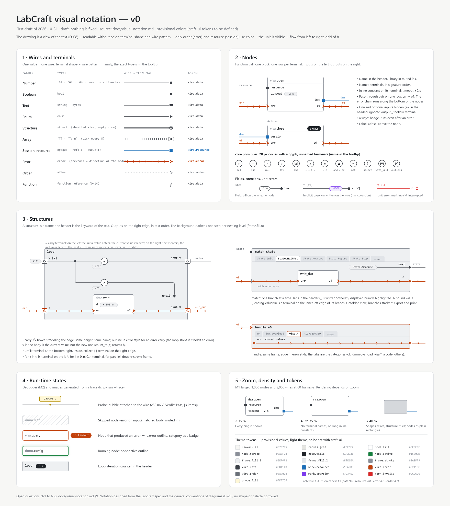
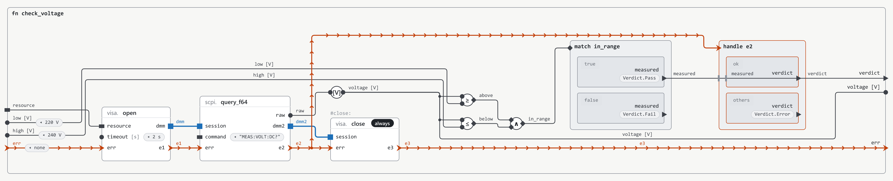

# Visual notation — v0

*Last updated: 2026-11-09. Status: draft, nothing is frozen; the compact view (3.2), automatic placement (2.1), wire routing (2.2), the font (2.3), the values of a run (6.1) and the theme (8) are written for M0v.*

How a LabCraft diagram is drawn. The language spec (`language-spec-v0.md`) defines the text; this
document defines its graphical view. It serves the M0v viewer and the M1 editor and, before them,
the project images generated from real `.lcf` files. Open questions are numbered N-1, N-2… at the
end of the document.

[](images/visual-notation-board.png)

*The board, drawn by hand on 2026-10-31 (click to enlarge). It does not show the compact view of
nodes yet (3.2, N-10 to N-12).*

A function rendered from its file by `tools/lcf-figcraft`, not drawn by hand
([examples/check_voltage.lcf](../examples/check_voltage.lcf)):

<picture>
  <source media="(prefers-color-scheme: dark)" srcset="images/rfc/check_voltage-dark.png">
  
</picture>

**Files.** Both open with [FigCraft](https://github.com/storytold/figcraft), a design app of the
Craft family:

- [design/visual-notation-v0.figcraft](../design/visual-notation-v0.figcraft): the board above.
- [design/notation.figcraft](../design/notation.figcraft): the component library that
  `tools/lcf-figcraft` reads to draw diagrams (terminals, primitives, pills, node and structure
  samples, one sample per wire family, theme tokens in light and dark modes). Edit it, rerun the
  tool, and every rendered diagram follows.

## 1. Principles

1. **The drawing is a view of the text (D-08).** Every drawn element corresponds to a construct of
   the text, and the reverse. Only the position comes from elsewhere (`layout` section, spec 11).
   If a graphical element has no equivalent in the text, it does not exist.
2. **Readable without color.** The type is read from the shape of the terminals and the pattern of
   the wires; color only doubles the information. A diagram stays readable printed in black and
   white, or by a color-blind person.
3. **Order and resources first.** On a test bench, the question is "in what order do the actions
   happen, and on which equipment?". The error wire carries the order (spec 5.3), the session
   carries the resource: these are the only two wires drawn in color. Data is drawn in a single
   neutral ink.
4. **The unit is visible.** A physical quantity shows its unit on its terminal and on its wire; an
   implicit conversion (`mV` to `V`) is written on the wire.
5. **Its own identity (D-23).** A notation designed from the LabCraft spec and from the general
   conventions of schematics and node editors. No palette, icon or shape borrowed from NI. Every
   proposed shape is justified by a construct of the text, never by "as in such and such tool".
6. **Theme tokens.** No hard-coded color: tokens (`wire.error`, `node.fill`…) whose values are
   LabCraft's own, light and dark (section 8; Craft convention).

## 2. The canvas

- The flow goes **left to right**: inputs on the left of a node, outputs on the right.
- **The function is a frame**, like a structure: its inputs are terminals on the left edge, its
  outputs on the right edge, in signature order, except `err`, which is always at the bottom of each
  edge (2.1). An optional input shows its default value next to
  its terminal (`low ◂ 220 V`). The `///` documentation is the tooltip of the title.
- Orthogonal wires, rounded corners (radius 6). Grid of 8 units.
- Canvas units: 1 unit = 1 logical pixel at 100% zoom; `node x at (40, 80)` places the top-left corner
  of the node, from the top-left corner of the frame that holds it (spec 11).

### 2.1 Automatic placement

A function without a `layout` section, which is what an agent writes, is placed automatically, and so
are the nodes that a `layout` section does not place (spec 11).

- **One drawing per file.** Placement and routing depend only on the file, on what it uses from other
  files (the signatures, type declarations, icons and bands of what it calls), on the font of the
  notation (2.3), on the values of the notation (10), which are the defaults outside a viewer tuning them, and on
  the view state: the view of each node, tabs or unfolded branches, folded or
  unfolded constructions, the branch shown in tabs (by default that of the run,
  6.1), which changes nothing around its frame, as large as its largest branch (5.2). With the same
  view state, the same file gives the same drawing on screen, when it is opened again, in an export and
  in the snapshots of CI (scenario 6 of `acceptance-m0.md`). Nothing comes from a previous drawing, from
  the size of the window or from the order in which files were read.
- **Stable by construction.** Every choice rests on what changes little: the dependencies, the order of
  the signature and the names, through the canonical order of lines (spec 5.2), which keeps the written
  order only for ties (call statements without a label, lines whose outputs are all `_`, `collect`
  lines, the arms of a `match`, a body that cannot be ordered). No choice is random. A small
  change moves what depends on it, as far as the rules below allow. For each example and each data wire
  between two nodes, CI inserts a neutral node on the wire (`core.select(true, v, v)`, which passes the
  value on unchanged), compares the drawing with the drawing before, and reports how many other nodes
  change place. M0v reports the figure; the threshold is set before the M0v tag, on measures of the
  viewer itself.
- **Columns.** The flow goes left to right: a node stands in the column after the last of the nodes
  that feed it, and a node fed only by the inputs of the function in the first column. Nodes with no
  input (a named constant, `time.now()`) are left out of that count; each one then stands in the column
  just before its leftmost reader, and when that reader is in the first column, a column opens before
  it. A node with no input and no reader stands in the last column.
- **The main error chain on one straight line** (N-7). The main chain is the chain of nodes joined by
  their error pass-through pairs (3.1) that starts at the `err` input of the function and goes through
  the most nodes; on a tie, the one that reaches the `err` output, then the first in the canonical order
  of lines. A function with no `err` input starts it at the first node, in that order, whose error input
  is not wired. The chain runs along the bottom of the nodes it crosses. Every other node goes above it,
  stacked in its column, in the order that keeps crossings low, ties broken by the canonical order of
  lines. Below the axis, apart from the lower edge of the nodes on the chain, there are only error wires
  that leave the main chain (`e2` in `check_voltage` leaves it at `query` and joins `handle e2`). A
  function with no error pair at all (`projectile`) has no axis: its nodes stack upward from the bottom
  of the frame, by the same rules.
- **Error pairs of structures.** A `loop` or a `for` with an error register has the two boxes of the
  register as its pair. A `match` or a `handle` whose arms take an outer error and yield an error output
  has a pair too: that error, entering by its notch or as the selector of a `handle`, on the bottom line
  of the left edge, and that output. With two error registers or two error outputs, the first in the
  text makes the pair. Inside a body, the chain starts at the inner side of the pair (the register box,
  the notch, the value bound by the arm) and ends at `next` of the register or at the error that the arm
  yields.
- **Through structures.** A structure on the chain is placed so that its error input and output sit on
  the axis around it, and the chain inside goes on along the same line: one straight line through every
  level of nesting. Structures grow upward, and their error lines line up. A structure off the main
  chain keeps its own chain straight along its own bottom.
- **The numbers** *(proposed)*. In a column, the blocks are aligned on their left edge, and the column is as
  wide as its widest node. Two nodes stacked are 24 apart, plus what a band or a label adds above the lower one;
  a column with no node of the chain starts 40 above the axis. The order in a column comes from four sweeps of
  barycentres each way, the order that makes the wires the shortest kept. A channel is as wide as
  its wires need (2.2). A frame has a header of 32 for its title and 16 inside around what it holds; a
  `match` or a `handle` unfolded stacks its arms 16 apart, 16 below its header, each with a title of 24, all as wide
  as the widest; the error enters and leaves it on the axis of its last arm, whichever arm reads it.
  The terminals of a frame keep their order (the signature, the clauses of a loop), each at the height of the
  first node it feeds or that feeds it, as far as that order allows and at least 24 apart; the error terminal on
  the axis, at the bottom of its edge, and every other terminal at least 24 above it; the two boxes of a register at
  one height. Each has its name inside the
  frame, with its unit and the default of an input (`low ◂ 220 V`). An error that crosses a body with no node
  on its way still has its straight line.
- **A partial `layout` section.** The nodes it places never move. A frame grows upward to hold the nodes that
  they push out of it *(proposed)*; the positions of the file are still measured from the corner it has without
  them. A node that it does not place goes into
  free space between what it connects: right of what feeds it, left of what it feeds, above the error
  chain if there is one. The other unplaced nodes move apart only as far as needed. With no position in
  the file, this gives the placement above. What the file writes always wins: around a position or a
  `via` that it gives, the rules that say "never" hold as far as they can. The axis of the chain goes
  through the first node of the chain, placed or not, and a node of the chain that the file does not
  place goes on the axis.
- **When the file changes**, in the live viewer, the nodes glide from their old place to the new one in
  about 150 ms *(proposed)*, so that one sees what moved. There is no glide when the system asks for
  reduced motion. The drawing at the end is always the one computed from the file. The update time of
  scenario 6 runs to the new drawing; the glide comes after it. A node is followed across the change by
  the body that holds it (the function, an arm, a loop body) and the name that designates it in the
  `layout` section (spec 11: its label or the name of its line); a node with no name, by its rank among
  the nodes with no name of its body, in the canonical order. A node whose name changed appears in its
  new place.
- When the developer moves a node (M1), its position is written in the `layout` section, and it no
  longer moves.

### 2.2 Wire routing

- A wire never crosses a node, a label, a pill, a band or a wire name, and it enters a structure only
  through its terminals and its notches (section 5).
- A wire whose two ends are at the same height is straight. Between neighbouring columns, it otherwise
  has a single vertical segment, in the channel between them. A wire that skips columns, other than an
  error wire, runs on a horizontal track above the nodes it passes over (`low` and `high` in
  `check_voltage`), with one vertical segment at each end; a secondary error wire does the same below
  the chain.
- Two wires never share a segment: parallel wires are 8 units apart. Two values that reach one terminal share the
  way into it: an input that reads several values, or a value bound twice, which `check` refuses.
- **Narrow channels** *(proposed)*. The channel between two columns is as wide as its vertical segments need,
  8 apart, with the conversion and field pills of its wires, the pills of the inline constants of the blocks
  it leads to, and a margin of 8 on each side: 16 with no vertical segment or one, 8 more for each other. The
  pills stand just before the block they lead to, in the room that its inline constants take (3.2). The name of a
  wire never widens it (section 4), nor does a value of a run (6.1): they take the room that is there, or none.
- **The numbers of routing** *(proposed)*. The wires of one value (its readers, an `after:` that names it) are one
  net: from its source, a vertical in the channel after it reaches the readers of the next column and rises to its
  track, which runs 16 above what the columns it passes over hold, 8 above another track, and drops in the channel
  before each column further on. A track that would start at the height of its source starts there, with no
  vertical, when no other wire ends within 8 of that height in that channel. A secondary error wire runs 16 below
  the chain. In a channel, a wire that enters at the height where another leaves (within 8) has its vertical left of
  the other's; otherwise those that rise stand left of those that fall. Wires that must each stand left of the next,
  round a cycle, cannot all keep 8 apart: all but the first of the cycle jog, a vertical where they enter, across at a
  height of the grid that no other wire of the channel enters, leaves or crosses within 8 (a track over it included),
  above the main chain, the nearest the middle of their vertical, then their own vertical. The main error chain runs straight on its axis past the columns that hold nothing there
  (2.1). A wire leaves a terminal of a frame past its name, and reaches one before its name; an order wire from a
  label starts right after the label, at its middle; a terminal on the top edge (`after:` of a compact block) is
  reached from 8 above what is above the node, and the label of that block starts right of it. A junction point is a
  disc of radius 3. A trunk is drawn once: each branch from where it leaves the others.
- **The margins of a `match` or a `handle`** *(proposed)*. A value that enters by a notch of the frame goes on to the
  notch of each arm that reads it, and what each arm yields to the output of the frame: a vertical each in the margin
  between the edge and the boxes of the arms, 8 apart, the margin 16 wide at least and 8 more for each other
  vertical. On the right, the later outputs stand further left.
- The order of preference is the fewest crossings, then the shortest length, then the fewest bends.
  Ties are broken by the order of the signature and by the names, as for placement. These are
  preferences that a fixed procedure follows as well as it can, not an exact optimum, which large
  diagrams could not afford (scenario 6, point 4).
- A value that feeds several inputs runs as one trunk, with a junction point at each split (section 4).
- Every wire that is not an error wire (data, session, order, function) stays above the main error
  chain and never crosses it. An error wire that leaves the main chain runs below it, and crosses it
  once, in the channel before the node it reaches.
- Order wires are routed like the others.
- The waypoints that a `via` gives (spec 11) are kept, and the routing joins them: across, then down to each, and
  from the last down to the height of the reader *(proposed)*. A `wire` entry keeps its waypoints when it names one
  wire by its value and the node it reaches, an output of the function or an input named after it; the part inside a
  structure that `wire stop -> n` names does not keep them yet (to do with the editor, M1).
- A terminal can sit on any side of its node, and the routing leaves it in that direction, so that
  sides chosen later (N-15) need no other routing. The terminals of a circle are off the grid of 8 (3.2), and the wire reaches them with a short
  segment.

### 2.3 Font and text metrics

Every text of the diagram, on the canvas and in the SVG, is set in one monospaced font: **Hack**,
version 3.003, Regular (MIT and Bitstream Vera licences, attributed). The font belongs to the notation,
not to the preferences: placement depends on the width of the texts (2.1), so that every screen, every
export and the snapshots of CI draw the same thing. A monospaced font tells `l`, `I` and `1`, or `O`
and `0`, apart in names, and keeps a value as wide when an iteration selector changes it (6.1). The
developer chooses the zoom, and the font of the other panels of the IDE.

- **Three sizes** *(proposed)*. 10 units (`text.large`, `text.label`, `text.medium`, section 10): the label in the
  center of a block, the names of terminals, the titles of structures and of the function, the names of wires,
  inline constants, the values of a run (6.1), badges, tabs, legends and banners. 9 units: the text of the band
  (3.2). The three values stay apart in the table, so that each can be tuned. A title stands out by
  its place and its color, never by its weight: there is one face.
- **Cells.** Every length of text in the notation is counted in cells: its width, and the limits at
  which a text is cut (3.2, 6.1). A grapheme (Unicode, UAX #29) takes one cell, or two when one of
  its code points is East Asian Wide or Fullwidth (UAX #11) or an emoji (`Emoji_Presentation`, or
  U+FE0F, which asks for one): `☝🏽`, a hand and a skin tone, takes two; `©`, `™` or `▶`, which Hack
  draws, take one cell, and `e` with an accent one: in the band of a block of 40, which holds 5 cells, a
  library name in Japanese is cut after 2 characters and `…`, not after 4. The Unicode version is the one with which names are read (spec 14.1).
- **Every text has a cut.** A text that no other rule cuts (the name of a terminal or a wire, a title,
  a label in standard view, an inline constant) is cut at 40 cells *(proposed)*: 39 and `…`, and its
  tooltip shows more of it. A name of normal length stays whole (`measurement_channel_voltage_limit` is 33
  cells), and a name or a string of millions of characters cannot stretch the drawing or the SVG. Nor can
  a letter followed by a million accents, a single grapheme: a drawing keeps the first 32 code points of a
  grapheme *(proposed)*, which no real text passes (Unicode's stream-safe form asks for no more than 31),
  and the text ends there with `…`, so that what it keeps cannot join what followed.
- **A tooltip is cut too**, on the canvas as in the `<title>` of the SVG ([cli.md](cli.md), section 7.2): at
  200 code points and `…`, names and values alike, so that hovering stays fast whatever the file holds. To
  see a longer value whole belongs to the debugger (M5).
- **Width.** Every character of Hack has the same advance, 1233/2048 of the size: 6.02 units at 10,
  5.42 at 9. A text is as wide as its cells times that advance. No kerning, no ligatures.
  A character that Hack lacks (a name in Japanese, an emoji in a string) is drawn by a fallback font.
  On the canvas, a text that a fallback font makes wider than its cells is drawn smaller, as a whole, to
  fit them, so that it never runs past them.
  A text keeps 4 units on its left and on its right between itself and the edge of its box (block,
  band, pill, badge, tab, bubble); the label of an oblong keeps 2 (`node.label_padding`), and the label of a
  compact block holds between its terminals, which straddle its edge (3.2).
- **Direction.** Every text is put in display order with the Unicode bidirectional algorithm
  (UAX #9), on its own and with a left-to-right base direction, so that a name in Hebrew or Arabic
  reads in its order. A text is cut first, in its logical order (one cell less than its limit and `…` at its logical end,
  which then shows on the right), and reordered after. The `diagram` crate cuts and counts; it does not
  reorder. The canvas and the SVG both give the text in its logical order, isolated, with a left-to-right
  base, to a text engine that applies the algorithm and joins Arabic letters: epaint, in the egui of the
  Craft suite, for the canvas ([architecture.md](architecture.md), section 11.4); the browser for the SVG
  (`direction: ltr; unicode-bidi: isolate`). A bidirectional control
  character of those that `LC0005` names (U+202A to U+202E, U+2066 to U+2069) never acts: it is shown
  as its code, `⟨U+202E⟩`, in the token `mark.invalid`, so that no text can hide how it reads (spec 2,
  Encoding). The marks U+061C, U+200E and U+200F act as in any right-to-left text.
- **Controls.** A text has one line. A line break in it (LF, CR, or CR LF) is drawn `↵`, as a value of a run
  writes it (6.1), and a tab `⇥`; any other control character (general category Cc) is shown as its code,
  `⟨U+0007⟩`, in the ink of the text, since it is legal and hides nothing. Each sign counts the cells it
  shows: a code takes 8. A cut never splits a sign: it is whole, or gone after `…`. The text of an icon and
  `LC5009` count the same signs.
- **Height.** A line of text is 2384/2048 of the size (ascent 1901 and descent 483, in units of 2048).
  A text that sits on a line, such as the name of a terminal, has the middle of its capitals on that
  line (capital height 1493/2048); a text in a box (band, pill, badge, tab, bubble, each line of a
  label) has the middle of its capitals at the middle of its line in the box.
- **Where the numbers live.** These metrics and the counting of cells live in one crate, with the
  SHA-256 of the font file that they come from, low enough for `check` to judge the text of an icon
  (spec 11.1) and for `diagram` to place. A test reads the font that the canvas draws with and checks
  them, so that another version of the font is a reviewed change of the drawing. They are the module
  `text` of `types`, and the file is in `assets/fonts/` ([architecture.md](architecture.md), section 11.1).
- **In the SVG**, the font is named once, on the root element:
  `font-family="Hack, DejaVu Sans Mono, Menlo, monospace"`. DejaVu Sans Mono and Menlo come from the
  same Bitstream Vera design and have the same advance. Another font draws texts slightly narrower or
  wider, and so can a fallback glyph, which the SVG cannot scale: a text can then run a little past
  its box in that SVG; the positions do not change. The
  SVG does not embed the font.

## 3. Nodes

A function call has **two views**:

- **Compact, the default**: a small shape with the function's icon or a short label, under a band
  naming its library when it comes from another one, unnamed terminals (3.2). It lets a whole
  function fit on screen.
- **Standard, on request**: a block with the name as a header and named terminals (3.1).

The view of a node is changed in the IDE and saved in the `layout` section (`view standard`,
spec 11); an IDE preference displays everything in standard view. The read-only viewer of M0v
draws the view that the file gives; a view changed there is a state of the viewer, never written to
the file, like the branch shown in a `match` (N-2). **Primitives** are not a special
case: they are the `core` functions whose compact view is a circle with a glyph (3.2); a project's own
`add` is an ordinary function, with no glyph. The choice
of view changes nothing in the program: the text, its canonical form and its diffs stay the same.

### 3.1 Standard view

Rectangular block with rounded corners. Header: the function name (`visa.open`, the library in
muted ink). Named terminals, **in signature order**: inputs on the left, outputs on the right. The
sides of the terminals, and the error chain along the bottom, are **defaults**: what the IDE and the
agents draw when nobody chooses. The author of a function may later choose other sides for its
terminals (N-15).

```text
                ┌─ visa.open ───────────────┐
  resource ─────▬ resource              dmm ■━━━━━━━━ dmm
                │ timeout ◂ 2 s             │
  err ──›──›────▸ err                    e1 ▸──›──›── e1
                └───────────────────────────┘
```

- **Sizes** *(proposed)*, those of `design/notation.figcraft` on the grid of 8: a header of 24, its text at 10; the
  first line of terminals at 40 from the top, the others 24 apart (a pill is 14 high), the last at 16 above the
  bottom, so a block of one line is 56 high and one of two 80. The names of the terminals keep 12 from the edge,
  and an input name and an output name on one line 24 between them; a unit badge follows its name, 4 after it,
  and the pill of a constant its input, 8 after. The width is the largest of 112, the header (12, the name, the
  badges, 12) and each line, rounded up to the grid.
- **Lines of terminals**: a line holds at most one input, on the left, and one output, on the right.
- **Pass-through pair on the same line**: an input and an output of the same opaque type (session)
  or error type share a line, so that the wire crosses the node in a straight line. Pairs are made
  by name first (an input `to` with the output `to`), then in signature order among the terminals of
  that type that are left. A pair that would cross one made before it, in signature order, is not
  kept: its two terminals are placed like the others. The `err` pair is always on the bottom line,
  even when `err` is not last in the signature (it is last by convention): lines are made as if `err`
  were last in both lists, so the error chain runs along the bottom of the nodes. A function with an
  error output and no error input (`errors.merge`) has its error output alone on the bottom line.
- **The other terminals**: the pairs fix their lines, in signature order. Before the first pair,
  between two pairs and after the last, the inputs and the outputs that lie there in their own
  lists fill lines side by side, in signature order; when one side has more, the rest take lines of
  their own. `visa.open` above: `resource` and `dmm`, then `timeout` alone, then the pair `err`,
  `e1`. `scpi.query_f64` (inputs `session`, `command`, `err`; outputs `value`, `session`, `err`):
  `value` alone, the pair `session`, `command` alone, the pair `err`, so four lines.
- **Inline constants**: a constant written as an argument (spec 5.1) is shown on its terminal
  (`timeout ◂ 2 s`, `◂ "MEAS:VOLT:DC?"`), not as a separate node. Long text is truncated (`…`),
  in full in the tooltip.
- **Named constant** (`limit = 240 V`, spec 5.1): a small node without a body, the user places it near what it
  feeds. It shows its name, its value in a pill and one output terminal (`limit  240 V ●`), and its wire splits like any
  other. *(proposed)* It is 24 high: its name in `text.large`, then 8, the pill, 8, and the terminal on its right edge. Dragging a wire from an inline constant to a second terminal makes one. A new name for a wire (`err = e3`) still
  draws nothing.
- **Constant construction** (`k = Limits { low: 220 V, high: 240 V }`, or a variant with values): when every field is a
  constant and the values fit in a tooltip, it is drawn folded by default, as a small node (`k  Limits {…} ●`). Each node can be
  unfolded into its block; the file does not change, and an exported image shows the block. A field that is a variant
  without values (`Verdict.Pass`) is a constant.
- **Nodes of `ui`** (`ui.set`, `ui.get`, spec 10): the element is written on the face of the node (`set live_voltage`), with no
  terminal for it, since it is no wire. An element named like an input or an output of the function is also that terminal of the
  function, and selecting an element selects its nodes and terminals. The default of an input has one field in the inspector,
  shared with the pill on its terminal, since it belongs to the signature.
- **`led` on a panel** (spec 10): until the developer chooses, grey when off and one accent colour, neither green nor red, when
  on, with the name of the variant on an enumeration. No default gives a colour a meaning: colours by position would make a
  `Fail` green.
- **Unwired optional inputs**: drawn, at their place in the signature, so that a node has the size of its
  definition at every call (N-6); the tooltip of the terminal gives the default value.
- **Ignored output** (`_`): hollow terminal, no wire.
- **`always`**: `always` badge in the header. This is the node that runs even after an error; it
  must be spotted at a glance.
- **Label** (`#close:`): shown above the node.
- **`after:`**: small order terminal to the left of the header, connected by an order wire (4.1).
- **The name of the node** (key of the `layout` section) is that of its first named output, already
  written on its terminal, or its label (spec 11): nothing more to draw.

### 3.2 Compact view

```text
               ┌─ visa ─┐
  resource ────▬        ■━━━━━━━━ dmm
     2 s ◂ ────●  open  │
  err ──›──›───▸        ▸──›──›── e1
               └────────┘
```

A compact node is a **block** whose center says what the function does: its icon, or a short label.
When the function comes from another library, a **band** above the block says which.

- **Band**: the name of the library of the function (`visa`, `scpi`, `dmm_driver`, `results_log`), whole
  when it holds in the width of its block less 4 on each side, beyond that cut to one cell less followed by `…`
  (cells, 2.3): above a block of 40, 5 cells at 9, `visa`, `resu…` *(proposed)*, in the token `band.text` on `band.fill`, neutral by default,
  with a contrast of at least 4.5:1 in both themes. The band is 12 units high and as wide as the block,
  which it never widens; an oblong (below), as wide as its label, holds more of it (`results_log` above
  `StepResult`). The name of a library is whole in the tooltip, and a library mask will give it a shorter
  text (N-11). A call to a function of `core`, of the other primitive libraries of the spec
  (`array`, `string`, `time`, `errors`, `ui`, spec appendix A.2) or of the library that holds the diagram has no
  band: those are everywhere, and their band would say nothing. `visa`, `scpi` and every other library keep
  theirs. A folder of the project is a library like any other (spec 4), so a call from the root to
  `relays.close` has the band `relays`. A sub-library `a.b` shows its last segment, `b`, with the full
  path in the tooltip; when two bands of one diagram would read the same (`x.util` and `y.util`), each
  shows the full path. The texts compared are those drawn, after the cut: when they still read the
  same, each is cut in the middle instead, keeping its start and its end (above a block of 40,
  `measurement_a` and `measurement_b` give `me…_a` and `me…_b`). The label (`#close:`) is drawn above the band, or above the block when there is
  no band, in 10 (`text.medium`) and `ink.muted`, 4 above it, right of an `after:` terminal on the top edge *(proposed)*. Neither counts in the position: `node x at (40, 80)` places the top-left corner of the block
  (spec 11), so a band never moves the terminals. A library cannot yet change its band (N-11).
- **Block** *(proposed)*: `node.square` wide, 40 units, whatever its label, its band or its lines, so that a node
  reads as an icon and the blocks of a column line up; as tall as its lines need (below), with 8 above
  the top line and 8 below the bottom one, 40 at least, rounded up to the grid: up to four lines a square of 40, five
  lines 40 × 48. Its size comes from the definition of what it calls, never from what a call wires: every terminal of
  the signature is drawn, the lines are evenly spaced, and its label, its band and the pills of its constants never
  make it larger (N-6). A label that does not hold is cut (below): a reason to give the function an icon. A
  construction, a variant constructor and a node of `ui` are not squares: they can have no icon, and their text
  is what they show. Their width is that of their label, in `text.label` (10), with 2 on each side
  (`node.label_padding`), their height the larger of what their lines need and their label with 8 above and below (two
  lines, `set` / `live_volt…`, need 39.28, so 40), each at least 40 and rounded up to the grid; their lines are counted from the bottom, as on a square. A value too many for a
  variant, or an argument too many for a function, which `check` refuses, still has its input, named by its position
  (`1`), so that the drawing shows where.
- **Center** of the block: the function's icon (`icon` section,
  spec 11.1), alone, drawn 28 × 28 units and cut to its grid, so that a shape that leaves it (`LC5009`) never covers
  the block, a terminal or a wire, each of its texts cut at 40 cells (2.3) to bound what is drawn; otherwise a
  short label: the last segment of the name (`visa.open` → `open`), in `text.label` (10), on two lines at most, each
  as wide as the block less a terminal (5 cells in a block of 40 with terminals of 8) *(proposed)*. A label that holds
  is on one line. Otherwise it is cut at an underscore, which is not drawn, when both parts hold: the cut whose longer
  line is the shortest, the first one on a tie, never one that leaves a line empty (`query_f64` → `query` / `f64`).
  Otherwise the first line goes as far as the last underscore that it holds, or the one right after what it holds,
  which is not drawn, or as far as it holds,
  in the middle of a word, and the second line takes the rest, cut to one cell less followed by `…`: `bench_selftest` →
  `bench` / `self…`, `read_dc_volts` → `read` / `dc_v…`, `elapsed` → `elaps` / `ed`. Here and in the band, a cut falls
  between two graphemes, before the one that would pass the limit, and `…` takes one cell. The author does not declare a label: the icon is there for that. The qualified
  name (`visa.open`) is in the tooltip, and in the `<title>` of the node in an exported SVG.
- **Unnamed terminals**: inputs on the left, outputs on the right by default (3.1, N-15), on the
  **same lines as in standard view**: signature order, pass-through pairs on one line. Switching a
  node from one view to the other never reorders its terminals. By default (N-15), lines are counted
  from the bottom: the last one is 8 units above the lower edge, and the lines above it are `node.pitch` apart, 8,
  the grid of the canvas, whatever they carry *(proposed)*: a block of one line has it at 32 from the top, a block of
  two lines at 24 and 32. A pill (an inline constant, or the pill of its wire, 3.3, 4.2) is 14 high and lies where a
  wire would, 8 left of the terminal; when it would overlap the pill of a line above, it steps outward, its right end 8
  left of that pill, and a constant so moved has a wire to its terminal, as N-15 does for M1. The name of a terminal is shown in the tooltip and while wiring, on the targeted
  terminal. The shape of the terminal still tells its family (4.1).
- **The `err` pair stays on the bottom line**, as in standard view: the error chain crosses the
  node in a straight line.
- **What the compact view never hides**: the `always` badge (reduced to `▴` at the bottom center,
  clear of the `err` terminal, drawn over the icon if they meet), the inline constants (abbreviated to
  8 cells, 2.3), the label (`#close:`), the `after:` terminal (on the left of the band; with no band, on
  the top edge of the block, 8 units from its left corner), the conversion marks and the run-time state
  (6). Otherwise the diagram would lie about the execution.
- **Unwired optional inputs** are drawn, at their place, as in standard view: a node has the size of its
  definition at every call (N-6), and the tooltip of the terminal gives the default value. A variadic primitive
  (`errors.merge`) has the inputs that the call gives.
- **Construction** (`StepResult { … }`, 3.3): the label is the name of the type, without its library,
  which goes to the band (`results_log` above `StepResult`). **Variant constructor**: the type and the
  variant on two lines (`Reading` / `Value`).
- **Nodes of `ui`** (`ui.set`, `ui.get`, 3.1): no band; the label is the operation and the element on
  two lines, each cut at `text.label_line` (`set` / `live_volt…` at 10 cells), so the element stays on the face of the
  node.
- **Indistinguishable inputs**: when two or more wired inputs have the same type and nothing
  tells them apart (no inline constant, no wire name drawn, section 4), the editor warns: "inputs `low` and `high`
  indistinguishable in compact view", with the action "show in standard view". This is a warning,
  not an error.

**Primitives.** The compact view of the `core` operations is a **circle** of 28 units with a
glyph, unnamed terminals (name in the tooltip). The list is closed (N-4):

| Glyph | Primitives |
|---|---|
| `+` `−` `×` `÷` | `add`, `sub`, `mul`, `div` |
| `−` with one input | `neg` |
| `√` | `sqrt` |
| `\|x\|` | `abs` |
| `≥` `≤` `>` `<` `=` `≠` | comparisons |
| `∧` `∨` `¬` | `and`, `or`, `not` |
| `?` | `select` (condition on the upper input, then value if true, value if false) |
| `[V]` | `with_unit` (shows the added unit); `unitless`: the requested unit, struck through |

A unit too long for the circle (`[kg/(m*s)]`) turns it into a capsule of the same height, as wide as
the unit needs, with 3 on each side *(proposed)*. When an input carries a pill (an inline
constant, the pill of its wire), the circle stretches into a capsule of the same width, as tall as needed for it to
be 16 from a neighbour, 24 from a neighbour that carries one too, since a pill is 14 high
(`select(ok, 1 V, 0 V)`): the span of its inputs and 14 *(proposed)*. More than three inputs, which
`check` refuses but the drawing still shows, are 8 apart, and the circle stretches the same way. The other `core` functions (`min`, `max`, `pow`, the conversions, `call`) have the
ordinary compact view (block, no band).

**Constant on a primitive input**: the circle has no terminal line, so the pill is attached to the
left of the terminal, outside the circle (`◂ 0.5` in front of `>`).

**Terminals of a circle**: on its edge. One input at the middle of the left side, two at 8 units
above and below the middle, three at 10 above, at the middle and 10 below; the output at the middle
of the right side. They are not on the grid of 8: the routing of the wires (2.2) joins them.

### 3.3 Field access, structs, variants

- **Field access** (`step.low`): no node. The wire starts at `step` and carries, just before the
  terminal, a `.low` pill. This is what the text says: a path as an argument, not a call. A pill of a
  wire, a field or a conversion (4.2), is cut at 10 cells (`text.label_line`), and steps outward past the pill of a
  neighbour as an inline constant does (3.2) *(proposed)*.
- **An array of wires** (`y = [a, b]`): a block `[ ]` with one input per element, in order, one output,
  as the IR builds it; an array of constants is an inline constant *(proposed)*.
- **Construction** (`StepResult { name: n, … }`): block with the header `StepResult { }`, one
  input per field in declaration order, one output.
- **Enum value** (`Verdict.Pass`): inline constant. **Variant constructor** (`Reading.Value(v)`):
  small `Reading.Value` block.

## 4. Wires

**One value = one wire** (spec 5.1). The wire starts at a named output terminal; it splits at
junction points when the value feeds several inputs. The name of the value is that of the output
terminal. It is written on the first horizontal segment of the wire, 3 units above it, when the whole name
(cut at 40 cells, 2.3) fits there with 4 units on each side and covers no node, pill, bubble, wire or other name (a parallel
wire 8 above runs through a name, which is 12.8 high);
otherwise it is only in the tooltip and in the `data-wire` of the SVG: it never widens a channel (2.2). A long
wire repeats its name halfway (N-3), by the same rule: on its longest horizontal past the first segment, centred,
when that is three times what the name needs *(proposed)*.

### 4.1 Wire families

| Family | Types | Wire | Terminal | Color |
|---|---|---|---|---|
| Number | integers, floats, complex, `duration`, `timestamp` | solid, 1.5 | filled circle | `wire.data` |
| Boolean | `bool` | solid, 1.5 | diamond | `wire.data` |
| Text | `string`, `bytes` | solid, 1.5 | rectangle | `wire.data` |
| Enumeration | `enum` | solid, 1.5 | triangle | `wire.data` |
| Struct | `struct` | sheathed: outline of 4, empty core | double circle | `wire.data` |
| Array | `[T]`, `[T; n]` | that of `T`, with cross-ticks (small perpendicular strokes) every 8; one tick per dimension | that of `T` in brackets | `wire.data` |
| Session, resource | opaque types, `ref<T>`, `queue<T>` | solid, 2.5 | filled square | `wire.resource` |
| Error | `error` | solid, 2, chevrons `›` every 24 in the flow direction | chevron | `wire.error` |
| Order | `after:` | thin dotted | hollow chevron | `wire.order` (muted) |
| Function | function references (Q-14) | dash-dot | `ƒ` | `wire.data` |

*(proposed)*: the core of a sheath is the fill of the frame it runs in, 1.6 wide; a cross-tick is 6 across and 1
along, every 8, up to three per period for three dimensions and more; the chevrons of an error are 24 apart, the
first 12 from the start, none on a bend; an order wire is 1 wide, dotted 1.5 and 3; a function wire dashed 6, 3,
1.5, 3. A value read as an order and as a value is one net: its trunk is drawn with each.

- A terminal is 10 units across, centred on the edge of its node.
- The chevrons of the error wire show **the direction of the order**: this is the wire you follow
  to know what happens before what.
- The exact type (`f64[V]`, `[StepResult]`) is always in the tooltip of the wire and the terminal.
- **Order wires** are the text's `after:` (spec 5.3). The command "order in sequence"
  (`order.chain`) chains the selected nodes with order wires, in the order they were selected, and
  adds the labels that are missing.

### 4.2 Units and conversions

- A terminal or wire that carries a unit shows a badge: `voltage [V]`, `period [ms]`.
- **Implicit conversion** (numeric widening spec 3.4, scale change spec 3.3): written on the
  wire, just before the terminal that receives it, in a `mV→V` or `i16→i32` pill (token
  `mark.coercion`). You read the conversion instead of guessing what a mark means.
- Unit error at edit time (`V + A`): the wire is drawn in `mark.invalid`, interrupted at the
  terminal, with the message in the tooltip. An exported image draws the wire again in `mark.invalid`, over
  itself and not interrupted, *(proposed)* ([cli.md](cli.md), 7.2).

## 5. Structures

A structure is a **frame** with, as header, the keyword of the text (`loop continue_on_error`,
`for x in readings`, `match state`, `handle e6`). Its outputs are terminals on the right edge, in
the order of the text, except its error output, which is always on the bottom line, so that the error
chain crosses the frame in a straight line (2.1).

- **Outer values** used inside (spec 6): the wire crosses the edge; a notch marks the crossing.
  No terminal to wire. A value that is also the selector of a `match` or a `handle` enters by the
  selector, which serves as its notch: one wire outside, not two side by side. The developer can still
  give it a notch of its own, which the `layout` section keeps (spec 11).
- **Nesting**: frames contain each other; the background darkens by one step per level (token
  `frame.fill.n`).

### 5.1 `loop` and `for`

```text
        ┌─ loop ───────────────────────────────┐
 0 V ──┤↻├ v ─────── …               … ── next v ┤↻├───── value
        │                             until ◆  │
 err ──┤↻├ e ───›─── …               … ─›─ next e ┤↻├───›── err_out
        └──────────────────────────────────────┘
```

- **`carry` register: a register terminal**, a small box straddling the edge, marked `↻` ("the
  value goes around"). It renders the four values of the text:
  - **on the left**, the initial value enters from outside (inline constant or wire) and the
    **current** value (`v`) leaves on the inside;
  - **on the right**, `next v` enters on the inside and the final value leaves on the outside.

  The two boxes of a register are at the same height and carry the same name: they are paired
  without an arrow, whatever the number of registers. The outline of the box takes the color of
  the register's family (error style for an `error` register). The labels `v` on the left and
  `next v` on the right make visible the trap noted in spec 13: `v` in the body is the current
  value, not the new one.
- **Return arc: in the editor only.** On hover or selection of a register, an arc connects its two
  boxes over the frame, with the tooltip "`next v` becomes `v` at the next iteration". Exported
  images do not have it: with several registers (five in `station`), stacked arcs would become
  unreadable. No pair of vertical arrows on the edge, a shape too close to an existing editor
  (D-23).
- **`collect`**: `[ ]` terminal on the right edge; the outgoing wire is an array.
- **`for x in array`**: `]▸` terminal on the left edge (the array enters, the element leaves);
  `for i in 0..n`: `0..n` terminal on the left edge.
- **`until`**: `until` terminal on the right, inside the frame, just above the error register, so
  that the error chain keeps the bottom line (2.1); it is a `bool`, so a diamond.
- **Error register**: box in error style, on the bottom line of the frame; it is a reminder that the loop stops when it contains
  an error (spec 6.3). **`continue_on_error`**: badge in the header, since it changes this default
  behavior.
- **`for parallel`**: header `for parallel`, double-line frame.

### 5.2 `match` and `handle`

- **Selector**: terminal on the left edge, at the level of the header. The selector of a `handle`,
  which is an error, enters on the bottom line instead, which is the axis when the `handle` is on the
  error chain (2.1).
- **One branch at a time**: the frame is as large as its largest branch, so that showing another
  branch moves nothing around it. A tab bar in the header lists the branches (`true`, `false`;
  `State.Init`, `State.WaitDut` …; `_` is written `other`). A branch with several patterns is one
  tab, which lists them (`1, other`). The displayed branch is highlighted. *(proposed)* The tabs stand in a row
  of 24 under the title, each 20 high and 4 apart, from the start of the title: the branch shown filled with
  `tab.fill` and outlined like the frame, the others outlined with `frame.divider`, their text in `ink.muted`. The
  box of a branch has no title of its own, 8 at its top, and the boxes of all the branches start from one corner,
  moved down so that their error chains meet on one line: the frame is as high as the lowest.
  A bound value (`Reading.Value(v)`, `io.timeout(err)`) appears as a terminal on the inner left
  edge of that branch.
- **`yield`**: each branch wires the same output terminals on the right edge. A terminal that a
  branch does not wire is impossible (the text forbids it), so there is nothing to flag here.
- **Unfolded view**: all branches stacked vertically, each with its title. This is how exported
  images and printouts are rendered, and an editor mode. The last branch in the text sits at the
  bottom, on the axis of the error chain; the others are stacked above it, each with its own straight
  error chain, joined to the error output of the frame. The output of each branch joins a vertical
  bus along the inner right edge, which leads to the output terminal; an outer value read by several
  branches enters by its notch, then a vertical bus along the inner left edge (N-9). After a run, the
  branches that the run did not take are muted (6.1).
- **`handle`**: same frame, edge in error style; the tabs are the categories (`ok`,
  `dmm.overload`, `visa.*`, a code, `other`).

## 6. Run-time states

For the values of a run on the wires (M0v, once M0b runs programs), the debugger (M5) and images
rendered from a run trace
(`tools/lcf-poc/lcf.py run … --trace`):

| State | Rendering |
|---|---|
| Value of a wire (probe) | bubble at the output terminal: `230.1 V`, `Verdict.Pass`, `[3 elements]` (6.1) |
| Skipped node (error on input) | hatched body, muted ink |
| Node that produced an error | `wire.error` outline, category in a badge (`io.timeout`) |
| Running node | `node.active` outline |
| Loop | iteration counter in the header (`× 6`) |

### 6.1 Values of a run on the wires

The viewer of M0v shows the values of the last run of the function it draws, read from the trace that
the run writes (`labcraft-trace/1`, [commands.md](commands.md), section 8).

- **Every wire shows its value** once the run has ended, in a bubble at its output terminal, 4 units above
  the wire *(proposed)*: below it, a bubble reads as that of the wire beneath.
  - **The bubble** is 16 units high, a rectangle with corners of radius 3, in `probe.fill` with an outline in
    `probe.stroke`: never the capsule of a constant, so that the two are told apart without color (principle 2).
  - **Neighbouring outputs.** The outputs of a node less than 20 apart have their bubbles side by side, from the
    bottom line up, each starting 4 units after the end of the one below.
  - **What it covers.** A bubble covers the wires and the wire names under it, never a node, a pill or another
    bubble: it moves along the first horizontal segment of its wire to the first place where it covers none.
    When there is none, no bubble is drawn and its value is read on hover; the SVG still holds it, in a
    `<g data-value>` with its `<title>` and no shape (cli.md 7.2).
  - **The name of the wire** follows the bubble when the segment has room (section 4), and is otherwise in the
    tooltip while the values are shown.
  - **Other starts.** An input of the function shows its value at its terminal on the edge of the frame, in place
    of the pill of its default. A value that a register, a branch or a bus binds has its bubble where it starts
    inside the frame: the inner box of a register, the bound terminal of a branch, the top of a bus.
  - **Inputs.** Hovering or selecting a node also shows the values at its input terminals, to the left of each,
    side by side as those of outputs, each ending 4 units before the start of the one below; the values are
    never drawn at every input, which would repeat a value at each of its readers.
  - **Order.** Bubbles are drawn after everything else: those of the inputs of the function in the order of
    the signature, then the others in the canonical order of the lines that bind their values (spec 5.2), so
    that the SVG is the same every time.

  Order wires carry no value. The value is in the tooltip, up to 200 code
  points (2.3), which says when the trace cut the value (`$len`, `$cut`). An error wire that carries no error shows nothing, so that the eye
  goes to the errors; one that carries an error has a bubble with its category in `wire.error`, as the badge of the node that
  produced it shows it.
- **Short forms.**
  - A float with 4 significant digits, zeros after the decimal point dropped, then its unit
    (`230.1 V`, `0.5 s`, `12350 Hz`); an exponent when the magnitude is below 0.001 or from 1,000,000
    on (`1.2e-6 A`); `0` as `0`; `nan`, `inf`, `-inf` as they are. An integer in full, with its unit
    (`42`, `1250000`, `-3 mV`). A complex number as `1.5+2i`, with its unit. A `duration` with its unit
    (`2 s`), a `timestamp` as its time of day in UTC (`14:02:31.250Z`).
  - A string in quotes, whole up to 12 cells, beyond that 11 followed by `…`, counted as in 3.2;
    a line break is written `↵`. `bytes` by their length (`[16 bytes]`).
  - `true` or `false`; a variant (`Verdict.Pass`), with `(…)` when it holds data
    (`Reading.Value(…)`).
  - An array by its length (`[1 element]`, `[3 elements]`), by its sizes when it has more than one
    dimension (`[3×4]`), or `[… elements]` when the trace cut it without its length; a waveform by its
    samples (`[1000 samples]`); a struct as `{…}`.
  - A session by its resource (`SIM::DMM0`), and `SIM::DMM0 (closed)` once closed; another opaque
    value, a `ref` or a `queue` by its type (`⟨queue⟩`); a function reference by its name (`ƒ scale`).
  - Every name or text that comes from the trace (a resource, a category, a file or node name in a
    banner) is cut like a string.
- **Bubbles never move the drawing.** They are drawn over it, after placement and routing, which
  ignore them (2.1), and cover what passes under them: the narrow channels (2.2) leave no room to make for
  them. Opening a trace or hiding the values changes no position.
- **A button hides the values** and shows them again. It is a state of the view, never written to the
  file.
- **Where a value comes from**, in the frame of the function drawn (frame 0):
  - an input of the function: the `in` of the `call` event of frame 0;
  - a value that a node binds: the `out` of its `ran` event, under the name of the wire;
  - a node that did not produce its results, because it was skipped (`skipped` event) or because its
    own error output carries a new error: no value on the outputs that it fills with defaults, which
    would read like results (spec 7.2). The error it passes on shows, and so does a value that it
    passes through unchanged (a session);
  - the current value of a carry (`v`): its initial value at the first iteration, then the `next v` of
    the iteration before;
  - the element of a `for x in` (`x`): the element of the array at that iteration, and no value when
    the trace cut the array before it; the index of a `for i in a..b`: `a` plus the iteration;
  - a value bound by a branch (`Reading.Value(v)`, `io.timeout(err)`): taken from the selector of the
    `match` or `handle`.
- **Loops.** A wire inside a loop has one value per iteration (the `iter` of the trace). The frame of
  the loop gets an iteration selector next to its counter (`× 6`), on the last iteration by default.
  What a person reads counts iterations from 1, as the counter does: the selector (`‹ 6/6 ›` next to `× 6`)
  and the message of a fault (`LC8001`); the fields of JSON (`iter` of a trace, `status.loops.iteration`) count
  from 0, as indices. The bubbles inside show the chosen iteration, and stepping it forward or back shows the values
  change. A loop that made no iteration shows `× 0` and no iteration selector. Each nested loop has
  its own iteration selector: when an outer one moves, the inner ones go to the last iteration of
  their loop in that outer iteration. In a `for parallel`, the last iteration is the one with the
  highest index. Hovering a wire inside a loop shows its values over the iterations of its own loop,
  within the iterations chosen outside: a small curve for a number, a list otherwise, cut after its
  first 1,000 values with a note.
- **`match` and `handle`.** The branch shown by default is the one that the run took, at the chosen
  iterations (the `arm` event of the trace); without a trace, or when the branch of the trace no longer
  exists, the first (N-2). A tab that the developer picks then wins until an iteration selector moves
  or another trace arrives. A branch that the run did not take, in a tab or in the unfolded view, is
  muted and carries no values.
- **A run that did not end well.** A wire with no value in the trace (a node that never ran, after a
  `fault`, an `aborted` run or a cut trace) shows nothing, and a banner gives the status that the `end` event gives ("aborted", "fault"), or says that the trace was cut, or that it has no end (the
  run did not finish writing it). With a cut trace, the last iteration shown is the last one traced,
  and the banner says so. The banner is 20 units high, above the frame of the function and never over the
  drawing; a trace that no longer matches (below) and did not end well has one banner, which names the files
  first.
- **A trace that no longer matches.** The first line of the trace gives the SHA-256 of every file the
  run read. The viewer compares only the files that it resolved itself to draw the function; one that
  has changed or is gone mutes every value (its bubble takes the fill of the canvas and a dashed outline, and its text
  `ink.muted`), and a
  banner names it, with the time when the trace was written (the time of its file): "`check_voltage.lcf` has changed since this run (14:02)", or "and 2
  other files" when there are more. Nothing is hidden, and nothing looks current that is not.
- **The trace is an input like a file.** Reading it is bounded and never crashes the viewer: a line
  that does not read ends the values there, as a cut trace would, and a first line that does not read
  gives a diagnostic and no values. Its limits are those of [cli.md](cli.md), section 7.4
  (scenario 4).
- **Called functions.** The viewer shows the values of the function it draws, when that function is
  the one that was run. Opening a called function to see the values of one of its calls belongs to the
  debugger (M5).

## 7. Zoom and density

M0v target: 1,000 nodes and 2,000 wires, panned and zoomed at 60 frames/s; M1 keeps it while
editing (`roadmap.md`). Rendering depends on the
zoom:

Seeing a whole function without scrolling is a goal, never a rule: the narrow channels (2.2), the square
blocks (3.2) and the bubbles that make no room (6.1) serve it, and a long sequence of steps stays legitimate.
CI reports, for each example, its size and the zoom at which it fits whole in the canvas of the window of
M0v (1340 × 560 units *(proposed)*), as it reports the figure of stability (2.1): a figure, never a threshold.

| Zoom | Shown |
|---|---|
| ≥ 75% | everything |
| 40 to 75% | no terminal names or units; the names of the wires stay; the values of a run (6.1) down to 50 %, only on hover below |
| < 40% | shapes, wires, structure titles; nodes as plain rectangles; no values |

## 8. Theme tokens

`canvas.fill`, `canvas.grid`, `node.fill`, `node.stroke`, `node.title`, `node.active`,
`frame.fill.1..4`, `frame.stroke`, `wire.data`, `wire.resource`, `wire.error`, `wire.order`,
`mark.coercion`, `mark.invalid`, `probe.fill`, `probe.stroke`. Supporting tokens, which appeared while drawing
real diagrams (`tools/lcf-figcraft`): `ink.muted`, `ink.faint` (secondary text), `node.divider`,
`frame.divider`, `pill.fill`, `pill.stroke`, `pill.text` (inline constants, fields),
`coercion.fill`, `badge.fill`, `badge.text`, `tab.fill`, `band.fill`, `band.text` (library band of the
compact view, 3.2). Their values are LabCraft's own, in a light theme and a dark theme (the table
below), with no reference to another editor's palette (D-23). Whatever library draws the panels of the
IDE, the diagram takes its colors from this table.

- **Contrast of at least 4.5:1, in both themes**, checked by a test of CI on the table: every wire and
  mark token, and every text token (`node.title`, `ink.muted`, `ink.faint`, `pill.text`), against
  `canvas.fill` and each `frame.fill`; and every text on its own fill: `node.title`, `ink.muted` and
  `ink.faint` on `node.fill`, `pill.text` on `pill.fill`, `badge.text` on `badge.fill`, `band.text` on
  `band.fill`, `node.title` on `tab.fill`, and the texts of a value bubble (`node.title`, `ink.muted`,
  `wire.error`, `mark.invalid`) on `probe.fill`.
- **Outlines of at least 3:1**, checked by the same test: `node.stroke`, `frame.stroke`, `pill.stroke`,
  `probe.stroke` and `node.active` against `canvas.fill` and each `frame.fill`, in both themes. A node, a pill or a
  structure is told from its background by its outline, at every level. The dividers inside a node or
  a frame (`node.divider`, `frame.divider`) are decoration and stay outside the rule.
- **"Muted" does not exempt from contrast.** `wire.order` is told apart by its pattern (thin
  dotted), not by a pale color: a light gray falls below 4.5:1. In the light theme, `ink.faint` has the
  value of `ink.muted`: secondary text stands out by its size and place, since a paler gray fell to
  2.2:1.
- **Nesting backgrounds** (N-13). Every wire keeps 4.5:1 down to `frame.fill.4`. In the light theme,
  the backgrounds are closer to `canvas.fill`, and `wire.resource`, `wire.error`, `wire.order`,
  `mark.coercion`, `mark.invalid` and `ink.muted` are a little darker than before; in the dark theme,
  the backgrounds are closer to one another. Lightening the backgrounds alone did not work: to keep the
  former error color at 4.5:1, no background could be darker than `frame.fill.1`, and the four levels
  looked alike. Whether neighbouring levels stay easy to tell apart is judged on the canvas of M0v.
- **In the SVG**, every color is a CSS variable named after its token, with hyphens for dots
  (`wire.error` gives `--wire-error`, `frame.fill.1` gives `--frame-fill-1`), and a shape names it for
  each property it paints (`style="stroke: var(--wire-error)"`, `style="fill: var(--node-fill)"`). One
  `<style>` element gives the light values, and the dark ones under
  `@media (prefers-color-scheme: dark)`; the background, in `canvas.fill`, is always painted. An SVG shows the theme of whoever looks at it, and an agent reads
  what each stroke is. `diagram --svg` can force one theme for an image (`--theme light` or
  `--theme dark`, [cli.md](cli.md), section 7.2). The snapshots of CI use this table.
- **The developer's colors.** The developer may change the colors of their screen, and the IDE warns
  when a choice falls below 4.5:1, without refusing it (M1). Snapshots and exports keep this table.
- **Where the values come from.** The light values of the first list of tokens come from the board
  `design/visual-notation-v0.figcraft`; the light values of the supporting tokens and all the dark ones
  from `tools/lcf-figcraft/build_notation.py`; `band.fill`, `band.text` and `probe.stroke` (the value of `node.stroke`) are new. Changed on
  2026-11-08 for the two rules above: in the light theme, `frame.fill.1..4`, `wire.resource`,
  `wire.error`, `wire.order`, `mark.coercion`, `mark.invalid`, `ink.muted`, `ink.faint` (now that of
  `ink.muted`), `node.stroke`, `frame.stroke` and `pill.stroke`; in the dark theme, `frame.fill.1..4`,
  `mark.invalid`, `ink.faint`, `pill.stroke` and `probe.fill`. They were tried on the mock-ups of
  2026-11-09, and are judged again on the canvas of M0v.

| Token | Light | Dark |
|---|---|---|
| `canvas.fill` | `#F7F7F5` | `#16181C` |
| `canvas.grid` | `#E6E6E2` | `#23262B` |
| `node.fill` | `#FFFFFF` | `#20242A` |
| `node.stroke` | `#777D88` | `#7B8390` |
| `node.title` | `#1F2328` | `#ECEFF3` |
| `node.active` | `#15803D` | `#4ADE80` |
| `node.divider` | `#E1E3E6` | `#343A43` |
| `frame.fill.1` | `#F0F1F3` | `#1C1F24` |
| `frame.fill.2` | `#E9EBEE` | `#22262C` |
| `frame.fill.3` | `#E2E5E9` | `#282D34` |
| `frame.fill.4` | `#DBDFE4` | `#2E343C` |
| `frame.stroke` | `#777D88` | `#7B8390` |
| `frame.divider` | `#C9CDD2` | `#434A55` |
| `wire.data` | `#3D4148` | `#C5CBD3` |
| `wire.resource` | `#1A63A4` | `#5BA8F0` |
| `wire.error` | `#AD3A0B` | `#FF8F5E` |
| `wire.order` | `#5C6168` | `#A3ABB6` |
| `mark.coercion` | `#752FEC` | `#B197FC` |
| `mark.invalid` | `#BD1E1E` | `#FF6E6E` |
| `coercion.fill` | `#F1EAFE` | `#2E2646` |
| `ink.muted` | `#5D6168` | `#A3ABB6` |
| `ink.faint` | `#5D6168` | `#979EAA` |
| `pill.fill` | `#F0F1F3` | `#2B3038` |
| `pill.stroke` | `#777D88` | `#7B8390` |
| `pill.text` | `#3D4148` | `#C5CBD3` |
| `probe.fill` | `#FFF7D6` | `#3A3419` |
| `probe.stroke` | `#777D88` | `#7B8390` |
| `badge.fill` | `#1F2328` | `#ECEFF3` |
| `badge.text` | `#FFFFFF` | `#16181C` |
| `tab.fill` | `#E1E4E8` | `#2B3038` |
| `band.fill` | `#E1E4E8` | `#2B3038` |
| `band.text` | `#1F2328` | `#ECEFF3` |

## 9. Open questions

| # | Question | Lead |
|---|---|---|
| N-1 | A "color by type" mode for data wires? | Not in v0: shape and pattern are enough; to revisit on real diagrams |
| N-2 | Branch displayed by default for a `match` | **Settled (2026-11-08):** the one that the last run took, at the chosen iterations, when a trace is shown (6.1); otherwise the first; a tab that the developer picks wins until an iteration selector moves or another trace arrives. The editor remembers the last one viewed (editor state, not saved in the file) |
| N-3 | Repeated wire names: from what length? | 400 units; to tune on `station` |
| N-4 | Primitives: closed list of glyphs or extensible by a library? | **Settled (2026-11-08):** closed, the table of 3.2; `neg` and `sqrt` added |
| N-5 | Units and origin of the canvas in the `layout` section | **Settled (2026-11-02):** those of section 2, written in spec 11 |
| N-6 | Layout stability when a signature changes (terminals added) | The top-left corner is fixed, the node grows downward. **Retained (2026-11-10):** in compact view the size of a node comes from the definition of what it calls, never from what a call wires: every terminal of the signature is drawn, an optional input unwired too, the lines are `node.pitch` apart whatever they carry, and the label, the band and the pills never make a block larger (3.2). A block grows only when the signature changes, or with what a call gives beyond its parameters (the values of a variadic parameter, the fields of `string.format`, what `core.call` passes): down by 8 for each line past four, never across, so that its top-left corner and its width stay; the lines are counted from the bottom, so its bottom line and the error chain move down with it. This holds for a node that the `layout` section places; a node placed automatically follows 2.1 |
| N-7 | Does automatic layout keep the error chain straight? | **Settled (2026-11-08): yes, at every level** (2.1). The main error chain occupies one horizontal line, at the bottom of the nodes it crosses, through every structure on it; every other node goes above it, and only error wires leave it downward. Columns follow the order of dependencies. Tried on `check_voltage` and `settle` (`tools/lcf-figcraft`, which does not yet keep the line straight through a `match`) |
| N-8 | Accessibility: keyboard traversal of the diagram and through AccessKit (D-03) | Traversal order = canonical form of the text (spec 5.2) |
| N-9 | Unfolded view of a `match` or `handle`: where does the output wire start when each branch produces the value? How to draw an outer value used in several branches? | **Settled (2026-11-08):** the output of each branch joins a vertical bus along the inner right edge of the frame, which leads to the output terminal, so that the drawing says that every branch gives the value; an outer value read by several branches enters by its notch, then a vertical bus along the inner left edge; one bus per value, in the order of the outputs, the error output on the bottom line like the frame's (5.2) |
| N-10 | Short label of the compact view: always derived from the name, or declarable by the author? | **Settled (2026-11-08):** derived from the name, on two lines when it holds an underscore (3.2); the icon is there for anyone who wants better. A cut at 8 characters gave `bench_s…` and `query_f…` on the examples |
| N-11 | An icon shared by several functions of a library, and the band of a library | Copied into each file in v0, and the band is the plain name of the library (3.2). To judge on the viewer of M0v and settle before the editor (M1): a **library mask**, which a library declares once to change its band (a shorter text, `DMM` for `dmm_driver`; a proposed color, from which the theme derives the light and dark fills and which the developer can change) and to give the icons of its functions a common vector background, in the shapes of spec 11.1. Where it is declared, the manifest or a text file of the library, is open too. Lead: the band stays text and color, readable at 12 units high; drawing belongs to the icon. Retained as a lead (2026-11-09): the mask of a library sets whether its band is shown, and a function can hide it in its own file, next to its `icon` (a helper; a function that talks to an instrument shows it by its session wire); to settle with N-15, before M1 |
| N-12 | The `tools/lcf-figcraft` rendering draws only the standard view | **Settled (2026-11-09):** the compact view was judged on mock-ups of `check_voltage`, `settle` and `station` before the code of M0v; the public tool stays as it is until `diagram` replaces it |
| N-13 | Error and order wires fall below 4.5:1 from `frame.fill.2` on (section 8) | **Settled (2026-11-08):** lighter nesting backgrounds and slightly darker wires in the light theme, closer backgrounds in the dark theme; every wire, mark and text token keeps 4.5:1 down to `frame.fill.4`, checked in CI (8) |
| N-14 | How does the editor name the values of what the user draws? The text needs a name for each wire, and the `layout` section designates a node by the name of its line (spec 11) | The user never names a line, only a wire, if they want to. A new node gets a name at once, from the output of its signature (`timestamp`), or from the function when that output says nothing (`result` of `core` gives `sum`, `product`), with a suffix when the name is taken. Renaming the wire on the canvas renames the value in the text and in `layout`. A node with no useful output gets a label when it needs one. To judge on a mock-up in M1: `timestamp2`, `timestamp3` are what the user reads on the wires |
| N-15 | Sides of the terminals, and their place along a side, chosen by the author of the function: a configuration entering from the top, a vertical error chain, a wire that goes back to the left, a single line in the middle of a block | Left and right, with the error chain along the bottom and the lines counted from the bottom, are the defaults (3.1, 3.2); nothing in v0 chooses otherwise, so adding the choice later breaks no file. To settle before the editor (M1). Retained (2026-11-08): the choice belongs to the author of the function and is stored in its file, next to its `icon`, so that every call to it looks the same on every screen and in every export; never to each node, nor to a preference of the IDE. Lead: any of the four sides; a mark of direction on a terminal that leaves its default side, since the shape of a terminal tells its family, not its direction. The routing of the wires leaves by any side from M0v on (2.2). With a band (3.2), the terminals of the top side sit on its top edge and its text goes between them, so that the corner of the block does not move (to confirm in M1). **Retained for M1 (2026-11-10):** a section `terminals`, in the file of the function after `layout` and before `icon`, gives its compact block a grid of places, 8 apart on the grid of the canvas: `top N` sets the width and `left N` the height, each (N + 1) × 8 (`top 4`, `left 5`: 40 × 48), and the right side has as many places as the left. `left 2 parts` puts a terminal on a place, counted from the top or from the left; `last` names the last place of a side (no `first`: it is `1`). A terminal that the section does not name keeps its default side, on the first free place, with no warning: the author writes only what differs. By default `err` is on the last place of the left and right sides, so the author writes it only to move it; the error chain stays straight through a node whose `err` is elsewhere, which then hangs from it (N-7). The bottom side has no place. The defaults (retained 2026-11-10): inputs on the left and outputs on the right, in signature order, filled from the top, one place apart, a pass-through pair on one place; a terminal that the section does not name takes the first free place that keeps an empty neighbour, else a place next to another, else the block grows by two places; an optional input goes to the top side only when the left side is full: left, then top, then the block grows. The block has the size that the section gives at every call, with one exception: a variadic parameter takes a place per value that the call gives, the block grows from its place and what follows it moves along; the variadic primitives (`errors.merge`, `core.add`) follow the same rule. Two inputs on neighbouring places may both receive a constant: their pills step outward. The standard view does not follow the section. Like `icon`, the section says nothing about running: the CLI and the MCP server leave it out by default, and an agent writes it only when asked; in M1 the user drags a terminal onto a place and the IDE writes the line. `top`, `left`, `right` and `last` mean something only in the section and stay names everywhere (spec 14.1). Without a section, the layout computed by 3.2, as in v0 |

## 10. The values in one place

The numbers that `crates/diagram` gives a drawing by name, with their default, the range that a file of values may
give them, and the section that says what they are; the colours are those of section 8. Where the prose of a section
gives one of these numbers, this table is the reference, and a test checks it against the code: another value is a
reviewed change of both. Other numbers are still written in the code of a shape or of a size, and are not here yet;
among them, the gaps between the lines of a compact block and between the inputs of a primitive (3.2), the room around
the glyph of a primitive and between a block and its label, the height of an inline constant, the inset of a double
frame, the brackets of a terminal of an array, the junctions, the core of a struct wire and the size of a chevron.

The desktop viewer can try other values on the drawing it shows: `labcraft --style FILE` (`docs/cli.md`, 8) reads a file
of values in TOML, a table per section of this list (`[place]`, `stack = 24`) and `[colors.light]`, `[colors.dark]` for
section 8, and draws again each time it is saved. A value left out keeps its default; a value unknown or out of its range
is refused, and the viewer says why; a colour below the contrasts of section 8 is said too. The ranges keep a drawing
within a few times its work at the defaults. It is a tool to tune the notation, never a preference of the user: the same
file places its nodes the same way on every screen (2.1), so the sizes and gaps are the notation's own, and an export
always draws with the defaults. Only the colours may become a choice of the developer, in the IDE.

| Value | Default | Range | Section | What it is |
|---|---|---|---|---|
| `canvas.grid` | 8 units | 4 to 16 | 2 | The grid of the canvas: positions and sizes round up to it. |
| `canvas.margin` | 16 units | 0 to 64 | 2 | Around what an image shows (`docs/cli.md`, 7.2). |
| `text.large` | 10 units | 6 to 24 | 2.3 | Titles of structures and of standard nodes, names of constants. |
| `text.label` | 10 units | 6 to 24 | 3.2 | The name on a compact block, the label of an oblong. |
| `text.medium` | 10 units | 6 to 24 | 2.3 | Labels, pills, names of wires. |
| `text.small` | 9 units | 6 to 24 | 2.3 | Units of terminals, bands, marks. |
| `text.any_text` | 40 cells | 4 to 160 | 2.3 | A text that no other rule cuts. |
| `text.label_line` | 10 cells | 4 to 48 | 3.2 | A line of the label of an oblong, the pill of a wire. |
| `text.compact_constant` | 8 cells | 2 to 32 | 3.2 | An inline constant in compact view. |
| `node.terminal` | 8 units | 4 to 40 | 4.1 | The shape of a terminal. |
| `node.pill_height` | 14 units | 8 to 72 | 3.2 | A pill of an inline constant. |
| `node.band_height` | 12 units | 6 to 48 | 3.2 | The band of a library above a block. |
| `node.padding` | 4 units | 0 to 16 | 3.2 | Inside a pill, on each side. |
| `node.label_padding` | 2 units | 0 to 36 | 3.2 | Inside an oblong label, on each side. |
| `node.square` | 40 units | 16 to 160 | 3.2 | The width of a compact block, and its least height. |
| `node.pitch` | 8 units | 8 to 48 | 3.2 | Between two lines of terminals of a compact block. |
| `node.circle` | 28 units | 12 to 112 | 3.2 | The circle of a primitive. |
| `node.icon` | 28 units | 12 to 112 | 3.2 | An icon in a block. |
| `node.outline` | 1 units | 0 to 4 | 3 | The outline of a node. |
| `node.radius` | 2 units | 0 to 16 | 3 | The corners of a node. |
| `standard.header` | 24 units | 12 to 96 | 3.1 | The title of a node in standard view. |
| `standard.first_line` | 40 units | 16 to 160 | 3.1 | From its top to its first line of terminals. |
| `standard.pitch` | 24 units | 12 to 96 | 3.1 | Between two lines of terminals. |
| `standard.last_line` | 16 units | 0 to 64 | 3.1 | Below its last line. |
| `standard.side` | 12 units | 0 to 48 | 3.1 | Between a name of a terminal and the edge. |
| `standard.between` | 24 units | 0 to 96 | 3.1 | Between the names of an input and an output on a line. |
| `standard.width` | 112 units | 40 to 448 | 3.1 | The least width of a node in standard view. |
| `place.stack` | 24 units | 0 to 96 | 2.1 | Between nodes stacked in a column. |
| `place.off_axis` | 40 units | 0 to 160 | 2.1 | Between the error chain and the nodes above it. |
| `place.slot` | 24 units | 12 to 96 | 2.1 | Between two terminals of a frame, and above the error chain. |
| `place.label_start` | 12 units | 0 to 48 | 2.1 | From a terminal of a frame to its label. |
| `place.label_above` | 4 units | 0 to 16 | 2.1 | Between the label of a structure and its frame. |
| `frame.header` | 32 units | 16 to 128 | 5 | The title of a structure. |
| `frame.pad` | 16 units | 0 to 64 | 5 | Inside a frame, on each side. |
| `frame.arm_header` | 24 units | 0 to 96 | 5.2 | The title of an arm of a `match` or `handle` unfolded. |
| `frame.arm_gap` | 16 units | 0 to 64 | 5.2 | Between two arms unfolded. |
| `tabs.row` | 24 units | 12 to 96 | 5.2 | The row of tabs of a `match` or `handle` in tabs. |
| `tabs.height` | 20 units | 12 to 80 | 5.2 | A tab. |
| `tabs.gap` | 4 units | 0 to 16 | 5.2 | Between two tabs. |
| `tabs.arm_header` | 8 units | 0 to 32 | 5.2 | Under the row of tabs, above the arm shown. |
| `wire.gap` | 8 units | 4 to 32 | 2.2 | Between two wires side by side. |
| `wire.clear` | 16 units | 0 to 64 | 2.2 | Between a wire and a node it passes. |
| `wire.min_channel` | 16 units | 8 to 64 | 2.2 | The narrowest channel between two columns. |
| `wire.track_room` | 24 units | 0 to 96 | 4 | Above the highest track: room for the name of its wire. |
| `wire.radius` | 6 units | 0 to 24 | 2 | The corners of a wire. |
| `wire.chevron_step` | 24 units | 12 to 96 | 4.1 | Between two chevrons of an error wire. |
| `wire.name_above` | 3 units | 0 to 12 | 4 | Between a wire and its name. |
| `wire.name_side` | 4 units | 0 to 16 | 4 | On each side of the name of a wire. |
| `wire.width_data` | 1.5 units | 0.5 to 6 | 4.1 | A wire of a number, a boolean, a text or an enum. |
| `wire.width_struct` | 4 units | 3 to 16 | 4.1 | A wire of a struct, with a core of the fill under it. |
| `wire.width_session` | 2.5 units | 0.5 to 10 | 4.1 | A wire of a session. |
| `wire.width_error` | 2 units | 0.5 to 8 | 4.1 | A wire of an error. |
| `wire.width_order` | 1 units | 0.5 to 4 | 4.1 | A wire of order (`after:`). |
| `wire.width_function` | 1.5 units | 0.5 to 6 | 4.1 | A wire of a reference to a function. |
| `marks.line_pitch` | 20 units | 10 to 80 | 4.2 | Between the lines of a function that is not drawn. |
| `marks.around` | 3 units | 0 to 12 | 4.2 | Between a node marked and its mark. |
| `marks.width` | 2 units | 0.5 to 8 | 4.2 | The stroke of a mark. |
| `zoom.coarse` | 40 % | 10 to 100 | 7 | Below it, a node is a plain rectangle. |
| `zoom.names` | 75 % | 10 to 200 | 7 | Below it, no name of a terminal. |
